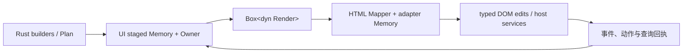

# Glory benchmark 体积差距：代码归因与去重（2026-10-26）

本轮基于[三框架同口径体积实测](framework-benchmark-wasm-size-2026-10-26.md)
继续分析。原始比较是 Glory 1,425,214 B、Dioxus 317,164 B、Leptos 155,008 B，
均为性能 benchmark 的 Rust `opt-level=3` / LTO / 单 codegen unit，再统一 Binaryen `-Oz`。

差距主要有两个来源：Glory 公共语义解释器保留了远多于当前行模板所需的宿主/映射代码；
同一配置下，Glory 的大量小型集合与属性操作又被积极内联进了大函数。
这不能直接归结为未使用 widget 或第三方 regex；也不代表所有保留代码都是重复错误。

保留的改动仅消除实际重复的 HTML 映射逻辑。没有裁剪能力、改 public feature、
擦除集合类型、合并两份语义树、增加插件注册层或切换 benchmark 编译配置。

## 对最终机器码归因

对三份 wasm-bindgen 输出重新运行相同 Binaryen 参数并增加 `-g`，保留函数名。
随后核对每一个非 custom section 的 SHA-256 与已测的最终产物一致。
因此下面统计的是 `-Oz` 后实际保留的代码，不是名称节或优化前的估算。

| 最终函数体统计 | Glory | Dioxus | Leptos |
|---|---:|---:|---:|
| 函数体字节总数 | 1,332,333 | 277,180 | 134,658 |
| 已定义函数数量 | 1,101 | 516 | 335 |
| `alloc/core/std` 归属符号 | 344,415 | 74,946 | 38,545 |
| BTree 实现归类 | 168,989 | 12,859 | 0 |

函数体不包括 Code 段内的长度编码等开销。每个函数只计一次，内联被调用者归入外层符号。
标准库一行包含 Glory 等框架使用的泛型集合与销毁逻辑；BTree 一行是另一种交叉分类，
与上行有重叠，不能相加。某类符号未出现不表示它的操作从未被内联。
这些数值不是 crate 的独占大小，也不是删除某个子系统能得到的收益。

Glory 的主要归属：

| 归属符号 | 函数体字节 |
|---|---:|
| `glory_web` | 362,508 |
| `glory_html` | 179,332 |
| `glory_render` | 163,188 |
| `glory_ui` | 118,489 |
| `glory_core` | 45,539 |
| `glory_style` | 12,512 |
| benchmark 自身符号（含内联代码） | 48,024 |

主要单个函数：

| 函数 | 函数体字节 | 对应源码 |
|---|---:|---|
| `semantics::attributes` | 70,845 | `crates/html/src/semantics.rs` |
| 公共事件回调 | 68,096 | `crates/web/src/browser/events.rs` |
| `Renderer::apply` | 56,637 | `crates/web/src/browser.rs` |
| `Mapper::apply<Sink>` | 46,082 | `crates/html/src/lib.rs` |
| `Renderer::drain` | 43,779 | `crates/web/src/browser.rs` |
| `Renderer::action` | 30,264 | `crates/web/src/browser.rs` |
| 行 `Each` 更新闭包 | 20,572 | `crates/ui/src/control.rs` |
| `DescriptorView::validate_fields` | 19,544 | `crates/render/src/props/view.rs` |

以上是本次去重前的原始三框架构建。Data 段为 76,738 B，分配器归属函数约 7.7 KB，
格式化/数字转换归类约 36.9 KB；它们都不足以单独解释约 1 MB 的差距。
当前浏览器图没有 regex 引擎，详见[依赖审计](wasm-size-attribution.md#regular-expressions-absent-from-this-browser-build)。

## 设计原因一：公共语义解释器的可达范围

Glory 的 Rust builder/Plan 最终进入一个支持有限完整模型的解释器：

`Session` 的 `Box<dyn Render>` 形成实际后端边界，其 vtable 保留通用的 apply、drain、
action、request 等入口。当前行只使用 View/Text/Button，不会把这些入口变成三种节点专用实现。

`Renderer::new` 安装公共监听；事件入口能够处理富文本、选择/组合输入、菜单、
树/表格/组合框导航、拖放和数值控件。`apply`、`drain` 又直接引用浮层、富文本、
文件、剪贴板、图片与动画等现有宿主路径。运行时检查让无关路径不执行，
但函数仍通过公共入口可达，因此不能全部链接消除。

HTML mapper 和 descriptor/事件校验也处理完整有限变体。Plan 共享声明与静态 shape，
改善实际创建和元数据所有权，但普通创建、动态补丁、完整模型检查仍是这个解释器的能力。

UI 的 staged Memory 与 adapter 的 Memory 分别承担变更前校验/Owner 管理和独立 apply/
成功前缀/查询水位契约。它们带来两侧的状态与协调代码；这不等于整套校验函数体恰好复制两份。
本轮不删除这些契约，也不为了链接裁剪改变技术边界。

## 设计原因二：三个框架的 DOM 边界不同

依据当前锁定版本的实际源码及最终函数名：

- Dioxus 0.7.10 的 `Template` 使用静态节点/属性/路径切片；VirtualDom diff 输出到
  `WebsysDom`/JS interpreter。`create_template_node` 和 `set_attribute` 的边界主要是
  HTML tag/attribute，而非 Glory 的完整语义控件解释器。最大 diff 函数约 14.3 KB，
  set_attribute 约 10.6 KB。JS 解释器及属性辅助片段的 22,742 B 已计入前一份下载报告，
  并未通过忽略 JS 制造差距。
- Leptos 0.8.22 / tachys 0.2.19 的 `HtmlElement<E, At, Ch>` 和属性/子节点 Render
  类型围绕当前模板实例化。此应用只保留对应 DOM 构建与响应式更新；最大的入口约 10.9 KB，
  keyed For 构建约 8.9 KB。它没有在此应用中经过 Glory 那样的通用语义到 HTML 的完整词表映射。

这些实现可从 Cargo 锁定源码中的 dioxus-core `nodes.rs`、dioxus-web `mutations.rs`、
tachys `html/element/mod.rs` 和 `html/attribute/value.rs` 复核。没有修改 Cargo 管理的源码。

三者应用数据、可见 DOM、行身份和布局通过相同验收；宿主能力边界不同是保留成本的原因，
不能据此把某一框架笼统归为类型安全或非类型安全。这里也不引入 RSX、模板 VM、
原始 DOM 捷径或把 Rust 代码转移到 JS 来缩小 WASM。

## 编译策略对照：只用于归因

在原始、未去重的同一冻结源码路径下，仅将 Rust opt-level 从 3 改为 z；
LTO、codegen units、依赖锁文件、wasm-bindgen 和后置 Binaryen 参数保持一致。

| 相同 Glory benchmark | Rust 3 | Rust z |
|---|---:|---:|
| 最终 WASM | 1,425,214 B | 899,197 B |
| Brotli | 376,223 B | 288,799 B |
| 函数体字节总数 | 1,332,333 B | 805,859 B |
| 已定义函数 | 1,101 | 2,205 |
| `glory_html` 归属符号 | 179,332 B | 64,329 B |
| BTree 实现归类 | 168,989 B | 125,940 B |

函数更多、代码反而更少，结合具体函数内联后的大小，说明积极内联/展开是显著放大因素。
这是 profile 的整体效应，没有把某一个内联 pass 单独隔离出来，不能把全部差额归因于它。
这也不是对“重复手写源代码数量”的度量。`alloc` 等泛型算法本身仍是同一份类型安全源码。

z 产物也通过数据、完整存续 DOM/Text/语义身份和万行布局验收；没有在本轮测量其运行速度。
所以不修改正式 benchmark 的 opt-level，也不拿 Glory z 与另外两个框架 3 的产物重新排名。
不为字节数批量加 inline(never)，也不通过类型擦除或自定义容器合并标准库特化。

## 实际保留的代码质量改进

改动仅在 HTML 层，核心 API、元数据类型、集合、事件和执行阶段保持：

1. 完整 shape 原先先写一次 role/heading，随后 `semantics::attributes` 又生成同样的属性
   并覆盖。删除前一次重复写入，创建和补丁使用同一份角色映射；保留 Check/Switch 等
   控件在自身物理节点上的 intrinsic role。具备 role 的完整 shape 少构造一个随后被覆盖的
  角色字符串，heading 还少构造一个被覆盖的 level 字符串。
2. Progress、Spin、Slider、Splitter 原先分别手写 `aria-valuemin/max/now/text`。
   提取私有的有限数值属性映射，保留四种控件各自的数据模型与校验：indeterminate、不受限
   Spin、固定区间 Slider、精确业务文本等仍由原类型表达，不增加动态 payload。
3. 环境、树、滑块、grid 和普通 navigation 的方向 token 统一为一个穷尽匹配。
   不改覆盖顺序或方向一致性校验，后续枚举扩展只需维护一处 HTML token 规则。

没有新增 public API、feature 或缓存；没有删除异常检查、隐藏错误信息，或改变 HTML 格式版本。

## 同路径 A/B：体积不是保留改动的理由

分别归档 before/after 输入，并在同一个编译源码路径建立两个独立 target。
相对原始三框架构建，改变源码绝对路径本身已有约 823 B 差异，不能算作本轮收益。
实际控制组与改动组比较如下，Rust 仍为 opt-level=3：

| 同路径对照 | Before | After | After - Before |
|---|---:|---:|---:|
| WASM `-Oz` | 1,424,391 B | 1,418,176 B | -6,215 B |
| Brotli | 376,307 B | 376,401 B | +94 B |
| gzip | 512,783 B | 512,813 B | +30 B |
| JS raw | 60,648 B | 60,648 B | 0 B |

Brotli 没有改善。这次保留的是消除重复映射/重复构造和明确唯一维护点的质量改进，
不是声称解决了首包大小。大部分差距仍由前述解释器范围与代码生成形态解释。

归档输入只改变 `crates/html/src/{lib,mapping,semantics,semantics_tests}.rs` 四个文件，
其中 lib/test 为测试接线。`inputs-before` 与原三框架源码清单逐文件相同，
`inputs-after` 与实际 staged 构建输入逐文件核对 SHA-256。

## 验证与证据

- HTML all-features 单元/集成测试、全 shape 差分 oracle、严格 Clippy 通过；新增黄金输出
  覆盖四种数值控件、缺省坐标、精确文本规范化、heading 清除、默认 Group、Switch 物理 role。
- Sapid 完整 `scripts/check.ps1` 通过：默认/all-features 测试与严格 Clippy，及共享
  Glory style/core/render/ui/html/ssr 的 all-features 测试与 Clippy。
- 同路径 A/B 的原发布与 `-Oz` 产物四项 benchmark 浏览器验收通过；before/after 截图一致。
  深层 integrity 另验证存续元素/Text/语义身份和全部万行布局矩形一致。
- 更新后的 semantic-web 在 CSR/SSR adoption 下的 semantics 与 Plan 浏览器套件通过，
  包括实际 AX role/name、输入身份/值/选择与组合输入保留、Keep/Clear 和清理。
- 最小应用/文本应用两个 z 基线门禁与浏览器检查通过，raw 各减少 435 B；
  Brotli 分别减少 93 / 51 B。未更新既有基线来掩盖增长。
- 不据此声称性能加速、OS IME 或屏幕阅读器验收，也没有更新原性能成绩。

[机器可读证据](../benchmarks/bundle-attribution-2026-10-26.json)保留三框架最终代码归因、
profile 诊断、A/B 产物/输入哈希和浏览器摘要。
完整日志和冻结输入在 `D:/BuildCache/glory-benchmark-analysis-20261026`；
所有源码快照、target、压缩结果、工具与浏览器临时文件均在 D 盘。

复现归因可使用 `benchmarks/wasm-size/attribute.cjs` 与原 `bindgen.wasm`：以相同
Binaryen `-Oz` 参数另生成带 `-g` 的模块，再与原 optimized.wasm 核对。局部重建可用
`benchmarks/build.ps1 -Apps glory -SourceRoot <同一 D: 源码路径>`；
`benchmarks/bundle-size.cjs --apps glory --source-manifest <对应归档的 inputs.json>`
分别测量控制组/改动组，不混用旧产物或原始源码绝对路径。
