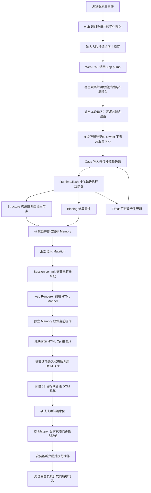
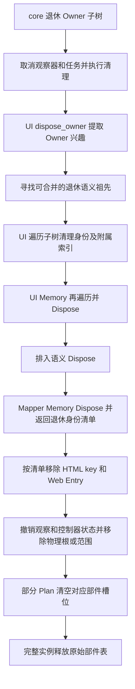
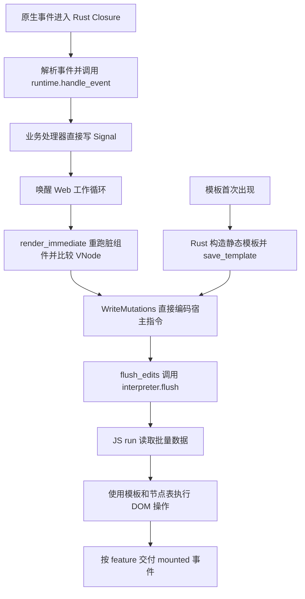

# Glory 渲染流程架构复核与改进报告

日期：2026 年 10 月 26 日。

**最终建议：保留现有分层，先统一 UI 的节点登记与退休流程，再整理浏览器节点的初始化和能力驱动依赖。完整宿主批提交暂缓。** 改进的首要依据是职责、数据归属和状态转换是否更清楚，性能、内存和 WASM 体积作为结果与约束评估。不能为了少几次过桥，把语义规则移到 JS，或者让传输协议反过来支配核心模型。

本报告复核浏览器 CSR 的事件、响应式执行、语义暂存、HTML 映射、DOM 提交、查询和销毁链路；对照 benchmark 锁定的 Dioxus 0.7.10。共享层的调整还必须覆盖 SSR、stream 和 Blitz，但浏览器测量不证明这些宿主的性能或平台验收。

## 1 判断改进是否成立

按以下顺序判断，而非按调用次数排序：

1. **层次是否成立。** core 管响应式和 Owner，ui 管应用及语义暂存，render 定义语义协议与参考模型，html 做纯映射，web 管浏览器对象和执行细节。
2. **事实由谁维护。** 不可变声明、每实例状态、待提交状态和宿主状态分别归属明确；索引有明确用途和同步入口。
3. **流程能否局部推理。** 一次创建、补丁、退休或查询的前置条件、状态变化、失败位置和清理顺序应能在所属层内说明。
4. **结构是否更简单。** 优先删除重复遍历和重复初始化规则；不以增加跨层日志、隐式重排和旁路状态换取局部速度。
5. **实现代价是否可接受。** 在以上条件成立后测性能、分配、内存和体积。架构更清楚而性能基本不变的整理仍有价值；更快但破坏边界的实现不采用。

代码行数和抽象层数不是独立评分。两个职责不同的模型不应强行合并；两个维护同一规则的入口则值得合并。

## 2 当前完整链路

### 2.1 普通更新

Structure、Binding、Effect 是调度优先级，**不是三次固定的 Render 提交**。Runtime 会继续处理被排入的观察器，Session 随后交付命令批；显式查询等屏障可形成额外提交。Web 默认宿主用 RAF 观察输入，显式 App::flush、SSR 和其他宿主不依赖这条 RAF 路径。

业务路由之前，Renderer::drain 观察编辑、资源和控件完成状态，读取合并的布局输入；富文本观察产生的补写在这些读取后执行。App 处理完整个已排空输入批次，单个路由错误不会丢弃后续事件和查询回复；最后仍 flush 合法写入，并优先返回 flush 错误。这些观察、业务执行和物理写入边界需要保持显式。

当前实现已经收集 `Vec<Mutation>`。批次到了 Mapper 后，仍按操作顺序校验、降低并执行 Sink。因此，当前差距不能概括成“Rust 没有批量”或“缺少一层命令队列”。

源码入口：[App::pump](/D:/Works/glory-rs/glory/crates/ui/src/app.rs:1961)、[Session::flush](/D:/Works/glory-rs/glory/crates/ui/src/app.rs:1009)、[Session::commit](/D:/Works/glory-rs/glory/crates/ui/src/app.rs:473)、[Runtime::flush](/D:/Works/glory-rs/glory/crates/core/src/runtime.rs:871)、[Web apply](/D:/Works/glory-rs/glory/crates/web/src/browser.rs:143)。

### 2.2 Plan 创建

当前一行的创建经过这些步骤：

| 层 | 当前负责的事实和工作 |
|---|---|
| Plan 声明 | 一次验证不可变拓扑和声明内容，保存声明事实；不保存业务回调和活跃实例 |
| UI Scope | 检查父上下文和宿主限制，分配完整 NodeId，建立暂存节点和 Owner 索引 |
| UI 命令 | 排入 CreatePlan 和 Place；随后静态赋值或 Binding 排入字段补丁 |
| HTML Mapper | 在独立 Memory 中接收创建，分配 HTML key，复用不可变 PlanShape |
| Web Plan | 复用有界原型，深克隆，写入完整身份，建立原始物理部件表 |
| Web Entry | 每个语义节点保留独立记录；部件引用按需取回，宿主目标可直接按原始地址执行 |
| 宿主执行 | 放置、文本和 class 等仍按语义命令顺序分别执行 |

`Scope::instantiate` 已自动排入 Place，然后才返回 PlanInstance。因此“克隆、初始值、挂载一次做完”并非单纯替换一个 JS 函数：它涉及现有构造 API 和操作顺序。Binding 的初值又在调度阶段求出，不能假设所有实例字段在一次构造调用中都已知。

静态声明、Shape、原型已经共享；Memory 和 DOM 活节点也已经使用校验完整身份的分页 NodeMap。再次提出“共享静态信息”或“改成直接节点索引”，不是新的架构改进。

源码入口：[Scope::instantiate](/D:/Works/glory-rs/glory/crates/ui/src/app.rs:1098)、[Plan Binding](/D:/Works/glory-rs/glory/crates/ui/src/plan.rs:152)、[Memory CreatePlan](/D:/Works/glory-rs/glory/crates/render/src/memory.rs:1662)、[Web create_plan](/D:/Works/glory-rs/glory/crates/web/src/browser/plans.rs:414)。

### 2.3 查询和失败

查询先 flush，再重新确认请求 Owner 仍存活，随后登记 token、目标和请求者。回复按接受时的水位验证，在登记 Owner 下不跟踪依赖地交付。请求者退休、目标退休和迟到回复是不同路径，必须分别维护。

Mapper 的模型修改在宿主调用前完成，成功 receipt 在宿主返回后推进。宿主异常可能留下当前操作已经完成的物理写入，App 随后进入 Faulted；这不是整批 DOM 可回滚的事务。对后续语义拒绝，已成功操作的查询水位仍须保留。

因此，Mapper 的当前树与“已成功完成的宿主前缀”也应区分；故障后不能仅凭树中的值判断该物理操作成功。后续整理应明确使用模型状态、成功水位还是故障状态，不额外复制一份所谓提交快照。

因此，合批不能只增加一个“最后统一成功”的布尔返回值，也不能把宿主错误解释成可以恢复整个 UI 状态。

源码入口：[请求屏障](/D:/Works/glory-rs/glory/crates/ui/src/app.rs:1028)、[Mapper 顺序提交](/D:/Works/glory-rs/glory/crates/html/src/lib.rs:423)。

### 2.4 退休与清理

图中的 **E 和 F 遍历同一份 UI 语义树**，是本次复核最明确的流程重复。F 与 H 则属于不同阶段、不同模型，不能同样处理。

## 3 哪些层次应当保留

| 结构或流程 | 归属与理由 | 结论 |
|---|---|---|
| UI 暂存 Memory | 让后续 builder、补丁和 placement 看到本轮已经提出的语义状态 | 保留 |
| Mapper 独立 Memory | 验证直接 Render 调用，维护适配器已接收状态和查询水位；UI 可领先于宿主 | 保留 |
| 语义 Mutation | 表达跨宿主的节点、补丁和生命周期，不含 HTML/DOM 对象 | 保留 |
| HTML Op/Edit | 表达纯映射结果，浏览器、SSR/stream 和 Blitz 可分别执行 | 保留 |
| 私有 Plan 宿主目标 | 只执行物理操作，避免为了写字段而把 Node 往返交给 Rust | 保留有限边界 |
| 全 NodeId 与世代校验 | 拒绝过期、跨运行时和复用槽位的访问 | 保留 |
| Owner 正向和反向索引 | 支持按节点路由、按 Owner 定向退休；两种查询用途不同 | 保留所需索引，统一维护入口 |
| Query token、目标和请求者索引 | 支持回复、目标销毁和请求者销毁，避免全表扫描 | 保留 |
| Plan 普通 fallback | 覆盖原型预算、不适合克隆的结构和普通 Create/adoption | 保留 |
| 输入、Revision、查询和已连接移动屏障 | 保护值版本、焦点、选择、组合态以及外部可观察顺序 | 保留 |

两份 Memory 带来成本，但不是两份无理由的缓存。消除它们之间的独立性，会把适配器约束、暂存状态和已接受状态混在一起。可以共享已经验证的不可变声明事实；不能共享可变节点状态，或者用 UI 的结论跳过适配器的直接调用校验。

同一个语义规则可以在不同边界分别执行，规则实现则应尽量共用。需要消除的是两套判定逻辑逐渐分叉，而不是把独立入口的校验调用一概视为冗余。名称冲突、世代、活跃父上下文等事实随实例变化，不能进入静态声明缓存。

JS 应当知道“对哪个物理部件写入什么、如何放置或移除”，不应知道业务 Cage、Owner、Role 合法性、请求者存活规则或语义内容约束。将机械细节放在 JS 是合理分工，将语义判定移过去则会增加第二套规则。

## 4 Dioxus 对照带来的结论

这里的 Dioxus 0.7.10 更新循环没有强制的提交前 RAF；VNode diff 直接写入 Web 编码器，不必先建立通用 Mutation 数组。其模板和动态位置记录也不同于 Glory 对每个静态后代维护完整语义记录的约定。

可借鉴的是 **每层只解释自己负责的含义、宿主批执行拥有明确边界**。不应直接照搬其指令解释器、事件重入方式或动态节点身份范围。Glory 的纯 Rust 声明、细粒度响应式和独立语义宿主是既定架构，不应为逼近某个 benchmark 将它们替换掉。

两份 benchmark 的响应粒度也不同：Dioxus 此应用在 App 中维护 rows/selected 两个 Signal，更新时重跑相关组件并 diff；Glory 每行有 label Source、selected 派生和两个 Binding。当前万行 Glory 实测为 **80,010 个语义节点、40,003 个图节点、10,013 个 Owner**。不能用“Dioxus 只有两个状态”推断它没有 VNode、挂载记录或回调成本，也不能用合并 Glory 的所有行状态来伪装底层改进。

两者每行都是 8 个 Element、3 个 Text，但 Glory 行内共 32 个属性、8 个身份属性，Dioxus 为 14 个属性、2 个事件身份属性。完整身份和语义默认属性是工作量差异，当前约束下应保留。

清空万行后，Glory 的部件表和离树行引用为零；Dioxus 活动解释器节点表在观察中仍引用 10,000 个离树行根。它说明这组清空的回收范围不同，不证明无限增长、卸载后泄漏或总内存占用，也不能解释创建速度差距。

对照源码来自 Cargo 锁定的本地 registry：`dioxus-web-0.7.10/src/{dom,lib,mutations}.rs` 与 `dioxus-interpreter-js-0.7.10/src/{unified_bindings.rs,js/core.js}`。完整路径及摘要记录在文末复核证据中。

## 5 已有测量对架构选择的约束

### 5.1 少过桥并不自动形成更好的流程

下表每行使用各自同轮 A/B，不把不同轮次的时间拼成一条累计收益：

| 改动 | 千行创建 WASM→JS | 同轮主要性能结果 | 结构判断 |
|---|---:|---|---|
| 原始部件表共享与按需取回 | 19,034 → 11,034 | 创建基本不变，替换约快 3.0% | 统一实例的物理寻址，保留；不继续增加寻址缓存 |
| 有限 Plan 宿主目标 | 11,034 → 5,034 | 创建约快 2.3%，万行约快 4.3%，清空约快 8.7%；更新、交换有回退 | 物理细节归宿主，保留边界；不是全面性能胜利 |
| 跨 mutation 字段批实验第二版 | 5,034 → 3,065 | 创建约快 1.5%，替换/选行/清空约慢 4.4%/23.6%/13.9% | 已撤回，不恢复通用字段日志 |

前两项分别增加 −Oz WASM 3,318 B 和 5,509 B；已撤回实验增加 7,535 B。它们不是体积优化。不能因为桥接数字漂亮就继续扩大协议；也不能仅因为代码体积增加，就否定职责更清楚的宿主封装。

当前保留实现的千行创建仍有 1,000 次克隆、9,000 次属性写入、2,000 次 nodeValue 和 1,000 次 insertBefore。5,034 次导入中，每行主要是克隆、放置、两个文本和 class 五个目标。行创建并未使用单个 Patch 内的 `gloryPlanFields` 多字段批。

跨 mutation 实验为支持延迟宿主执行，引入了字段逆操作日志、共享状态恢复、完成位置换算和跨层确认。它们扩大了 render Memory、HTML Sink 和 Web 的协调范围。**目前没有足够的领域需求证明这些状态机应成为通用渲染架构的一部分**；即使以后测出局部加速，也应先回答这个问题。

### 5.2 热点说明工作分布，不代表可删除预算

已保存的独立 CPU 采样中，预热后三次诊断的包含时间中位数如下，单位 ms：

| Glory 诊断类别 | 创建千行 | 创建万行 | 清空千行 |
|---|---:|---:|---:|
| Mapper 及其下游 | 14.184 | 152.725 | 5.357 |
| Memory | 4.365 | 45.170 | 1.565 |
| gloryClonePlan 及其下游 | 6.455 | 62.469 | 0 |
| 原生 cloneNode | 2.706 | 20.005 | 0 |
| 属性写入 | 2.803 | 33.343 | 0 |
| Hash/BTree 相关 | 1.069 | 21.972 | 1.628 |
| Owner 退休 | 0 | 0 | 3.931 |

这些类别存在包含关系和重叠，不能相加，也不能从正式耗时中相减。Mapper 包含 DOM Sink 和 JS 工作，不能把 152.725 ms 都归为 Rust 映射成本。采样支持继续查看实例登记、索引和生命周期，不支持承诺“消除某一层就能快多少”。

来源：[部件共享报告](/D:/Works/glory-rs/glory/docs/plan-bridge-batching-2026-10-26.md)、[宿主目标报告](/D:/Works/glory-rs/glory/docs/plan-host-goals-2026-10-26.md)、[撤回实验报告](/D:/Works/glory-rs/glory/docs/field-submit-plan-2026-10-26.md)。

## 6 第一优先级是统一节点生命周期

### 6.1 使用 UI Memory 自己返回的退休清单

当前 `Session::dispose_owner` 先自己遍历 UI 子树，释放 NodeId、事件和查询目标索引，然后调用同一份 `present.tree.apply(Dispose)` 再遍历一次。现有 `Memory::dispose` 已返回本次实际退休身份清单，Mapper 正在用它清理 key 和 DOM 状态。

建议 UI 同样以这次退休结果为准：

架构收益是 **Memory 定义哪些语义节点退休，UI 只维护这些节点的应用附属状态**，不再在两个位置维护子树枚举规则。减少一次遍历是随之产生的收益，不能预先承诺分配次数下降：返回清单本身仍需要存储。

实现必须保持原来的退休根选择、disposal boundary、外部 Owner 节点移动、取消顺序和 Mutation 数量。清单覆盖挂起和离树后代。不要把 UI 清单直接当作 Mapper 的校验结论：后者仍须从自己的已接受树执行 Dispose。

源码位置：[UI 重复枚举](/D:/Works/glory-rs/glory/crates/ui/src/app.rs:394)、[随后再次 Dispose](/D:/Works/glory-rs/glory/crates/ui/src/app.rs:460)、[已有退休清单接口](/D:/Works/glory-rs/glory/crates/render/src/memory.rs:1816)。

### 6.2 统一登记规则，再决定存储布局

此前建议“把 node_owners、handlers、node_queries 合成一个节点记录”，本次收窄为：**先集中维护不变量，不预先合并物理存储。**

目前 node_owners 覆盖所有节点，handlers 和 node_queries 只覆盖存在订阅或请求的节点。直接让每个节点携带两套空集合，会使大量静态节点为稀疏能力付费。Option<Box<...>> 也有每节点槽位、间接访问和分配的权衡，不能仅凭表的数量决定。

先在 Present 内集中处理登记节点、替换监听器、移除请求、退休节点等操作，使 Owner 反向索引和计数在同一入口同步。规则稳定后，再根据内聚性拆分私有模块；不为减少文件长度增加一层无实际职责的管理器。

必须保留三个不同的 Owner 含义：节点创建者、监听器登记者和查询请求者，它们可能不同。一个 `owner` 字段不能替代这三种关系。也不能把这些 UI 数据放进通用 render::Memory，令参考解释器依赖响应式运行时。

存储合并只在能明确减少重复维护、且稀疏状态布局合理时考虑。若只是换一个容器而规则没有更清楚，则不列为架构改进。

源码位置：[Present 与 Owned](/D:/Works/glory-rs/glory/crates/ui/src/app.rs:50)、[监听器替换](/D:/Works/glory-rs/glory/crates/ui/src/app.rs:1682)、[查询移除](/D:/Works/glory-rs/glory/crates/ui/src/app.rs:94)。

## 7 第二优先级是明确浏览器实例和能力驱动的职责

### 7.1 合并 Entry 的纯初始化规则

CSR/Plan 的 `make_entry` 和 hydration 的 `adopt` 各自构造一份 Entry，重复初始化 editing、interests、children、control 和可选观察器等字段。新增一个 Entry 状态时，需要同时维护两个构造处。

可以抽出一个私有、纯粹的 Entry 初始化入口，显式接受 Parts、Boundary、parent 和初始 Editing。它只负责建立 Rust 状态，不调用 DOM。

CSR 的新控件属性回放、Select 构造，以及 hydration 的组合态读取、脏值检查和 indeterminate 恢复继续属于各自流程。**不能为了共用构造函数，让 adoption 执行新控件初始化并覆盖已有输入。**

这项整理即使没有性能收益，也能减少默认状态分叉。暂不把所有 Entry 状态重新装进大型枚举或多层 Box；只有字段职责或生命周期确实不同，才调整结构。

源码位置：[adopt 构造](/D:/Works/glory-rs/glory/crates/web/src/browser/dom.rs:389)、[make_entry 构造](/D:/Works/glory-rs/glory/crates/web/src/browser/dom.rs:735)。

### 7.2 能力驱动声明自己的更新依赖

Renderer 在 Mapper 后调用多个能力驱动。当前已经共用一次借用的 `semantic_changes`，普通无 Semantics 的 Plan 也不会为所有节点建立这份元数据表；这一点无需重做。

仍存在可以缩小的工作范围。例如 `rich::update` 每次 apply 都复制活跃 Rich 身份清单，并逐个读取和校对属性；`update_files` 会检查当前文件选择及读任务；Layers 会重建 focus scope 声明。这些是活跃控件工作，不是业务数据源扫描，但无关更新也可能触发。

合理方向是由具体驱动明确依赖，先对无关的批次退出，再对受影响的活跃控件工作。可以沿用本轮提交内的临时变更摘要，避免各驱动重复解释 Mutation；不建立第二棵状态树、永久脏节点历史或通用反应式调度器。

依赖不能仅列出某个节点的 Semantics：祖先 enabled/inert、Place/Resume/Suspend/Dispose、焦点范围、版本变化和异步完成都可能影响控制器。第一轮采用保守的依赖分类，仍允许在相关变更时检查活跃集合；不急于建立复杂的祖先订阅网络。

普通行 benchmark 不含 Rich 或文件选择，空驱动多为少量判断。这项工作的主要理由是让能力依赖和更新责任清楚，其性能验证必须增加实际使用这些能力的场景。

源码位置：[统一语义变更摘要](/D:/Works/glory-rs/glory/crates/web/src/semantic_changes.rs:1)、[Rich 全活跃集合更新](/D:/Works/glory-rs/glory/crates/web/src/browser/rich.rs:421)、[文件选择更新](/D:/Works/glory-rs/glory/crates/web/src/browser/files.rs:566)、[Layers 更新](/D:/Works/glory-rs/glory/crates/web/src/browser/layers.rs:54)。

## 8 收益不足的复杂度与精简边界

| 项目 | 最终建议 | 理由 |
|---|---|---|
| 跨 mutation 通用字段日志和回滚确认 | 保持撤回 | 增加跨层状态协调，缺少足以支撑其成为通用能力的需求 |
| 为桥接总数继续叠加新的批处理层 | 暂停 | 容易形成语义队列、字段队列、宿主队列多套进度；需要先有独立职责 |
| `DEEP_CLONE = true` 私有实验开关 | 可删除开关与实验注释 | 当前源码只用于这个恒真分支；历史消融证据保留，正常 fallback 保留；运行时收益预计为零 |
| Entry 两套基础默认值构造 | 合并纯状态初始化 | 同一不变量应只有一个维护入口 |
| UI 手写子树退休清单 | 改用本层 Memory 的退休结果 | 删除同一棵树的重复解释和遍历 |
| 同一 Owner 各项索引更新散落在调用处 | 集中登记与退休规则 | 减少漏更新和计数分叉，不要求合并所有表 |
| 能力驱动无关更新时重建状态 | 按明确依赖保守跳过 | 能力拥有自己的状态与更新条件，不增加隐式全局框架 |
| 每次 Dispose 过滤 rich_pending/layout/inputs 等队列 | 先核实工作量，暂不统一延期 | 可产生重复队列扫描，但 native focus 事件及成功前缀要求即时身份失效；不可一律挪到批末 |
| Plan 部分退休位图 | 保留 | 存活兄弟共享 Array；不清空局部退休槽位会保留旧节点 |
| Plan Array 与 Rust 按需部件引用 | 保留 | Array 保障原始身份，Rust 引用服务查询和控制；不能改成从当前 DOM 重寻路径 |
| 单 Patch 多字段编码器 | 暂保留，按需要独立消融 | Role 等确实有多属性更新；已有整包 A/B 未单独证明编码器收益，千行创建也没使用它 |
| memory.grow 前的记录快照 | 保留 | 真实故障测试已证明缺少快照会丢失后缀，属于正确性要求 |
| 强行统一 Plan、普通 Create 和 adoption 的执行细节 | 不做 | 可共享基础状态，三者的宿主初始化和已有输入保护责任不同 |
| 将未用控件逐个切成 feature 来减体积 | 不作为本轮方向 | 先按实际职责划模块，不能让构建组合改变默认语义、CSR/SSR 形状或校验范围 |

其中“可删除”是下一步可审查的精简项，本次只形成报告，没有改动生产实现。精简默认值、重复规则和实验脚手架，与删除能力或安全检查应严格区分。

## 9 完整宿主提交计划的后续条件

“Rust 描述目标，JS 负责机械细节”仍符合分层，但它不意味着必须形成全能操作语言。当前有限宿主目标已经体现这一分工。

如果以后需要新实例初始化目标，应先回答：领域上是否存在一个清楚的“创建并初始化、然后挂载”构造单元？是否能通过纯 Rust 的显式 API 表达？如不能，就不通过偷偷缓存和重排已有操作来制造这个单元。

可接受的边界是：ui 仍决定语义构造和 Owner；render 仍表达语义节点及生命周期；html 完成纯映射；web 的私有目标执行已经降低的物理初始化。每层只使用自己的类型，不把 DOM 属性、JS 地址或传输完成位置塞进 core/ui。

这种目标必须能够在局部说明容量上限、返回结果、身份登记、失败位置和释放方式。若需要引入大范围回滚、跨查询延迟、重写受控输入或另一套生命周期账本，应退回现有顺序执行。即便性能更好，也不满足本次架构要求。

因此它是条件性设计选项，**不是已决定实施的第三轮批处理优化**。不设“追到 Dioxus 十次调用”这样的验收目标。

## 10 建议的实施顺序与验收

| 顺序 | 独立改动 | 首要验收 |
|---|---|---|
| 1 | UI 使用自身 Memory 退休清单；集中节点、订阅和请求的索引维护入口 | 退休事实只有一个来源，Owner 关系和借用外析构清楚，Mutation/查询语义一致 |
| 2 | 共用纯 Entry 初始化，清除恒真实验开关等脚手架 | CSR/Plan/adoption 的共同默认值只维护一次，宿主差异保持显式 |
| 3 | 为实际重复工作的能力驱动声明保守更新依赖 | 驱动职责和依赖可独立解释，无关提交不重建状态，相关祖先/生命周期变化完整生效 |
| 4 | 复核实例登记的临时分配与不可变事实传递 | 仅调整有清楚归属的数据；不复做现有共享，不更换已成立的响应式粒度 |
| 条件性后续 | 显式新实例初始化目标 | 构造单元先成立，随后才评估宿主合并是否简化实现 |

每项应独立形成可审查改动，先证明职责和状态转换，再决定是否保留。不能把登记表重排、构造 API、回滚协议和 JS 执行器一次合并，导致无法判断哪一项改善了结构。

正确性验收包括：

- 跨 Scope 监听和请求，监听替换，退休请求捕获释放，迟到/重复回复，以及屏障期间请求者退休。
- 外部 Owner 的节点移动、disposal boundary、部分/完整 Plan 退休、挂起后代、槽位复用和全部物理节点身份。
- 完整补丁差分、受控值版本、焦点、选择、组合态和宿主异常前缀；相关宿主目标继续覆盖 memory.grow。
- 共享层变化覆盖参考解释器、HTML、SSR 同步/stream 和 Blitz 相应 conformance；Web 变化覆盖 CSR/adoption 浏览器验收。

性能验证随后使用同路径冻结 A/B：保留九项批量 benchmark、持续局部更新场景，并按改动增加真实 Rich/File/Layer 场景。记录 Script、整轮耗时、分配和存活状态，分别记录 WASM/JS 原始与压缩体积。样本、慢项和回收范围完整保留；Leptos 连续选行异常继续与独立诊断区分。

性能更快不能豁免架构条件。架构整理若性能基本不变，可以因规则去重和维护收益保留；若引入明显回退，则优先寻找同等清晰的实现，不能再叠加隐式缓存掩盖它。

## 11 证据范围

本次为当前源码复核及既有数据的重新归纳，没有新增生产实现、重新编译或产生新 benchmark 成绩。复核基点为 `463272a9ea90ae2f7a544a46fcd903e03e225002`；其他会话正在修改的 Blitz、CLI、mobile 和文档内容未纳入本次改动。

与字段实验前冻结输入比较，core/ui/render/html/web 和两份 benchmark 的纳入清单中，139 个源码文件一致；另外两个 Web 文件只有 hydration cfg 及对应 import 整理差异。上述性能数据均指其原始冻结产物，不能当作整个当前工作树重新构建的成绩。

正式结果及完整限制保存在：

- [Plan 部件结果](/D:/Works/glory-rs/glory/benchmarks/plan-bridge-results-2026-10-26.json)。
- [Plan 宿主目标结果](/D:/Works/glory-rs/glory/benchmarks/plan-host-goals-results-2026-10-26.json)。
- [已撤回字段实验结果](/D:/Works/glory-rs/glory/benchmarks/field-submit-results-2026-10-26.json)。

本次源码摘要、冻结输入差异、Dioxus 对照源码摘要、诊断中位数和原始证据摘要位于 [review-evidence.json](/D:/BuildCache/glory-pipeline-review-20261026/review-evidence.json)，SHA-256 为 `a21e7b27f7abe888590c81aa51efb44a99206b08acecc26fbdf2ded31eb378a0`。复核脚本及输出均位于 D 盘。
