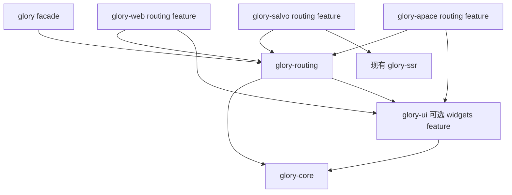

# Glory 路由系统架构报告

日期：2026-10-30。状态：架构与分阶段实施计划。首轮实现已采用目录 `crates/routing`、包名 `glory-routing` 和 facade 入口 `glory::routing`；实际 API 与交付边界见 [routing README](../crates/routing/README.md)，本报告中的 API 草图不替代实现契约。

Glory 的路由系统应由共享 URL 语义、不可变路由声明、Owner 管理的导航状态、保留布局的嵌套视图，以及浏览器和原生宿主接线组成。路由页面沿用唯一的 `Widget` 契约，参数通过 Cage/Bond 更新，显示层继续使用共享 HTML 模板和内容范围。

旧 routing 是行为与测试参考。保留它的类型化参数、嵌套布局、导航历史、回退和滚动恢复意图，重写依赖 Truck、旧 Scope/ViewId、reflow 和字符串内容邮箱的实现。下文记录先行设计及完整路线，已实现功能和后续增强分别记录。

## 1 设计结论

1. **独立且可选。** `glory-routing` 不进入 core、ui、html、render 的基础依赖图；浏览器、SSR 和原生实现共同使用它，而不各自维护匹配器。
2. **声明与实例分离。** `Routes` 保存编译后的路径树、稳定 RouteId 和纯参数 codec；可选 `RouteViews` 按 RouteId 绑定 Widget 工厂；`Router` 保存单个应用或请求的状态。不同 Router 可以共享声明，不能共享请求状态。
3. **显式传递。** 通过 `RouterHandle`、`RouteContext<P>` 和 `Outlet` 传递能力。首版不为路由新增全局 Router、Truck 或通用环境容器，也不假设当前 Scope 已有 provide/use_context。
4. **布局身份与 URL 分离。** 默认以声明节点身份复用存活分支。更改参数、query 或 fragment 不自动重建页面；需要重置业务局部状态时显式配置参数 key。
5. **类型安全先支持手写。** `RouteKey<P>`、`RouteParams` 和注册表提供类型化目标与反向生成。后续 Routable 派生只是同一声明格式的编译前端，不产生另一套匹配或渲染协议。
6. **按宿主能力承诺。** MemoryHistory 能精确报告边界；浏览器只能报告已受理历史跳转，成功要等事件。已经发生的 popstate 不能当作尚未执行的 push 来取消。
7. **导航准备不执行页面工厂。** 解析、匹配、参数转换和前置条件完成后才提交历史与响应式状态。渲染仍遵守现有成功前缀和故障契约，不承诺 DOM 与 history 跨系统回滚。
8. **先闭合普通应用。** 首轮完成 Web、Memory、Salvo 请求集成、嵌套和返回恢复；代码分包、并行命名路由和通用页面缓存后续独立验收。

## 2 源码基线和参考范围

| 对象 | 固定基线 | 参考内容 |
| --- | --- | --- |
| 当前 Glory | `ef41aebb276d5bb8a8ea22c555ca6415b5531195`，0.6.0 | Widget、Scope、Owner、Resource、统一 Each、模板与 SSR 宿主边界 |
| 旧 Glory routing | `617471fae72a277c2966a8a9ce31d7af3af3447b` | 删除提交 `d31a859` 的父版本，包含 routing 和原测试 |
| 当前官网 | 同级 `website/src/{routes,app,web}.rs` | 固定路径、双语路径、pushState、popstate、SSR hydration 和 metadata 更新 |
| 本地 Leptos | `765a39b5abdc441667b4abe3b635faf5d1dd2dc6`，router 0.9.0-rc0 | 嵌套路由、父级保留、参数、路由 SSR 和 lazy 组织方式 |
| 本地 Dioxus | `430cfb563f1b70602ef387f0c80f171d84527b41`，workspace 0.8.0-alpha.3 | 类型化声明、layout/outlet、导航与独立 history 接口 |

官方资料用于核对公开行为：[Leptos Router](https://docs.rs/leptos_router/latest/leptos_router/)的同构路由、父级保留和渐进增强；[Dioxus Router](https://docs.rs/dioxus-router/latest/dioxus_router/)的类型化路由、布局和实验性路由分包；[Dioxus 导航文档](https://dioxuslabs.com/learn/0.7/essentials/router/navigation/)的 push、replace、返回前进与 history provider。检索页面分别标注 Leptos Router 0.8.17、Dioxus Router 0.7.10；与上述开发树分别记录，不混作同一个版本的证据。

当前架构约束见 [HTML 模板架构](v2-html-template-runtime-architecture-2026-10-28.md)、[统一 Widget](v2-widget-dsl-unification-2026-10-29.md)、[统一 Each](v2-unified-each-2026-10-29.md)和[实施记录](semantic-ui-implementation.md)。历史代码可用以下命令读取，不恢复到活动源码：

```powershell
git show 617471fae72a277c2966a8a9ce31d7af3af3447b:crates/routing/src/router.rs
git show 617471fae72a277c2966a8a9ce31d7af3af3447b:crates/routing/tests/navigation.rs
```

## 3 旧 routing 的继承和替换

| 历史能力与位置 | 新系统保留的行为 | 需要替换的实现 |
| --- | --- | --- |
| `router.rs`、`filters/path.rs` | 树形路径、静态优先、动态参数、catch-all、完整路径消费 | 构建时编译优先级；不在每次匹配时排序子节点；不依赖 Truck 做匹配 |
| `typed.rs`、`tests/derive_routes.rs` | 参数转换、可选/重复 query、catch-all 分段、类型化导航、redirect 和 fallback | 一个共享 codec；错误与未匹配分开；不让派生解析器和运行时路径树各有一套定义 |
| `locator.rs` | 响应式 location、params、query、fragment | 只读投影与明确提交入口；不允许应用直接写底层 Cage 绕过导航 |
| `Aviator`、Memory/Browser/Server Aviator | 宿主可替换、push/replace、返回前进、请求解析 | History 只负责位置和历史；匹配、guards、渲染由 Router 负责；服务端使用 RequestLocation |
| `layout`、`outlet`、`graff.rs` | 兄弟切换保留父级，子视图有明确挂载位置 | RouteId 与存活分支；不恢复 `stuffs`、`stuff_keys`、`slot@key` 或消费式 FnOnce 邮箱 |
| `aviators/scroll.rs` | 有上限的滚动记忆、hash 与禁止滚动选项 | 按 EntryKey 保存，不按 URL 保存；等本次显示提交完成后恢复 |
| BrowserAviator 链接拦截 | 普通点击 SPA 导航，修饰键、下载、外链交给宿主 | 可释放的监听租约、根范围约束、统一链接归属；不在 document 上无条件接管所有链接 |
| 历史 navigation 测试 | 返回后 outlet 可再次填充；失败分支不泄漏参数；静态前缀优先；push 截断 forward | 将断言迁移至新 Runtime、Widget 和真实宿主，不沿用旧 wire 或 Truck fixture |

历史实现中有几处需要特别修正。ScrollMemory 的存储本身允许任意 key，但 BrowserAviator 实际传入完整 URL，因此两次访问 `/users` 会共享位置。BrowserAviator 的 base 判断使用小写字符串前缀，不能正确表达区分大小写的路径段边界。浏览器和服务端分别包装 URL、使用不同正则后端，也使边界行为难以保持一致。这些结论来自固定历史源码，不推定历史测试已经覆盖真实浏览器行为。

旧版支持的复杂片段/正则过滤语法不全部迁入首版。先确定可跨平台验证的有限路径语法；需要额外约束的业务通过 codec 或前置条件表达。HTTP method、header 等 HTTP 路由条件属于 Salvo，不进入 UI Router。

## 4 与 Leptos 和 Dioxus 的取舍

| 设计问题 | 采用的方向 | 对当前 Glory 的适配 |
| --- | --- | --- |
| URL 与状态 | 参考 Leptos，以完整 location 驱动页面状态 | path、query、fragment 分开做等值投影，避免整页订阅全部 URL |
| 嵌套布局 | 参考两者的父级与 Outlet | Widget 构建一次；保留的 RouteContext 提供响应式参数，不依靠组件函数重跑 |
| 类型化链接 | 参考 Dioxus 的类型化导航及旧 Routable | 手写 RouteKey/P 即可工作；枚举派生按需加入，不强迫整站维护一个总枚举 |
| 平台历史 | 参考旧 Aviator 和 Dioxus 的 history 分层 | 用纯 Rust 位置/事件协议；web-sys 与原生外部打开服务留在宿主 |
| 页面渲染 | 沿用 Glory 的 Widget/模板体系 | 路由不定义 IntoView、Component、第二个渲染器或独立 VDOM |
| SSR | 参考 Leptos 的同构匹配与 HTTP 结果区分 | 同一 Routes；HTTP 状态和重定向由 Salvo 提交；保留现有 stream 协议 |
| 分包 | 借鉴 lazy 能力，分阶段接入 | `display::lazy` 仍仅是延迟构造；没有构建器和 chunk loader 验收前不宣称支持分包 |

## 5 crate 和依赖方向

`crates/routing` 包含 URL 模型、声明与 matcher、导航协调器、MemoryHistory，以及可选的 Widget 视图层。首版不额外拆出 routing-core 或 routing-history crate。



建议 feature 连接如下。这里描述目标配置，不是当前 Cargo.toml 已有的配置。

| 入口 | 开启内容 | 保持的边界 |
| --- | --- | --- |
| `glory-routing` 默认 | core、跨目标共享 URL/编码库；纯模型和状态 API、MemoryHistory | 无 ui、serde、DOM、HTTP、原生引擎、宏 |
| `glory-routing/widgets` | glory-ui；RouteView、Outlet 和路由链接组合 | 无 web/ssr/apace 依赖 |
| `glory/routing` | 可选 glory-routing，并开启 widgets | 不自动开启 web、ssr、apace、dsl、resources |
| `glory-web/routing` | 可选 glory-routing、浏览器 History/链接/滚动驱动 | wasm32 上才有浏览器实现 |
| `glory-apace/routing` | 可选 glory-routing；窗口激活与导航请求接线 | 不增加网络或系统浏览器的隐式授权 |
| `glory-salvo/routing` | 请求地址、路由结果、状态和 Location header 转换 | 不把 Salvo 类型引入 routing |
| 后续 `glory/routing-derive` | routing 和现有 glory-view-macros 的可选 routing 编译模块 | 不经 dsl feature 间接引入 Web；宏 crate 不依赖运行时 |

facade 在已经选择相应宿主时，使用弱 feature 转发启用其 routing 接线。无需路由的应用保持现有依赖图。`glory-ssr` 继续只渲染传入的 Widget，不必为了渲染路由页面反向依赖 routing。

## 6 核心对象和所有权

| 对象 | 职责 | 生命周期 |
| --- | --- | --- |
| `Routes` | 校验后的声明树、RouteId、参数 codec 和布局拓扑，不含 UI 工厂 | 应用定义；可跨请求共享，只读 |
| `RouteViews` | widgets feature 中按 RouteId 绑定布局/页面工厂 | 应用或当前请求的本地定义，不要求 Send |
| `RouteKey<P>` | 稳定声明名与参数类型；反向生成目标 | 可静态声明；本身不持有 Router |
| `Location` | 结构化 path、query、fragment；统一解析与生成 | 不可变值，可共享 |
| `MatchPlan` | 一条完整匹配链和转换后的参数，不含 UI 状态 | 一次准备/提交使用 |
| `Router` | 当前快照、待处理导航、分支记录、历史能力 | 一个显式根 Owner 管理 |
| `RouterHandle` | 只读 location/导航状态及发起导航的弱能力 | 可 Clone；不能让 Router 脱离 Owner 永久存活 |
| `RouteContext<P>` | 当前节点参数、受控 query 投影、子 outlet 与导航能力 | 对应存活分支；失效后访问返回 Gone |
| `History` | 查询当前位置、提交变更、报告外部位置事件 | 宿主接入租约管理 |
| `EntryKey` | 区分历史条目，包括相同 URL 的重复条目 | provider 会话内唯一；可持久到浏览器 history.state |
| `NavigationTicket` | 一次导航的结果与取消身份 | 有界，不保存完整导航日志 |

Router 在传入 Scope 下创建独立子 Owner，控制状态由该 Owner 的资源/清理租约保活，不依赖局部 Router 变量一直留在栈上。每个当前分支、pending guard 和浏览器接线都有明确释放点。监听器捕获弱 Router 输入端；异步任务和 view factories 不长期强持有 Router 自身。释放根 Owner 后，旧 handle、延迟结果和旧 outlet 不能复活分支。

当前 core Scope 没有通用上下文容器。页面工厂显式接收 `RouteContext<P>`，应用通过普通参数向深层组件传递 handle。以后若单独引入通用上下文功能，可以添加语法便利，不能让其成为首版路由的前置改造。

Routes 的共享部分只包含只读数据和不捕获环境的 codec 函数指针，可以跨线程共享，不含用户会话、guard 服务或 UI 闭包。RouteViews、前置条件及其应用服务可以使用本地 Rc/闭包，必须在当前 Salvo 请求的本地 worker 创建。两层按稳定 RouteId 关联；不得为了共享定义把 !Send UI 状态搬到 tokio 工作线程。

## 7 URL 和路径匹配

### 7.1 一套跨目标语义

采用同一个 Rust URL 解析库和相同配置处理 Web、SSR、Memory 地址；浏览器的 URL API 只负责读取宿主地址，不成为第二套 matcher。路径操作不使用 std::path/PathBuf，避免 Windows 分隔符和盘符规则进入 URL。

外部 URL 与内部目标使用不同枚举分支。内部 location 保存应用内地址；外层使用明确配置的 origin 与 mount base 转换成绝对地址。SSR 的 origin 来自可信部署配置或应用已经验证的代理信息，不自动信任请求 Host/Forwarded 值。

规则固定如下：

- path 区分大小写。mount base `/app` 仅覆盖 `/app`、`/app/` 和 `/app/...`，不覆盖 `/apple`。
- 默认保留尾斜杠差异；通过显式 SlashPolicy 选择严格匹配或规范重定向。规范化发生在渲染前，SSR 使用真实 3xx。
- 先按编码态 `/` 分段，再对每段解码一次。`%2F` 留在一个参数值内，不再次分割；`%252F` 不双重解码。反向生成对每个段单独编码。
- URL 库的标准 dot-segment 归一化在匹配前执行；对 request target、浏览器地址和 Memory 输入使用同一路径。不得一端额外解码后再执行 dot 归一化。
- query 使用有序、多值键值对；保留重复 key 和未消费字段。form query 中 `+` 表示空格，path/fragment 中不采用该规则。
- `None` fragment 与空 fragment 区分；fragment 不参与页面路径匹配，但属于可观察 location。
- 非法百分号、非法 UTF-8、控制字符和超限输入返回具体错误。业务已知的合法字节编码应由显式 codec 处理，不静默替换字符。

HTML `<a>` 的 href 按浏览器文档 URL/`<base>` 标准解析。程序化 `ctx.resolve("edit")` 明确按当前匹配节点已消费路径解析；`..` 退一个 URL 段，不能退到应用 base 之外。两种入口的相对地址基准不同，API 命名和文档必须明确。需要避开歧义时使用 RouteKey 或应用根绝对路径。

### 7.2 首版路径语法

| 声明 | 语义 |
| --- | --- |
| `users` | 固定路径段 |
| `users/:id` | 一段参数，由 codec 转换 |
| `users/:id?` | 末尾可选参数，参数类型显式包含 Option |
| `files/*rest` | 末尾零个或多个完整段，读取为 Vec，不丢失段边界 |
| `""` index | 父路径精确结束时的默认子页面 |
| 无路径 layout | 不消费 URL，只增加布局层 |

可选段仅允许位于路径声明末尾；catch-all 只能位于匹配分支末尾。首版不支持一个段内混合字符串/多个参数、任意 regex 或无界可选段展开。

声明编译时建立静态优先于必选参数、必选参数优先于可选参数、可选参数优先于 catch-all 的按段优先级。采用完整路径匹配：静态分支后续失败仍能尝试其他完整候选，失败候选使用独立参数记录，不能泄漏捕获值。index 优先于消费零段的可选/catch-all 候选。

结构等价且无法区分的兄弟声明，例如 `/:id` 和 `/:slug`，在编译时拒绝；不依赖注册顺序选择。优先级依据语法，不调用用户代码。最高优先级完整结构匹配的参数转换失败，得到 `BadParams`，默认 SSR 为 400；不悄悄落入低优先级 catch-all。应用可显式将该错误映射为 404。

### 7.3 声明编译

`RoutesBuilder::finish()` 校验 RouteId 唯一性、路径语法、参数名/codec 对应、重复 outlet、歧义、base 与深度限制，并输出只读 Routes。类型转换函数必须是纯计算，不发起 I/O、不创建 reactive 节点。

每次匹配只读取当前 URL 和编译树，不创建 Widget、不排序整棵树、不扫描访问历史。不能承诺任意路径树都严格 O(段数)；静态/动态回退的候选探索需要有编译结构和运行预算上限。

## 8 声明和类型化 API

首版推荐手写 builder，路径串只在注册时声明一次。`RouteParams` 将参数结构体与具名段互转；Query codec 独立处理 required、optional、repeated 和默认值。反向生成使用同一个编译后的 pattern，不由应用重复拼接 URL。默认 crate 使用不含视图的 `Routes::builder()`；widgets feature 的 `RouteViews::builder()` 内部使用同一个声明编译器，一次返回 Routes 与 RouteViews，不要求再写一份路径表。

下面展示 API 形状；Result 传播、builder 的异构存储和完整泛型签名在实现阶段确定，这些名称不是当前可调用 API。

```rust,ignore
const APP: RouteKey<()> = RouteKey::new("app");
const USERS: RouteKey<()> = RouteKey::new("users");
const USER: RouteKey<UserParams> = RouteKey::new("user");

struct UserParams { id: u64 }
// impl RouteParams for UserParams: decode / encode 具名 id。

let (routes, views) = RouteViews::builder()
    .root(
        layout(APP, "", |ctx| shell(ctx.outlet()))
            .child(route(USERS, "users", |ctx| users_page(ctx)))
            .child(route(USER, "users/:id", |ctx| user_page(ctx.params())))
    )
    .not_found(|ctx| not_found_page(ctx.location()))
    .finish()?;

let target = routes.target(USER, UserParams { id: 42 })?
    .query("tab", "profile")
    .fragment("details");
let ticket = router.push(target)?;
// views.view(router.handle()) 是挂到现有宿主的 Widget。
```

`routes.target` 校验 key 是否属于该 Routes、参数类型和声明是否一致。手写静态 key 与动态表的成员关系仍需要运行时校验；不能宣称所有错误都在编译期消失。错误包括 UnknownRoute、WrongParamType、MissingParam 和 InvalidParam。

页面获得 `Bond<Rc<P>>` 或等价只读参数投影，而不是参数的一次性快照，也不要求参数对象为 Clone。参数由当前快照中的转换结果投影；只在规范参数值变化时通知，分支不用再保存可被外界修改的镜像。`user_page` 若只读取一次 `id` 再构建静态文本，就不会自动随参数更新；标准范例应使用动态绑定和以参数为 key 的 Resource。

未来 Routable 派生允许应用用 enum 书写同样的路径、布局和 query schema。生成器输出 Routes 声明、RouteKey/codec 与 enum 目标转换；解析继续走共享 matcher。应用选择 builder 或派生作为一份路由表的权威定义，不要求两边重复注册。

首版统一导出 `glory::routing::{Router, Routes, RouteKey, RouteContext, Outlet}`。不把路由 Outlet 加入通用 display prelude，避免与 `html::view::Outlet` 名称混淆；建议业务显式别名 `RouteOutlet`。

## 9 嵌套视图和分支复用

### 9.1 RouteId 决定默认复用

匹配结果是一条根到叶的 MatchPlan。Router 比较前后分支身份，保留最长公共前缀，按叶到根释放退出后缀，再在保留父级的 outlet 内构建进入后缀。

分支身份是 `(父分支身份, RouteId, 显式 instance_key)`。默认 instance_key 为空，因此同一声明参数变化保留 Widget。`key_by(|params| params.id)` 仅在业务需要重置局部状态时使用；其变化同时重建该节点的全部后代。

| 跳转 | 保留 | 更新或重建 |
| --- | --- | --- |
| `/users/1` → `/users/2` | AppShell、UserPage | 更新 UserPage 参数；对应 Resource 取消旧请求并加载新 key |
| `/users/2?tab=a` → `?tab=b` | 所有分支 | 更新 query 投影；不再次调用页面工厂 |
| `/users/2#intro` → `#details` | 所有分支 | fragment 投影和宿主锚点请求 |
| `/users/2` → `/settings` | 共同 AppShell | 释放 UserPage，挂载 SettingsPage |
| 离开 users 再返回 | 仍存活的共同父级 | users 页面重新构建，不自动缓存离开页面 |

父级参数视图仅包含祖先与本节点消费的段；子参数不能污染父级。后代可以读取祖先参数，但重复参数名在同一匹配链上默认编译拒绝。query/fragment 的投影由消费者选择，父布局不会因为子段 id 改变而无条件重新请求数据。

### 9.2 Outlet 的职责

`ctx.outlet()` 返回绑定该分支的 Widget，只显示下一层匹配视图。每个布局节点首版只有一个主 outlet。保留的父级 outlet 可多次更换子内容，不能消耗一次性待填充项后永久变空。

同一个 outlet handle 同时挂载两次返回 DuplicateOutletMount；布局声明需要后代但没有实际挂载 outlet 时，报告 MissingOutlet。匹配的合法分支不能静默显示空白。并行命名 outlet 和独立 modal URL 分支后续设计，不能用全局字符串 slot 模拟。

实现优先把一个 outlet 表达为当前统一 Each 的零/一个成员与稳定分支 key。每个 outlet 的成员数据只引用当前分支记录，参数投影的绑定属于其分支 Owner；不复制整张路由表，不用完整 URL 作为默认 key，也不创建第二套列表协调器。需要的内部小扩展应放在通用内容挂载边界，并由现有 ui/web 两种挂载器共用。

标准 Widget 宿主先覆盖 Web CSR、SSR、hydration、stream 和 Apace 的混合模板页面。direct `display::App` 可以通过既有 Widget 组合能力接入；专用稀疏快路径必须另测，不以“能够挂载一个 Widget”宣称零额外语义记录。路由本身只允许在分支/outlet 边界增加必要状态，不为 raw HTML 元素建立逐元素路由身份。

## 10 导航状态和提交边界

### 10.1 单一协调入口

所有 push、replace、内部链接、外部 location 事件和原生深链接都进入同一协调器。内部 Cage 不公开写权限，页面不能修改 location 后再另行通知 History。


Router 内部使用一份一致的 CommittedSnapshot，包含 location、match chain、参数和 EntryKey。只读细粒度投影按等值变化传播。pending intent 与 observed host location 单独记录：浏览器已改变地址但异步前置条件仍在等待时，必须能观察到这个状态，不能把旧页面宣称为新地址已完成。

### 10.2 程序导航

1. 同步验证目标、base、预算和 Router 是否存活。纯匹配完成后产生候选计划；页面工厂此时不运行。
2. 为待处理导航分配不可复用 ticket，在独立子 Owner 中执行需要的异步前置条件。新意图在历史提交前可替代旧 pending，旧任务立即失去发布权。
3. 最终目标确定后保存离开条目的位置，并向 History 提交 push/replace。受宿主限制的 clone/权限/URL 错误在这里返回。
4. 仅对明确已提交的 history 结果，在一个 Runtime batch 内发布快照和存活分支参数。退出页面按当前 Widget 生命周期释放。
5. 正常结构/属性提交完成后执行本 ticket 的滚动和焦点策略，再报告完成。

prepare/guard/history 拒绝发生于提交前时，旧 location、分支和历史游标保持不变；物理位置采样本身不改变页面。history 已成功后出现页面工厂或 renderer 故障，则保留已确认的 URL/快照，报告 RenderFault 并进入现有 App 故障策略。不能通过未经验证的反向 DOM 编辑伪造全局回滚。

`NavigationTicket` 区分 Accepted、Committed、Finished、Blocked、Superseded、Failed，并可将同地址操作终结为 Noop。浏览器提交历史跳转请求只得到 Accepted；不能返回“已经后退成功”的 bool。commit 阶段串行执行；已经提交的条目不因后来的快速点击被删除，最多跳过过时的 post-render 动作。无后续事件的浏览器 traversal 不能永远悬挂 ticket：由宿主显式截止或下一观测终结为 Unconfirmed，不推断到达边界，更不撤销可能已发生的宿主跳转。

相同完整 location 的 push 默认 Noop；显式 `new_entry` 可创建同 URL 的新历史条目。replace 保留当前 EntryKey，更新其 URL/state；push 总分配新 EntryKey。refresh 数据是 Resource 的职责，不通过同地址导航隐式刷新所有页面。

回调中发起导航进入有界队列，不重入匹配/graph 借用。队列满返回 Busy；只保存当前和有限排队意图。读取/调用用户 factory、guard 和完成回调时不得持有 RefCell、响应图或 renderer 借用。

### 10.3 外部位置与浏览器返回

popstate/hashchange 到达时，宿主 URL 已改变。浏览器 provider 给出 Observed 事件，Router 不再 push 一条重复记录。同一次事件以 provider 版本和完整 location 去重，避免 popstate/hashchange 双重执行。

首版浏览器 traversal 不提供可取消承诺。guard 返回 Redirect 时在访问到的条目上 replace 最终目标；返回 Block 时得到明确的 TraversalNotCancellable 结果，并以新地址提交受限/拒绝视图，而不是保留敏感旧页并谎称取消。已经发生的外部位置解析错误同样必须显示错误状态，不能长期让 URL 和旧页面错配。

只有 MemoryHistory 在尚未改变游标时可以真正拒绝 traversal。浏览器基于已知 index 的恢复跳转与平台 Navigation API 拦截后续独立提供；未知历史条目不猜测 delta，不自动执行相反方向跳转。离开整个文档的确认由宿主 beforeunload 策略处理，不等同于路由 guard。

## 11 History 协议

协议以纯 Rust 值传输，不暴露 JsValue、Window、Salvo Request 或原生窗口句柄。建议操作集合为 current、commit push/replace、request traverse、subscribe；订阅返回可释放租约。

| provider | 位置来源 | 精确能力 |
| --- | --- | --- |
| `MemoryHistory`，放在 routing | 有界 entries 与 cursor | push、replace、已知 back/forward 边界、提交前拒绝 |
| `BrowserHistory`，放在 web | window.location、history.state、popstate/hashchange | 同源 push/replace；异步 traversal；无法可靠获知任意浏览器历史边界 |
| `RequestLocation`，放在 routing；Salvo 做转换 | 显式绝对请求地址与可信部署配置 | 一次解析/重定向决策，无可变浏览历史 |
| 原生窗口接线，放在 apace/应用 | MemoryHistory 加系统返回/深链接事件 | 应用内返回；跨应用打开是显式服务，可能不支持 |

MemoryHistory push 前先准备计划；提交时截断 forward，追加新条目，再按容量淘汰最老条目。replace 不增加长度，失败不提前移动 cursor。浏览器不复制整个 history 栈，只存有界位置/条目元数据。

EntryKey 使用 provider 会话标识加不回绕序号或等价不可复用身份。浏览器跨 reload 保留的条目 key 使用带版本的 app namespace 写入 history.state；生成会话身份由 web 宿主提供，不使 routing 引入随机 I/O。初始接入采用 replaceState 为当前条目补 key，不增加一条历史。

不得覆盖调用方的 history.state。对象状态合并保留其他字段；原始状态为 primitive/数组时不能静默改成对象：默认采用不改写 state 的退化模式，或者由应用显式选择可解包的 envelope。退化模式不能承诺重复 URL 条目的精确恢复。外部/旧版本 state 视为未知条目，不猜造已知 cursor。

首版浏览器支持一个 Window 内一个顶层 history provider。一个 Router 可以嵌套任意数量的布局；多个独立 Memory Router 互不干扰。多根应用共享地址栏需要显式 Host 仲裁，第二个顶层 BrowserHistory 默认返回 AlreadyAttached。第三方直接调用 pushState/replaceState 不会产生 popstate，必须通过显式 notify_location 接口协作；首版不通过轮询地址栏或全局改写原生 history 方法猜测外部导航。

## 12 链接和 UI 接入

`routing::link(handle, target)` 组合现有 UI Link，生成真实 href，保留标签、子内容、ARIA 和样式能力；不重新实现 Sapid Anchor。Sapid 或应用可将自身 AnchorRequest 接到同一个 RouterHandle。当前页样式使用按目标投影计算的 active 状态，不只做任意字符串前缀判断。

浏览器接线支持两种明确的链接来源：现有 Widget 的导航请求，以及显式注册的 raw `<a>`。raw 链接由 web 在拥有的根内使用委托监听，首版需要显式 opt-in 标记或注册；不改变整个页面普通 `<a>` 的含义。两条路径由同一个归属判定保证一次点击只发起一次导航。

只有未被阻止的左键、无修饰键、当前 browsing context、无 download、非 external、同 origin 且在 mount base 内的链接可以被接管。校验候选可接收后才 preventDefault；不支持的目标沿用浏览器行为。Shadow DOM 使用 composedPath 查找最近的拥有链接，嵌套应用必须在边界停止。宿主监听只捕获和入队意图，不同步运行页面工厂或业务代码。

无 WASM 时真实 href 继续访问服务器/预生成页面。GET 表单导航可以在后续阶段接同一 query/导航接口；POST、验证、文件上传和 server function 是另一层能力，不把现有 form 事件支持计为渐进增强路由表单已完成。

## 13 前置条件和重定向

前置条件统一返回 Allow、Redirect、Block 或业务 Denied。URL 重定向、登录判断和未保存编辑保护不使用旧式任意 hoop 修改 Truck。guard 接收只读候选计划、导航来源、取消身份和显式应用服务，不能自己提交 history。

全局前置条件之后，分支条件从根到叶执行；首个非 Allow 结果终止本轮。Redirect 重新进行完整解析、匹配和条件判断，使用同一导航 ticket。检测已访问的规范目标并限制最多 16 跳；循环或超限返回 RedirectLoop。最终只提交一个目标，不把中间 redirect 逐条 push。

guard 对参数/query 的读取不隐式成为长期 effect。登录态改变需要显式 revalidate 当前 Router；不得在 guard 内藏一个不会释放的全局订阅。路由条件用于控制页面展示，服务端数据和操作仍执行各自的身份校验。

默认临时 redirect 对 GET 使用 302，永久规范地址使用 308。客户端采用当前导航的 push/replace 策略；initial/observed 导航的 redirect 使用 replace。重定向目标默认只能是内部地址，外部 redirect 需要应用明确允许。未知路径使用 fallback 视图并保留原 URL，不默认 replace 到 `/404`。

## 14 数据加载和异步生命周期

首版不再造 LoaderStore。普通页面在自身 Owner 下创建现有 `Resource<K,T,E>`，K 来自所需 params/query Bond。只改 hash 不刷新无关资源；父级资源不读子参数，就不会因为子页面变化重复加载。

默认导航采用“条件通过即提交，页面资源在新页面显示 pending/error”的模式。应用可显式将极少数提交前要求作为 async guard，但不声称具备通用 loader 数据跨 Owner 转移。没有 TaskHost 的同步 SSR 如遇 async guard，返回 AsyncRequired；由请求集成选择已有本地 executor 等待，不能偷偷同步轮询未来任务。

每个导航 pending Owner 在取消或 supersede 时释放。Resource 沿用现有不可复用请求身份和旧结果拒绝规则；离开分支取消加载，保留分支因 K 变化撤销旧请求。guard 返回的临时数据不得自动塞进全局缓存，后续若需要提交前加载数据，必须单独定义 seed 的键、schema、所有权和大小限制。

不默认缓存离开的页面、请求结果或组件树。预取只允许访问显式可预取资源，使用独立短期 Owner 和容量/超时；不得执行页面工厂或带副作用的 guard。预取与代码分包都属于后续里程碑。

## 15 SSR 和 hydration

### 15.1 请求流程

Salvo 将请求 target、GET/HEAD 和显式 request services 转成 routing 输入，在当前请求的本地执行环境完成纯解析和所需前置条件，然后分流：

| 路由结果 | HTTP 处理 |
| --- | --- |
| Matched | 200；用同一 Routes 和请求 Router 生成 Widget，交给现有 SSR |
| NotFound | 404；渲染 fallback，保留请求路径 |
| BadUrl / BadParams | 默认 400；应用可配置参数错误为 404 |
| Denied | 应用配置的 401/403 或登录 redirect |
| Redirect | 明确 3xx 与 Location，不用内部重写伪装成功页面 |
| OverLimit | 按输入类型映射 414 或应用配置错误 |

HEAD 返回与 GET 相同状态/响应头，不传输 body。其他 HTTP method 由 Salvo 路由层接管。API、静态资产、stream script 和 server function 路径必须在应用层明确保留；SSR 页面兜底不能吞掉它们。

现有 `glory-salvo::html_response` 默认 200；未来集成必须在对应 helper 外层按 RouteOutcome 设置状态，不能因为成功生成 HTML 就丢失 404/3xx。框架对每个请求创建独立 Router/资源上下文，不能把用户会话写回共享 Routes。

### 15.2 首次接管

服务器和客户端使用相同声明、base、SlashPolicy、path/query 规范化。初始 hydration 使用服务器实际渲染的路由计划，不能先 pushState，也不能重建页面再假装采用 SSR DOM。

路由 bootstrap 是独立、版本化、可选的外层数据，至少包含声明版本、base/policy、已渲染 location 和分支声明身份摘要。声明版本包含应用显式给出的 codec schema 版本和规范拓扑摘要，不能使用不稳定的默认 Hasher 或仅使用 Glory 包版本。它不序列化 Scope、NodeId、闭包、guard 凭据或任意 Rust 参数对象；客户端重新运行同一个 codec。数据采用有预算的解析与安全转义的 inert payload，沿用应用 CSP，不直接拼接可执行脚本。该集成的 serde 依赖放在 web/请求适配可选模块，保持 routing 默认不带 serde。

HTTP 请求不会传 fragment。因此页面路径匹配不得依赖 hash；客户端先采用 path/query 对应页面，再发布真实 fragment 并执行锚点动作。登录等 guard 的初始结果不能在 hydration 开始前用另一套客户端默认状态重新选择分支；先校验 bootstrap 并采用服务器计划，外层数据访问仍执行自身校验，后续变化显式 revalidate。

若浏览器地址已在 WASM 加载期间改变，不能拿当前地址构造另一棵树去采用旧 DOM。先校验服务器计划：若可安全采用则完成采用后排队一次新导航，否则返回结构化 mismatch，并由应用选择完整刷新。失败保留原 DOM 和用户脏编辑，不静默清空 root。

### 15.3 增量 stream

路由、redirect 和 HTTP 状态必须在响应头/shell 发出前确定。之后资源逐步完成通过当前 Shell/Patch/End 协议更新同一请求页面；已发出的 200 不可改成 302。迟到鉴权或错误走流内业务错误/显式客户端后续动作，不声称修改了原始 HTTP 状态。

End 的 route bootstrap、资源 seeds 和最终 DOM 分支要一致；浏览器在 End rekey/adoption 结束前不向半完成树提交 SPA 导航。预先捕获的真实链接保持有效 href，不能因路由未就绪而吞掉导航。客户端接管请求后按现有机制释放服务器任务，不新增一套流协议。

## 16 滚动和焦点恢复

滚动由宿主驱动，Router 只生成与 ticket/EntryKey 绑定的策略，不读取 DOM。默认规则为：

| 导航 | 默认动作 |
| --- | --- |
| 初始 hydration | 保留浏览器当前位置和脏输入焦点；不无条件置顶 |
| 新页面 push | 有 fragment 则尝试锚点，否则主滚动容器置顶 |
| 同分支 query 更新 | 默认保留位置；应用可选择置顶 |
| hash 更新 | 定位对应 anchor；不重建分支 |
| replace | 默认保留；规范 redirect 继承原导航策略 |
| back/forward | 优先恢复 EntryKey 对应位置；没有记录则按 hash/默认策略 |

位置记录以 `(EntryKey, 显式 ScrollContainerId)` 为 key。相同 URL 两个历史条目分别存储；不缓存 DOM 引用或退休 NodeId。程序导航在离开前采样；浏览器返回无法预知，因此注册容器通过合并后的 scroll 采样和 pagehide 保存当前条目，不能等 popstate 已发生后再把可能改变的 offset 记成离开页的位置。默认最多 64 个历史位置记录、每条最多 16 个注册容器；淘汰仅影响旧位置，不改变浏览器 history 栈。

恢复在结构提交并获得布局机会后执行。采用有限次数或有限时长的重试等待异步内容/anchor，不启动常驻 observer 扫描整页。容器消失、下一导航、用户真实滚动、用户输入或 ticket 失效时撤销旧恢复。虚拟列表可显式注册稳定业务 anchor 的序列化/恢复回调，不能将列表逻辑坐标当作 viewport scrollY。

焦点策略独立于滚动：query/hash 默认保留焦点；页面切换可以显式指定新页面标题/主区域。焦点在显示提交后执行，使用 preventScroll 避免覆盖滚动计划。首版自动历史恢复只承诺滚动，历史焦点恢复需要页面提供稳定 FocusKey 并实际验收；不按旧 NodeId 或任意 CSS selector 找回编辑器。

BrowserHistory 在明确接管恢复时暂设 history.scrollRestoration 为 manual，释放时恢复先前值，并处理 pagehide/pageshow 与 bfcache 的重复接管。原生没有相应查询/滚动能力时返回 Unsupported，不伪造成功。

## 17 原生宿主和多语言

平台服务与渲染服务分别接入：Android/iOS 的 History、返回、深链接和交互式返回协议不依赖 Apace。Apace 是一种 Widget 渲染宿主；替换渲染器时沿用同一 Routes、Router、MemoryHistory 和 NativeNavigation。系统手势适配在开始阶段准备导航，取消时保持历史不变，完成时才提交；不能把手势开始直接转换为 back()。

Apace 窗口默认使用 MemoryHistory。系统返回键、菜单返回或移动端返回事件进入相同 request_traverse 接口；是否消费系统事件由能力和当前边界决定。首个页面无可返回条目时，交回应用/系统，不假装退到空页面。

深链接由应用定义 scheme/host 到内部 location 的映射，经过同一 base、codec、预算和 guards。接入协议/系统注册、打开外部浏览器和跨应用跳转仍是平台服务，不能从启用 routing 自动获得这些能力。共享逻辑不等于 Android/iOS 系统深链接已验收。

多语言不作为 routing 内建全局模式。应用可将 locale 放在父路径参数，由该参数 Bond 驱动现有 glory-i18n；切换语言使用类型化目标并显式保留 query/fragment。路由核心不发现浏览器语言、不读取 cookie、不依赖 Fluent。SSR 语言协商留在请求服务。

页面标题、canonical、alternate 和 description 属于外层 head 管理。后续可由各分支提供声明式 HeadIntent，按从根到叶的确定规则合并，由 web/SSR 执行；routing 本身不插入 DOM，也不把 head 文档节点加进 ui 页面树。首轮官网迁移保留现有 metadata 服务，并由提交后的路由状态驱动。

## 18 错误和资源上限

公开错误至少区分 Definition、BadUrl、BadParams、UnknownRoute、NoMatch、Blocked、RedirectLoop、HistoryRejected、TraversalNotCancellable、AsyncRequired、Busy、Gone、HydrationMismatch 和 RenderFault。NoMatch 可转换为正常 fallback；renderer 故障不能伪装成“找不到页面”。

首版建议以下默认上限，构造 Router/Routes 时可显式调小或调大。实施时需要预算与真实用例验证，不能把这些设计值写成已有性能数据。

| 项目 | 建议默认值 | 超限处理 |
| --- | --- | --- |
| 输入 URL UTF-8 字节 | 16 KiB | BadUrl/OverLimit；SSR 可映射 414 |
| path 段 / query 键值对 | 256 / 256 | 在大分配前拒绝 |
| 单匹配链深度 / 捕获参数数 | 64 / 64 | 拒绝声明或输入 |
| 声明节点 / 可选展开候选 | 4096 / 每条 32 | 编译拒绝；首版末尾可选通常不需大展开 |
| 匹配候选探索 | 4096 次状态访问 | MatchBudgetExceeded，不降级为错误的 fallback |
| 待提交异步导航 | 1 | 新意图撤销旧 pending |
| 导航输入队列 | 32 | Busy，不无限积累回调 |
| redirect 跳数 | 16 | RedirectLoop |
| MemoryHistory 条目 | 256 | 丢弃最老可返回条目，报告真实能力 |
| 滚动记忆 | 64 条目，每条 16 容器 | 淘汰旧位置，不保留退休节点 |

时间、定时器和随机会话标识从宿主服务获取。Web 不在运行路径上使用 std::time::Instant。用户任意页面工厂内部的分配、I/O 和 panic 不属于这些预算可以自动约束的范围。

## 19 建议源码布局

```text
crates/routing/
  Cargo.toml
  src/
    lib.rs
    location.rs       # 统一 URL、base、query、fragment 与编码
    definition.rs     # RouteId、RouteKey、builder 与编译校验
    matching.rs       # 纯 MatchPlan，不调用页面工厂
    params.rs         # path/query codec 与类型错误
    router.rs         # Owner 内状态、细粒度只读投影
    navigation.rs     # ticket、prepare/commit、来源和队列
    guard.rs          # 前置条件、redirect 和重验
    history.rs        # 协议、EntryKey、能力与租约
    history/memory.rs
    view.rs           # widgets feature：RouteViews、RouteView、Context、Outlet
    link.rs           # widgets feature：组合现有 Link
    limits.rs
    error.rs
  tests/
    matching.rs
    params.rs
    history.rs
    navigation.rs
    ownership.rs
    nested.rs

crates/web/src/routing/             # 浏览器 provider、链接、恢复与 bootstrap
crates/salvo-adapter/src/routing.rs # RequestLocation、HTTP outcome
crates/apace/src/routing.rs         # 窗口返回/导航事件桥
```

后续宏放入现有 view-macros 的可选 routing 模块。若编译器边界实际需要独立 crate，应单独说明必要性；不在本次设计阶段预建多个包。

## 20 实施阶段和验收

以下都是待实施项。每个阶段完成时分别更新 API 和验收记录，不用设计文档替代实现证据。

| 阶段 | 交付 | 必须通过的验收 |
| --- | --- | --- |
| R1 纯模型 | routing crate、URL/base、声明编译、匹配、typed target、query codec | 跨 host/wasm 相同输入输出；静态优先；失败捕获不泄漏；同源/base 边界；编码往返与预算 |
| R2 状态和 Memory | Router、只读投影、tickets、History、MemoryHistory | push/replace/back/forward；截断 forward；失败不动 cursor；相同 URL 不同 EntryKey；多 Router 隔离 |
| R3 嵌套 Widget | RouteView、Context、单主 Outlet、参数复用与 key_by | 父级和编辑器真实身份保留；工厂调用次数；返回后 outlet 可重新填充；任务/Owner 全释放；混合 raw/Widget |
| R4 Web | BrowserHistory、链接、query/hash、滚动与释放租约 | 真浏览器刷新/深链接/前进返回；修饰键/下载/外链；同 URL 两条位置；hash；监听释放；地址写入拒绝 |
| R5 SSR 和 Salvo | RequestLocation、HTTP 结果、bootstrap、hydration/stream | HTTP 200/400/404/3xx/HEAD；并发隔离；无 JS href；脏输入采用；首屏 URL 改变；End 前后路由一致 |
| R6 前置条件 | async guard、redirect、revalidate、错误视图 | 慢 A 快 B；旧结果不得发布；重定向循环；TaskHost 缺失；真实 traversal 不可取消的明确行为 |
| R7 官网和原生 | 官网迁移；Apace Memory 返回；平台深链接接线分项 | 官网布局保留与双语/query/hash；真实原生窗口返回、滚动和清理；各移动 OS 深链接独立验收 |
| R8 可选增强 | Routable 派生、head 意图、GET Form、预取、分包 | 编译诊断/无重复权威路由表；SSR/client head 一致；真实 chunk 请求和失败恢复；缓存容量 |

R4/R5 的普通路由可使用纯同步前置条件；R6 才宣称完整异步导航条件支持。R5 对 stream 的提交前 async 需求必须使用已有本地 executor 显式适配，不能把后来才加入的 guard 能力算作已交付。

跨阶段保留以下重点场景：

- `/users/new` 与 `/:id`、`/*rest` 并存，顺序变化不影响优先级；失败捕获不流入兄弟；index 与空 catch-all 可区分。
- `/users/1` → `/users/2` → query → hash，断言父级与页面工厂次数、真实 DOM/native 节点身份、脏值和 selection，而不只检查最终文字。
- 同 URL 的两条不同 EntryKey、A→B→A、replace、退后再 push；滚动保存按条目区分，异步内容到达和真实用户滚动能撤销过时恢复。
- 慢 guard A 被 B 替代、释放 Router 后回调到达、导航回调再次导航、history 拒绝和 renderer 前缀失败；结果与 URL 的阶段语义明确。
- 两个 SSR 请求共享声明但不共享参数/用户/资源；404 返回真实 HTTP 404，redirect 返回真实 Location；客户端采用前后 branch 和资源 key 一致。
- 大量进入/离开唯一参数页后检查 live Owner、bindings、tasks、listeners、outlet 与缓存容量；有限业务缓存不冒充 RSS 或性能证据。
- 依赖图检查：未启 routing 的 facade/default/core/ui/html/ssr 不引入 URL/serde/宏；routing 默认不引 ui/DOM/HTTP；每个宿主 feature 单独组合编译。

代码测试和 metadata/build 检查遵守仓库 D: 缓存要求。性能测试分别报告匹配准备、分支挂载/退休、保留分支参数更新和宿主恢复；小样本优先补正确性场景，不为了可逆文档改动启动整套构建。

## 21 官网迁移路径

首先把 `website/src/routes.rs` 的路径、语言前缀和 fallback 转为一份 Routes 声明；保留现有 Route/SiteRoute 作为业务模型或类型化目标前端，不同时保留另一套手写 matcher。

AppShell 挂载一次，header/footer 和文档布局使用祖先 RouteContext 更新 active/locale；文档正文位于子 outlet。将 locale 放在父级参数，并通过 Bond 更新文案；如明确需要切换语言重建某层，可在该层选择 key_by。不能仅把完整 SiteRoute 换成另一个 Each key 后声称布局保留已完成。

随后以 BrowserHistory 替换 `website/src/web.rs` 的 pushState/popstate 和无条件 scrollTo(0,0)。metadata 更新先保留为显式提交后服务；static generator 使用同一声明的静态路径清单，动态参数必须由应用提供枚举数据，不能假定框架知道所有可能 id。

最后迁移现有路由往返、SSR 页面和浏览器返回测试，并新增父级身份、query/hash、重复 URL 位置和释放监听器断言。旧官网接线在新行为实际通过后删除，避免长期保留两个会处理同一点击和 popstate 的系统。

## 22 当前确定的范围

当前方案确定采用 `crates/routing`、显式 Owner/handle、统一 URL/matcher、类型化 builder、嵌套分支复用、按条目区分的历史和宿主接线。首版不恢复旧 Truck 协议，也不新增独立组件/资源系统。

通用页面 keep-alive、并行命名路由、可取消浏览器 traversal、构建器驱动的真实代码分包，以及完整原生 OS 深链接仍是后续独立功能。它们可以沿当前协议扩展，不能由首版 MemoryHistory、Widget 挂载或代码编译成功推定完成。
