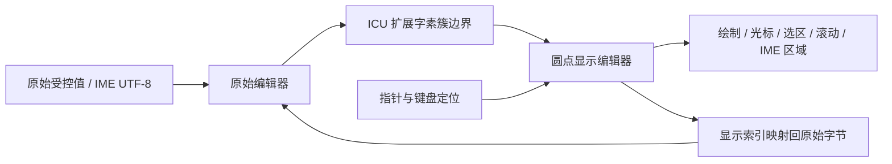
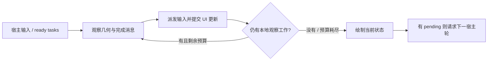
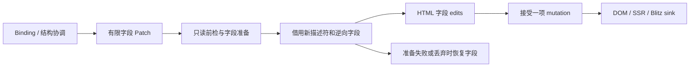

# Glory 语义组件与可替换呈现后端架构改进报告

评估日期：2026-10-21。Glory 基线提交：`d2f92dfa13745377dc2d579d2ac95d9a1b7cc1cb`，workspace 版本 `0.3.1`。

修订：v38（2026-10-23）。采用允许破坏兼容的重构路径，不兼容旧应用 API、源码、协议和持久化格式。本批修复测量缓存淘汰顺序，并在64/1024预算下复验滚动优化、位置与最终画面（§12.19）；重复失效优化见§12.18，引擎阶段观测见§12.17，节点退休队列见§12.16，清理/查询归属见§12.15，同路径复用和回调上下文见§12.14，集合结构编辑见§12.13，字体/装饰见§8.12，窗口协调见§12.12，旧架构退出见§13.4。主题、其他平台与剩余优化仍按原范围推进。

依赖维护已按用户要求改为组织 fork：第三方修改只在 [glory-rs/blitz](https://github.com/glory-rs/blitz) 和 [glory-rs/taffy](https://github.com/glory-rs/taffy) 维护，Glory 使用完整 Git revision，不使用 vendor、副本补丁树或全局 Cargo patch。具体提交、升级与测试流程见[引擎依赖维护](engine-forks.md)。下文早期本地包的实施描述已被这一决策替代；它们不是当前依赖方式。

本文保留初始评估与目标设计；§2 的“基线”指上述提交，不代表重构后的工作树。实施和实际验证独立记录在[实施记录](semantic-ui-implementation.md)，不能把目标结构当作完成证据。标有“提案/拟议”的接口仍按提案阅读；§6.2 的基础用法已按当前源码修订。

2026-10-26 工具补充：旧 CLI 已随旧架构移除；经用户另行授权，新建的
[项目内 CLI 库](../tools/cli/README.md) 位于独立 `tools/cli` workspace。
应用拥有私有 runner、共享 Cargo.lock 和 bin 入口，不为运行时增加工具依赖。
它只编排当前 Web/desktop/server 宿主，不引入另一套 UI 生命周期；完整方案、
已验收命令与未实现的打包能力见该说明及实施记录。

**当前对照（2026-10-23）**：活动 workspace 已有 style/render/core/resource/ui/html/web/ssr/blitz/glory 十包，八组件、直接依赖运行时、窗口化列表与显式行预算、有界焦点保留、逻辑键盘导航与位置/总数元数据、类型化 inline 样式 profile、HTML/DOM、资源快照及渐进输出接管已有实现。Blitz 文档/CPU 绘制和可选桌面 shell 已接通；Windows、Ubuntu WSL 的 X11/Wayland 窗口链路已运行，含一亿行定高/变高列表、surface 恢复、尺寸同步、异步唤醒及关闭回收。当前 shell 源码还已有焦点、UTF-16 选区查询和列表键盘导航；受控编辑事件与原生组合协议也已接通；资源内核、provider 注入、有界图片缓存与可选桌面 HTTP/包资产 Loader 也已接通；共享请求/完成背压也已接通；固有 PNG 高度锚点与持续导航已有跨后端验收；显式文件挂载已接通；Windows UIA 语义树与动作桥已接入，Linux AT-SPI 客户端、屏幕阅读器、真实 OS IME 及 Android 资源仍待完成，详见 §11.5–§11.10。Android 宿主、更广样式语法/主题/非HTML resolver与完整能力审计、真实平台辅助技术验收、R7 优化和旧代码清理仍未完成；Android cargo check 继续只证明编译。

### 决策速览

| 问题 | 采用的决策 | 具体影响 |
|---|---|---|
| Glory 的抽象终点 | 有限语义节点、类型化更新、事件与查询 | 公共组件不依赖 HTML 标签、GTK 类型或 GPU scene |
| 第一条样式路线 | HTML mapper → browser / SSR / Blitz | 复用已有 CSS 引擎；Blitz 内部已经使用 Taffy，Glory 不重复布局 |
| 第一条本地窗口路线 | `glory-blitz` 的可选 shell | Windows、Linux X11/Wayland 已有窗口证据；继续补实际平台交互，Android 独立推进 |
| 原生系统控件需求 | 后续 `glory-gtk` 或实际系统工具包适配器 | Blitz 的本地绘制不等于 WinUI/Android 系统控件 |
| 最小词表 | `view/group/text/button/input/check/image/link` | `row/col` 是 View 构造函数；`each/when/list` 是控制流 |
| 激进改造的重点 | 一套新运行时、一份 HTML 映射、明确的提交与宿主边界 | 提取旧算法后清理旧代码；不维护旧协议兼容层 |

阅读路径：crate 与 OS 组织看 §5，组件和命名看 §6，CSS 取舍看 §8，feature 看 §9，四个框架的适配取舍看 §11–§12，实施优先级看 §14。

## 0. 本次修订：采用什么，以及为什么

建议直接采用：**纯 Rust 语义组件 → 增量运行时与语义提交 → 按实际引擎实现的 adapter → 各平台宿主。** 允许删除旧 API 和重新划分 crates；设计的约束来自新契约的正确性、依赖方向和实际交付范围。

### 0.1 六项明确决策

| 事项 | 决定 | 取舍与当前状态 |
|---|---|---|
| 第一条呈现路线 | `html` 共用映射，`web` 执行 DOM，`ssr` 输出 HTML，`blitz` 使用本地引擎 | 三条消费者已有实现；SSR 属于独立能力，不因开启 html 自动启动 |
| CSS 与布局 | Browser 使用浏览器；Blitz 使用自己的样式/布局/文字组合 | 不在这两条路径外再计算一份 Taffy 几何；GTK 的可移植样式另行定义和验收 |
| 自绘依赖 | 优先 Blitz；直接 Taffy 作为有明确独立消费者时的备选 | Taffy 负责布局算法；采用它后，文字、绘制、编辑、滚动、IME 和辅助技术仍需集成 |
| crate 命名 | 基础层按职责，adapter 按引擎，OS 差异归宿主 | 沿用现有十包；GTK/Wry/GPUI/Makepad 包在立项时创建，不新增笼统 native 总包 |
| 最小词表 | `view/group/text/button/input/check/image/link` | view 有盒子，group 无盒子；短完整单词优先，不提供 container/fragment 同义别名 |
| 重构交付 | 用新纵向链路替换旧链路，再删除旧源码与入口 | 不维护双运行时、旧协议兼容包或旧示例自动转换器；有价值的行为测试迁入新体系 |

采用 Blitz/Taffy 不意味着引入 Dioxus 的 RSX 或 VDOM；二者的接入位置低于 Glory 的 Rust builder 和响应式业务层。上游能力边界参考 [Blitz 架构](https://github.com/DioxusLabs/blitz#architecture) 与 [Taffy 架构和两级 API](https://docs.rs/taffy/latest/taffy/#architecture)（2026-10-23 核对）；具体依赖身份以工作树 Cargo manifest/lock 和本地 vendor 为准，不以 latest 文档替换当前锁定版本。

### 0.2 最终命名：短名称必须保留职责

`core/style/render/ui` 分别表达运行时、样式值、语义提交、组件构造；`html/web/ssr` 分别表达映射、浏览器宿主、服务端输出。`blitz/gtk/wry` 表达实际引擎或工具包。`native` 只在描述中使用，并注明是本地自绘还是系统控件。Windows、Linux、Android 表达运行目标，不能据此决定渲染技术。

这里最值得缩短的是高频应用 API：`view` 替代 container，`group` 替代 fragment。`button/image` 保留完整拼写，`row/col` 保留为 View 的布局便捷函数；不引入 `btn/img/frag/grp` 第二套词表。`list` 是窗口化控制器，`each` 是普通 keyed 集合，两者不能仅为统一名称而合并。

不再把每个功能都拆成 crate：当前 document/paint/raster/shell 继续在 `glory-blitz` 内按模块和 feature 隔离。只有出现两个真实宿主、独立版本需求或依赖冲突时，才评估拆出宿主包。`platform/android` 等目录只容纳真实 OS 差异；签名、应用标识和 Android manifest 留在应用入口/打包 scaffold。

### 0.3 三类平台交付不能混称

| 产品需要 | 推荐路径 | 公共库与应用入口 |
|---|---|---|
| Windows/Linux 本地绘制，共用 HTML/CSS | `glory-blitz` + 桌面 shell | 同一 UI 构造函数，独立窗口入口；Linux 分别验 X11/Wayland |
| Android 本地绘制 | 同一语义/UI/Blitz 文档 + 移动宿主 | 后续实现 Activity/Surface、IME、资源和 APK/AAB scaffold；当前桌面 shell 不覆盖 Android |
| Linux GTK 或某系统的原生控件 | `glory-gtk`，或实际系统工具包 adapter | 工具包拥有主循环、控件树和布局；每条路线单独定义样式 profile |

这些是选择建议：Windows/Linux 的当前证据见实施记录；Android 宿主及工具包路线仍属后续。没有产品需要系统控件时，先完成 Blitz 的移动与交互准入，比同时启动 GTK、GPUI、Makepad 更有交付价值。

### 0.4 当前实施顺序

1. **P0：收口语义和能力契约。** 保持直接依赖、字段 Patch、受控输入与有界列表；声明的属性/错误必须能在模型变更前检查。Portable CSS 文本没有验证器前不公开承诺支持。
2. **P1：完成 Web/SSR 产品入口和旧架构退出。** 共用 mapper、hydration/stream 行为与资源策略；按 §13.4 逐项迁移或删除旧入口，减少两套文档和依赖并存。
3. **P2：平台交互与 Android 纵向链路。** 桌面的 OS IME/辅助技术继续实际验收；Android 从应用入口走通窗口、事件、Surface 恢复、资源和输入，不以 cargo check 结束。
4. **P2：按测量继续增量优化。** runtime、结构协调、引擎 style/layout、文字、paint/present 分开计量；不把已有字段通知优化视为全帧性能完成。
5. **P3：有需求再接一个工具包。** GTK 等适配器消费同一语义端口和列表控制器；直接 Taffy 自绘路线需另有可验证收益和完整服务预算。

允许破坏兼容让我们能一次消除旧边界，但不会减少输入、生命周期和性能验证。尤其大列表应始终只让可见窗口进入后端；更换引擎不能弥补全量数据扫描或无界行缓存。

## 1. 核心判断与建议决策

用户的新目标可以归纳为：纯 Rust builder 描述有限的语义组件；状态与业务逻辑独立于呈现；HTML、GTK、Makepad 等可作为不同呈现实现；CSS 负责样式与布局；HTML 的 SSR、hydration 等能力按需开启。初始交付顺序是先 HTML，再 Blitz 本地引擎；当前二者均已接入，其他工具包保留扩展边界。

这个方向成立，而且可以继承 Glory 的主要响应式与组件机制。初始基线最明显的偏差是：**已经解耦了一部分输出执行方式，但还没有解耦输出的 HTML 语义。** 序列化了 DOM 操作，不等于已经获得了跨工具包的语义 UI 协议。当前重构已建立有限语义端口，Blitz 已验证第二文档/布局/绘制消费者；窗口交互与完整工具包适配仍需继续验证。

建议采用以下决策：

1. 保留纯 Rust builder、`Widget`、`Cage/Bond/Lotus`、keyed `Each`、批处理和命令流积累，不改成 RSX、DSL 或 VDOM 框架。
2. 增加小规模的语义组件层，区分组件语义、视觉样式、HTML 标签映射；不继续以扩充 HTML 标签覆盖率作为公共核心的目标。
3. 直接重设 render contract、节点身份和生命周期，删除由旧 HTML API 造成的核心耦合；旧 Command/Node/feature 不作为兼容约束。
4. 用 `html` 表示共同的 HTML 映射，用较短的 `web` 表示浏览器宿主，用独立的 `ssr` crate 表示服务器序列化；`hydrate` 是 web 的可选能力。
5. 将 CSS 复用路线明确为 browser + Blitz：Blitz 直接提供现成 CSS/文字/布局引擎，不重复实现这套系统。GTK 等非 HTML 工具包另按 Portable CSS 子集适配。
6. 首选 Blitz 作为实际第二引擎，按无窗口文档、绘制、窗口与交互顺序验证。当前已接通文档/CPU 绘制/桌面窗口，继续补齐平台交互与移动宿主；GTK、GPUI、Makepad 暂不同时实施。
7. 不承诺兼容旧组件内部结构和响应式实现。保留 Cage/Bond/Lotus 的概念价值，允许更换订阅存储与调度实现；首发以绑定正确性为准，不以全量性能优化为前提。
8. 组件使用 `view`、`group`、`text`、`button`、`input`、`check`、`image`、`link`；短且完整的单词优先，避免 `container/fragment` 与难懂的缩写。

必须明确的产品取舍：**跨后端优先保证语义、状态和交互契约；布局按支持配置保证；像素完全一致不作为默认承诺。** 以后若需要一致像素，可以另选共享布局与自绘后端配置。

### 1.1 本轮选择与放弃的约束

采用“统一语义与增量运行时，后端自行拥有布局和绘制”的方案。纯 Rust 是应用 UI 的编写方式；不要求 GTK、Android 或图形驱动的内部实现也必须是 Rust。CSS 文件可作为样式输入，不引入第二种 UI 描述语言。

| 需求 | 直接采用的选择 | 必须接受的代价 |
|---|---|---|
| 常规 CSS、Web/SSR 与本地绘制共用业务 | HTML mapper + Web/SSR/Blitz | 浏览器与 Blitz 的 CSS 覆盖率仍有差异 |
| 系统控件、平台交互习惯 | 独立工具包 adapter，先按需求选 GTK 等 | 只共享语义和声明的样式子集，不承诺任意 Web CSS |
| 统一几何、定制绘图 | 将来单独选 Taffy + 文字 + 绘制组合 | 需要补齐控件、命中测试、编辑、IME 和无障碍 |
| 最快完成新架构 | 删除兼容负担，交付 Web/SSR 和一个真实第二消费者 | 暂缓没有应用需求的后端，避免维护多套半成品 |

因此不把“所有原生平台”做成一个自动选择渲染器的 `native` feature。应用选择实际后端和入口，组件只依赖语义端口。旧项目无法编译是本轮允许的结果；新契约中的事件顺序、资源寿命和受控值正确性仍须明确，不能借破坏兼容省略。

## 2. 评估依据：重构前基线做到了什么

### 2.1 关键证据

| 编号 | 基线实现与位置 | 与新目标的关系 |
|---|---|---|
| G01 | [core/lib.rs](../crates/core/src/lib.rs)，`pub mod web`、全局 ViewTree、`is_server/is_browser` | core 仍暴露 Web；`is_server()` 等于非 browser，桌面原生也可能被归为 server |
| G02 | [core/Cargo.toml](../crates/core/Cargo.toml)，features 和 dependencies | `web-csr` 隐式开启 `single-app`；`web-sys/js-sys` 是无条件依赖；特性决定核心类型与调度形态 |
| G03 | [node/mod.rs](https://github.com/glory-rs/glory/blob/d2f92dfa13745377dc2d579d2ac95d9a1b7cc1cb/crates/core/src/node/mod.rs)，第 26、37 行 | `Node` 是按 cfg 选择的 `web_sys::Element` 或 `CommandNode`，不是每个运行实例选择的抽象呈现对象 |
| G04 | [scope.rs](https://github.com/glory-rs/glory/blob/d2f92dfa13745377dc2d579d2ac95d9a1b7cc1cb/crates/core/src/scope.rs)，第 75 行起 | Scope 同时管理 Owner、子 View、DOM anchor、parent/render Node，逻辑树与物理呈现位置耦合 |
| G05 | [renderer/mod.rs](https://github.com/glory-rs/glory/blob/d2f92dfa13745377dc2d579d2ac95d9a1b7cc1cb/crates/core/src/renderer/mod.rs)，第 111 行起 | `Renderer` 有关联 Node/Event 类型，但方法仍是 create_element、attribute、class、set_html |
| G06 | [renderer/command.rs](https://github.com/glory-rs/glory/blob/d2f92dfa13745377dc2d579d2ac95d9a1b7cc1cb/crates/core/src/renderer/command.rs)，第 55 行起 | wire 指令主要是 HTML/DOM 操作；`SetProperty` 的值为 String；不能直接代表 TextField 的完整语义 |
| G07 | [web/widgets/mod.rs](https://github.com/glory-rs/glory/blob/d2f92dfa13745377dc2d579d2ac95d9a1b7cc1cb/crates/core/src/web/widgets/mod.rs)，`generate_tags!` | API 以大量 HTML/SVG/MathML 元素工厂组织，不是有限语义组件目录 |
| G08 | [CSR Element](https://github.com/glory-rs/glory/blob/d2f92dfa13745377dc2d579d2ac95d9a1b7cc1cb/crates/core/src/web/widgets/csr.rs)，第 325 行起 | Element 构造阶段就调用 `document().create_element`，后端与节点结构在 builder 配置完成前已绑定 |
| G09 | [共享命令 Element](https://github.com/glory-rs/glory/blob/d2f92dfa13745377dc2d579d2ac95d9a1b7cc1cb/crates/core/src/web/widgets/ssr.rs)，第 128 行起 | 名为 ssr.rs，实际也服务非浏览器命令目标；构造阶段即分配 CommandNode |
| G10 | [web/style.rs](https://github.com/glory-rs/glory/blob/d2f92dfa13745377dc2d579d2ac95d9a1b7cc1cb/crates/core/src/web/style.rs)、[styling.md](https://github.com/glory-rs/glory/blob/d31a8591dc626a303b1106285dff11f8e6162a28/docs/styling.md) | 已有 class、scoped CSS、CSS module；没有跨后端 computed style 与布局契约 |
| G11 | [web/events/mod.rs](https://github.com/glory-rs/glory/blob/d2f92dfa13745377dc2d579d2ac95d9a1b7cc1cb/crates/core/src/web/events/mod.rs) | 以 DOM 事件名和 web_sys 类型为中心；backend-command 时改为 EventData，尚无统一 Activate 等控件事件 |
| G12 | [ServerHolder](https://github.com/glory-rs/glory/blob/d2f92dfa13745377dc2d579d2ac95d9a1b7cc1cb/crates/core/src/web/holders/server.rs)、[ssr_dom.rs](https://github.com/glory-rs/glory/blob/d2f92dfa13745377dc2d579d2ac95d9a1b7cc1cb/crates/core/src/renderer/ssr_dom.rs) | SSR 已回放命令流；这是可以复用的 HTML 序列化路径，不必另建一套组件逻辑 |
| G13 | [CSR hydrate](https://github.com/glory-rs/glory/blob/d2f92dfa13745377dc2d579d2ac95d9a1b7cc1cb/crates/core/src/web/widgets/csr.rs)，第 72 行起 | hydration 按标签名与 gly-id 查询，映射一致性、额外 wrapper、Text fragment 都会影响接管 |
| G14 | [native/blitz_consumer.rs](https://github.com/glory-rs/glory/blob/d31a8591dc626a303b1106285dff11f8e6162a28/crates/native/src/blitz_consumer.rs)、[native/Cargo.toml](https://github.com/glory-rs/glory/blob/d31a8591dc626a303b1106285dff11f8e6162a28/crates/native/Cargo.toml) | 已有 HTML/CSS 原生引擎接入，依赖 Blitz/Vello 路线；它不是任意原生工具包适配器 |
| G15 | [reflow/bond.rs](https://github.com/glory-rs/glory/blob/d2f92dfa13745377dc2d579d2ac95d9a1b7cc1cb/crates/core/src/reflow/bond.rs)、[web/attr.rs](https://github.com/glory-rs/glory/blob/d2f92dfa13745377dc2d579d2ac95d9a1b7cc1cb/crates/core/src/web/attr.rs) | Bond 有缓存及相等门控，但订阅透传来源；属性注入按 is_revising 判断，尚未完全形成独立 Binding 边界 |
| G16 | [reflow/store.rs](https://github.com/glory-rs/glory/blob/d2f92dfa13745377dc2d579d2ac95d9a1b7cc1cb/crates/core/src/reflow/store.rs)，第 73、89 行 | CageLens 投影根 Cage 的读取和修改，不等于字段级订阅 |
| G17 | [spawn.rs](https://github.com/glory-rs/glory/blob/d2f92dfa13745377dc2d579d2ac95d9a1b7cc1cb/crates/core/src/spawn.rs)、[effect.rs](https://github.com/glory-rs/glory/blob/d2f92dfa13745377dc2d579d2ac95d9a1b7cc1cb/crates/core/src/reflow/effect.rs)、[Suspense](https://github.com/glory-rs/glory/blob/d2f92dfa13745377dc2d579d2ac95d9a1b7cc1cb/crates/core/src/widgets/suspense.rs) | 异步执行、资源 hydration、SSR 占位符机制也需要随拆层迁移；不能只移动 web 目录 |

当前文档关于多平台“地基已经完成”的结论，针对的是 HTML/DOM 命令流的多消费者方案。用户现在要求新增语义控件层，因此要重新界定抽象范围；这不是否定已有后端工作。

### 2.2 应保留的设计

以下是值得继承的设计与实现经验，不是旧符号、类型布局或协议兼容承诺。允许提取算法后删除原模块。

- Builder 与显式响应式绑定：无需全量重建 UI，也无需引入模板编译器。
- Cage/Bond/Lotus 的用户模型、Owner 与代际失效：抽象后端不要求改换信号类型。
- Widget 与控制流组件：Each、Switch、Loader、Suspense 的逻辑可以重建在语义树；公开构造名按新词表确定。
- Each 的稳定 key 和 LIS：保留列表身份与减少移动仍然有价值。
- Holder 的实例隔离、batch 和命令队列：应作为运行时与提交边界继续使用。
- SSR replay、HTML 转义、属性/property 区分与已有 Web 生态：提取可验证规则与代码，重建在新的 HTML 实现中，不为旧序列化格式保留适配层。
- CSR 静态子树与直接 DOM 快路径：新分层不应强制浏览器先 JSON 序列化再解释。
- 不同宿主的具体运行时：WebView、浏览器、服务器本来就需要不同服务，不能因“统一”而抹平。

### 2.3 不能只靠重命名完成的部分

将 `Element` 改名 `Text`、将 `Renderer` 改名 `Backend`，都不足以完成改造。必须改变创建时机、输出语义、事件契约、树身份与样式输入的边界。旧实现只作为算法和行为证据来源，新架构不保留 legacy 分支。

## 3. 对需求的校准：成立的部分与必须限定的部分

### 3.1 纯 Rust builder：成立，且与当前实现一致

保留手写 Rust、闭包与常规 trait 扩展，不引入 UI DSL。样式可放外部 `.css` 文件，也可使用 Rust 类型化 style builder。用户已经明确希望支持 CSS，因此 CSS 文件属于样式输入；不另外引入 Splash、RSX 或新的 UI 描述语言。

不强制使用新的宏。已有 tag codegen、Store derive、asset/CSS module 等辅助能力可以继续放在可选工具层；它们不应成为构建基础语义组件的前提。

### 3.2 有限组件：成立，但“只剩 text”不能损失语义

`p/h1/h2/span` 可以统一为 Text builder 的不同语义配置。标题层级、段落、行内文本、可选择性和富文本结构仍需保留。把所有文字退化成 `String + font_size`，会损失文档结构、可访问性与正确的 HTML 输出。

建议语义状态区分：

- `TextKind::Inline`：短行内文字；HTML 默认 span。
- `TextKind::Paragraph`：段落；HTML 默认 p。
- `TextKind::Heading(level)`：标题层级；当前参数为 u8，挂载验证 1–6，HTML 默认对应 h1–h6。
- 富文本作为后续独立能力：有序文本 run/inline 子节点、强调与链接，不能通过多个 Text 外加 SetText 草率拼成。

字体大小和颜色来自样式，不决定标题级别。`heading(1)` 不必使用最大的字号，`font_size` 很大也不自动等于 heading。

Button、Link、Input、Check 不能折叠成“有 click 的容器”。它们有键盘激活、禁用、焦点、输入法或导航等共同语义。有限组件的目标是减少重复元素，而不是删去交互契约。

### 3.3 HTML 定制闭包：成立，但它配置的是映射元数据

建议命名为 `.html_options(|html| ...)`，不用 `.on_html`：`on_*` 留给事件；也不用 `.html(...)`，避免与当前注入 inner HTML 的 API 混淆。

闭包只构造配置，不直接接触 DOM、网络、窗口或运行时。配置在 builder 完成后随节点挂载交给 HTML mapper，SSR 与 browser 读取同一份配置。

应优先用语义配置表达段落与标题。`html_options.tag(...)` 仅用于确实需要的 HTML 映射例外，而不是要求用户为每个 Text 手写平台语义。

### 3.4 CSS 布局：成立，但需要选择兼容范围

以下三项不能无成本同时实现：任意浏览器 CSS、任意原生工具包控件、完全相同的布局与视觉结果。

若把完整 Web CSS 作为跨后端统一标准，接入 Makepad/GTK/GPUI 的工作将包括 CSS 引擎、布局协调、字体测量与呈现桥接；并不是给几个 style 字段赋值。若使用原生工具包自己的布局，应公开支持的 CSS 子集与差异。

建议保留两级：HTML CSS 能力随具体引擎，优先由浏览器与 Blitz 提供；Portable CSS 明确子集，可供未来非 HTML 后端实现。允许使用成熟引擎，意味着不必先自建 CSS 系统；也不意味着 Blitz 已覆盖浏览器全部 CSS。不要将整个 CSS 规范写成 core 的必选依赖。

### 3.5 布局与业务分离：通过数据与职责分离，不能把布局属性全部移出组件

组件可以声明布局意图，如 `row/column`、class、style 和可用空间约束。业务状态只负责“显示哪些内容、什么值、触发什么操作”；具体几何计算、文字测量、绘制和平台控件适配交给后端。

布局也可能依赖状态和视口。允许样式绑定响应式值，不要求 CSS 完全静态；应避免业务代码根据 DOM 测量反复手动设置兄弟节点位置。

## 4. Dioxus 真正可借鉴的边界

核对本地 `E:/Repos/dioxus`，提交 `7a817390a69294f614b3055aae2dacdf25c050a2`（2026-10-17）：

- `packages/core/src/mutations.rs` 提供 `WriteMutations`，有 create_element、create_text、set_attribute 等方法。
- `packages/html` 提供 HTML 元素与事件体系。
- `packages/native-dom` 依赖 `blitz-dom`、`dioxus-core`、`dioxus-html`；它通过 Blitz 获得 HTML/CSS 能力。

这些证据说明：Dioxus 的“核心更新产物与执行器分离”值得借鉴，但不能推导为“框架自动把全部 CSS 转成任意 GTK/Makepad 控件”。Glory 新目标比其 HTML 树抽象进一步要求了有限语义组件。

Blitz 官方将 style resolution、box layout、text layout、paint、windowing 分开：CSS 解析与样式计算使用 Stylo，box layout 使用 Taffy，文字布局使用 Parley，再通过绘制层与宿主呈现。Taffy 本身不是完整的 CSS 选择器与级联引擎。

参见 [Dioxus mutations 源码](https://github.com/DioxusLabs/dioxus/blob/main/packages/core/src/mutations.rs)、[Blitz 架构](https://github.com/DioxusLabs/blitz#architecture)、[Taffy 文档](https://docs.rs/taffy/latest/taffy/)。网上 main 与本地提交可能不同，本文不混用具体函数签名作为版本承诺。

## 5. 推荐分层与依赖方向

```text
应用 Rust 代码
  ├─ 业务组件、Cage/Bond/Lotus、语义事件
  ├─ view/text/button/input 等 builder
  └─ class、类型化 style、可选 CSS 资源
                  │
                  ▼
语义 UI 与运行时
  ├─ 逻辑组件树、Owner、Binding、控制流
  ├─ 有限呈现节点、类型化属性、稳定身份
  └─ 更新事务、呈现后端端口、宿主服务端口
                  │
        ┌─────────┴──────────┐
        ▼                    ▼
HTML mapper              未来工具包 adapter
  ├─ tag/attr/property     ├─ GTK widgets
  ├─ HTML style lowering  ├─ Makepad widgets/draw
  └─ document metadata    └─ GPUI / 其他实现
        │
  ┌─────┼──────────────┐
  ▼     ▼              ▼
Browser DOM   SSR serializer   HTML-compatible host
CSR/hydrate   static/stream    WebView / Blitz
```

图中的“语义呈现节点”是已有保留式组件树的输出记录，可以存于 runtime arena。它不要求每次重新生成整棵树，也不引入通用 VDOM diff。

### 5.1 各层职责

| 层 | 拥有的职责 | 不应承担的职责 |
|---|---|---|
| reactivity/runtime | 状态、直接订阅关系、更新事务、Scope/任务生命周期 | DOM、CSS parser、窗口创建 |
| semantic UI | 组件语义、类型化 props、默认交互契约、无障碍意图 | HTML 标签与 GTK 具体类型 |
| presentation port | 稳定节点身份、创建/更新/移动/暂存/销毁、事件与查询 | GPU device、CSS 全规范、HTTP 服务 |
| style contract | class 标识、类型化值、CSS 支持 profile、样式资源引用 | 强迫所有后端使用同一个布局引擎 |
| HTML mapper | 语义到 HTML、HTML 例外、UA 默认处理、文档 metadata | GTK/Makepad 映射 |
| HTML consumer | DOM 更新或 HTML 序列化、hydrate/stream 专属处理 | 重新执行完整业务组件模型 |
| host services | 任务调度、时钟、窗口、剪贴板、资源加载、失效唤醒 | 决定 Button 的业务操作 |
| toolkit adapter | 控件状态、布局策略、输入/焦点/IME、平台语义树与绘制 | 再建立一套业务 Cage 的真值来源 |

按目标依赖图直接拆出有实现职责的 crate；不必先维持旧目录结构。分阶段交付可运行的纵向功能，而不是先创建所有未来后端的空 crate。

### 5.2 最终物理组织与当前落地状态

| 名称（12 个活动包） | 内容 |
|---|---|
| `glory-style` | 叶子层：样式值、资源标识、支持 profile；不引用 runtime。重型 CSS parser/resolver 按需启用 |
| `glory-render` | 语义节点/props/event/query、Render trait、能力与提交数据；依赖 style，不依赖 core 或某个引擎 |
| `glory-core` | Cage/Bond/Lotus、实例/Scope、Binding、Owner/Task、调度与宿主服务端口；依赖 render |
| `glory-resource` | 可选的请求级命名资源注册表、显式 schema 与 JSON 快照；依赖 core/serde，无 HTML/HTTP/DOM。2026-10-22 实施时从 core/HTML mapper 单独分出 |
| `glory-i18n` | 可选 Fluent 资源与应用本地语言选择；目录不可变，响应式消息归明确 Owner，不进入默认 core/HTML/SSR 依赖图 |
| `glory-ui` | 纯 Rust 短名称组件 builder、内容模型、控制流；依赖 core/render/style |
| `glory-html` | 将 render 操作映射为 HTML 模型与 DOM 操作；HTML 扩展、默认样式、稳定接管格式；不依赖 browser/runtime |
| `glory-web` | browser DOM、浏览器事件/IME、任务宿主、hydration；依赖 html/core，平台依赖按 wasm 目标隔离 |
| `glory-ssr` | HTML 序列化、请求级资源快照、流式边界；依赖 html/core，不依赖 web、窗口或 GPU |
| `glory-salvo` | 外层 Salvo HTTP 集成，消费语义 SSR；可选流式响应保持请求本地执行、按 body 需求拉取和取消 |
| `glory-blitz` | render→HTML mapper→Blitz 文档；事件/资源/无障碍桥；可选 shell 启用窗口和绘制 |
| `glory` | 公共门面，重导出 ui/core，feature 选择宿主；不自行拥有第二份 Runtime |

依赖图的关键边：`style ← render ← core ← ui`；html 只依赖 render/style，web/ssr/blitz 在最外层组装 core + html。HTML 扩展 trait 可以让 html 额外依赖 ui 来实现，但会增加不必要耦合；推荐由门面或独立 `ui::ext` 集成模块完成扩展，把 HtmlOptions 作为已注册的类型化配置插入，不让 ui/core 依赖 html。首版应选择一种实现并写依赖测试，不保留两种平行机制。

具体推荐：`glory-html` 保持纯 mapper；`glory` 门面在 `html` feature 下定义 `HtmlTextExt` 等扩展，依赖 ui 和 html 并连接两者。直接使用低层 crates 的集成者可调用类型化 backend option setter；无需另开一个仅含几行 trait 的 crate。

目录采用短名称，与现有 workspace 风格一致：当前活动包为 `crates/{style,render,core,resource,i18n,ui,html,web,ssr,blitz,glory,salvo-adapter}`。旧 CLI、路由、宏、serverfn、devtools、热更新与 command adapter 源码已于 2026-10-26 清理；未来外围工具按实际需求依赖新端口实现，不保留旧运行时或 wire 兼容层。resource 单独提供可选序列化，避免 core/HTML mapper 因资源快照而依赖 serde。

`glory-render` 中的 Node/Props/Mutation 是稳定职责边界，但 v1 类型本身允许随开发修改；协议 freeze 仅在实际远程通道交付时进行。core 不包含 HtmlOptions/GTK Widget/Blitz Node 等具体类型。响应式样式 builder 在 ui 中求值为 style patch，style 值层不反向依赖 Lotus。

原 `glory-native` 的 Blitz 实现提取为 `glory-blitz`；原 `glory-desktop` 的 Wry 宿主按引擎改为未来的 `glory-wry`。旧 crate 名、feature、重导出与序列化格式可以删除，不建立别名或旧项目自动转换器。迁移过程中可用旧代码作离线参考，但新发布只维护一套架构。

### 5.3 命名规则：引擎、宿主、操作系统是不同维度

后端 crate 按实际技术命名：`glory-blitz`、`glory-wry`、`glory-gtk`、`glory-gpui`、`glory-makepad`。不以 `glory-native` 隐藏所用引擎，也不建立内容相近的 `glory-linux-native/glory-windows-native/glory-android-native`。

“native”在文档中必须注明含义：Blitz 是不经过 WebView 的本地绘制，GTK 是工具包控件；二者都不能自动等同于每个系统的原生控件。winit 是窗口与事件循环库，也不是渲染器。

web/ssr/blitz 已在活动 workspace；后续保持“有交付内容才创建 package”的规则。GTK/GPUI/Makepad/Wry crate 在实际立项时才创建。

### 5.4 Windows、Linux、Android 等平台如何组织

| 引擎/宿主 | Windows/Linux/macOS | Android/iOS | 引擎内外的职责 |
|---|---|---|---|
| `glory-web` | 浏览器运行 | 移动浏览器运行 | DOM/CSS/输入由浏览器；不需要额外 native crate |
| `glory-ssr` | 服务器或无窗口进程 | 不作为移动 UI 宿主 | 只输出 HTML，不创建系统窗口 |
| `glory-blitz` + shell | 首个自绘目标；复用 blitz-shell/winit 及其合适绘制后端 | Android 单独验收 Activity/Surface；iOS 另有设备准入 | Glory 负责桥接，Blitz/窗口库负责已有底层；不重写每个平台渲染器 |
| `glory-wry`（后续） | 系统 WebView 宿主 | 按 Wry 的实际支持与应用集成验证 | 通信、资产协议和窗口服务；HTML mapper 复用 |
| `glory-gtk`（后续） | 优先 Linux；Windows/macOS 单独验证 | 不列为默认移动方案 | GTK/GLib 自己的主循环和控件；不能强制套入 winit |
| `glory-gpui` / `glory-makepad`（后续） | 按所选引擎的已验证平台 | 按其移动实现单独验证 | 引擎自己的事件循环、文字、布局、绘制及资源设施 |

这是规划支持矩阵，不是本轮已运行的平台列表。Blitz 官方 README 当前列出 Windows/macOS/Linux/Android 示例下载，不能由此推定 Glory 的 IME、生命周期和打包已经验证；iOS 尤其不能从桌面/winit 可编译直接推出可交付。

每个有宿主代码的后端内部按需使用 `platform/windows.rs`、`linux.rs`、`android.rs`、`macos.rs`、`ios.rs`，通过 target cfg 选择。目录名是组织提案；不要求为没有特有代码的平台创建空模块。Android 的 Java/Kotlin glue、manifest 与资源放在该宿主集成目录或 app scaffold；CLI 统一编排产物。

权限、文件选择器、剪贴板、系统菜单等通过后端服务接口与目标模块实现。只有当两个真实宿主共享了一套稳定且显著的 OS 服务实现时，再提取 `glory-os` 或目标桥接 crate；不提前建立一个依赖所有 SDK 的“统一 native 层”。

窗口 shell 与引擎可逻辑分层，但不要假设它们任意组合：Blitz 可先复用 blitz-shell，GTK 使用 GLib，Makepad/GPUI 使用自己的宿主。一条运行路径只有一个事件循环拥有者和一个呈现提交驱动。core 只获得 spawn/wake/clock/commit 等能力，不尝试同时运行多个主循环。

Android 必验：Activity 进入/离开前台、Surface 销毁/重建、GPU 资源恢复、DPI/旋转/safe area、返回键、软键盘与 composition、资产加载、权限及进程重启。暂挂不等于 Dispose；CPU 业务状态是否保留与 GPU 资源是否重建分开处理。签名与 APK/AAB 打包属于 CLI/app 配置，不属于 glory-render。

Windows/Linux 必验：窗口/DPI、文字与 IME、剪贴板、焦点和无障碍、资源释放；Linux 还区分 X11/Wayland，Windows 要验证实际图形设备与窗口恢复。不能以“采用 Blitz/Taffy”替代这些验收。

参考：[Blitz 模块与目标](https://github.com/DioxusLabs/blitz#architecture)、[winit 窗口与事件循环](https://docs.rs/winit/latest/winit/)。具体版本在立项时固定，不在报告中承诺跨版本 API 一致。

### 5.5 外部组件的实际接入层级

以下选型区分完整引擎、布局算法、绘制和宿主，避免依赖名字相近就放到同一层。2026-10-22 重新核对的上游模块职责见 [Blitz 架构](https://github.com/DioxusLabs/blitz#architecture)、[Taffy 架构](https://docs.rs/taffy/latest/taffy/#architecture) 和 [blitz-shell](https://docs.rs/blitz-shell/latest/blitz_shell/)。这些是上游能力，Glory 接通情况以上方实施对照为准。

| 组件 | Glory 中的接入位置 | 本次决定 |
|---|---|---|
| `blitz-dom` | `glory-blitz` 的文档解释器 | 复用其样式、布局、文字及事件处理；维护语义/HTML key 到引擎节点的映射 |
| `blitz-paint` / AnyRender 与选定实现 | `glory-blitz` 的绘制部分 | 使用上游适合的管线；不把 GPU/scene 类型放进 render/core |
| `blitz-shell` | `glory-blitz` 的可选 shell | 窗口、事件循环、无障碍集成；不让无窗口文档测试引入这层 |
| Glory 的有界 asset loader 或应用 provider | 引擎资源服务 | 应用数据 Resource 与 CSS/字体/图片分开；已有资源预算、完成背压和可选桌面 HTTP/包/文件挂载 Loader，Android 服务仍待补。可参考 blitz-net，但本地 trait 身份不同，不能直接替换 |
| `blitz-html` | 初始文档/外部 HTML 解析 | 按需使用；正常增量更新通过节点操作，不反复输出 HTML 再解析 |
| Taffy | Blitz 内部；未来直接自绘 adapter 可独立采用 | HTML/Blitz 路线不额外运行第二套 Taffy；无独立消费者时不创建 `glory-taffy` |
| GTK | 未来 `glory-gtk` | 直接消费语义节点、使用 GTK 控件及其主循环；独立声明可移植样式支持 |
| Skia / Vello 等 | 具体 adapter 的绘制依赖 | 可选择但不固定为公共后端 ABI；它们不自动提供编辑、焦点或控件语义 |

尤其不能把高层 `blitz` 的 HTML-string wrapper 当作 Glory 交互适配器直接启动：上游 README 对该 wrapper 与 Dioxus 集成的交互能力作了区分。Glory 应实现自己的文档更新、事件和调度桥，不引入 Dioxus VDOM/runtime 只为获得窗口。

未来直接用 Taffy 时再选择其 API：独立布局树可先用 `TaffyTree`；已有适合的自绘树且确实要避免重复存储时，才实现低层 tree traits，并承担缓存与布局分发。此选择只影响该 adapter，不能把 Taffy NodeId/Style 变成所有 Glory 后端的必需类型。

### 5.6 包名与目录的最终取舍

基础层保留 `core/ui/render/style`：core 是运行时，ui 是公共 builder 与控制流，render 是语义提交契约，style 是数据值。render 的名称不表示它直接操作显卡。`resource` 单数表示一类资源机制；`resources` 是门面 feature/模块名，不另开同名 package。

后端名表达实际技术，操作系统放在后端内部有真实实现的模块中。例如 `blitz/{document,events,resources,shell}` 可按职责拆模块，Android glue 放在 shell/platform 或应用 scaffold；具体目录随实现确定。只在两个真实消费者确实共享明显职责后再拆新 crate，避免一个薄桥接文件对应一个 package。

因此不创建笼统 `glory-native`，不为 Android/Linux/Windows 分别复制 UI 核心，也不建立空的 GTK/Makepad/GPUI 占位包。未来命名固定为 `glory-blitz/glory-gtk/glory-makepad/glory-gpui/glory-wry`；这些技术可跨多个 OS，设备支持逐目标验收。

### 5.7 引擎适配、窗口宿主与系统服务的拆分条件

当前继续使用一个 `glory-blitz` 包，以模块和 feature 隔离 document、paint、raster 与 shell。应用可单独使用文档布局、导出图片或启动窗口；四者不必同时编入。未来若有嵌入现有窗口与独立应用两种真实宿主，且二者产生明显依赖冲突，再拆 `glory-blitz-shell`，不提前新增 `glory-window/glory-platform/glory-os` 三层空接口。

运行中的状态分成三类：

| 状态 | 生命周期拥有者 | 典型变化 |
|---|---|---|
| 业务、Owner、响应式图、语义身份 | Glory App/Runtime | 组件卸载、应用退出 |
| DOM/布局、文字编辑、引擎资源 | adapter/document | props、CSS、字体到达、输入与焦点变化 |
| 窗口、surface、交换链/CPU backbuffer | shell 与实际绘制实现 | resize、DPI、最小化、Surface 销毁/恢复 |

Android Surface 消失或桌面窗口尺寸为零时，停止呈现并释放需要释放的表面资源，保留仍有效的 App/document。恢复后重建 surface、更新 viewport 并请求完整帧。这里的宿主暂停**不调用语义 Mutation::Suspend**：后者表示组件子树离开呈现树，两者的身份、资源与恢复规则不同。应用永久关闭时才 Dispose App、取消任务并释放文档；窗口依赖的 renderer/surface 必须按上游要求先于窗口句柄释放。

每条运行路径只保留一个主循环拥有者。Blitz shell 接入 winit，GTK 接入 GLib；Host 只暴露本地任务、唤醒和时钟，系统文件选择器等按需服务另行接入。事件、异步完成和资源到达只入队/请求唤醒；在没有引擎或图的可变借用时处理业务，再提交更新。空闲时不持续绘制；动画、滚动和输入引起的失效由宿主调度下一帧。

### 5.8 GTK 与直接 Taffy 路线的决策门槛

`glory-gtk` 首选 GTK 控件和 GTK 布局，不在每个控件外再运行 Taffy 后强制设置坐标。GTK 的 CSS 能力不等于浏览器 CSS 布局；把 flex/grid 字符串交给 GTK 不会自动得到相同几何。应将受支持的语义布局降低为工具包结构，其余样式按 profile 诊断。若选择 Taffy 统一几何，就必须明确改走自绘区域或承担控件测量、分配、baseline、滚动和焦点协调，这已是另一种适配模式。

独立 Taffy 自绘路线至少还需要文字整形/fallback/换行、命中测试、滚动、编辑/IME、无障碍和绘制服务。它适合确有自绘与一致布局需求的产品；当前优先复用 Blitz 的现成组合。只有 GTK/其他真实消费者证明 Portable CSS 需要落地时，才实现对应 resolver；单纯预留 Render 边界不要求预建这套系统。

### 5.9 可直接执行的 crate 与平台组织

下图是组织目标；带“后续”的条目尚不创建。已有十包的职责优先保持单一，允许进一步合并没有独立边界的薄模块。

```text
crates/
  style/       样式值与支持范围
  render/      语义节点、Mutation、Event、Query、Render
  core/        Runtime、Owner、Cage/Bond/Lotus、Host
  resource/    可选请求数据与快照
  ui/          builder、组件生命周期、each/when/list
  html/        一份 HTML 映射与输出操作
  web/         DOM、浏览器输入、hydrate
  ssr/         文档输出、快照、stream
  blitz/       文档、paint/raster、可选桌面 shell
  glory/       应用门面与跨 crate 扩展集成
  cli/         后续重接构建与打包，当前不算已完成
  gtk/         后续：仅在实际 GTK 消费者立项时创建
  wry/         后续：WebView 宿主
apps/          拟议的可运行宿主示例，不是公共库
  web/
  desktop/
  android/     Activity、manifest、assets、打包入口
```

`apps/` 是后续示例整理的候选目录，不要求立刻搬动当前 `examples/`。公共库不得反向依赖 app scaffold；Android manifest、签名和应用标识也不放进 core。后端内部只有出现实际 OS 专有代码时才建立 `platform/{windows,linux,android,...}.rs`。

| 交付路径 | 公共依赖与入口归属 | OS 专有工作归属 |
|---|---|---|
| 浏览器 | `glory-web` 挂载/接管入口 | 浏览器宿主实现；不建立 glory-windows/web 等包 |
| SSR | `glory-ssr` 渲染/流式请求入口 | HTTP 框架在外围，SSR 本身不启动窗口 |
| Windows/Linux 自绘 | `glory-blitz` 文档 + shell；当前 `Shell`/`WindowApp` | shell 内的窗口、显示服务、输入与 surface |
| Android 自绘 | 同一语义/UI/Blitz 文档，未来独立移动宿主入口 | Android scaffold 与 adapter 的移动 glue；不能直接复用当前桌面 shell |
| Linux GTK 控件 | 未来 `glory-gtk` 自己的启动/嵌入入口 | GLib/GTK 主循环、资源、输入与可访问性 |
| Windows/Apple/Android 系统控件 | 需求出现后选择 WinUI、AppKit/UIKit、Android Views 等具体 adapter | 各自控件树与 SDK 桥，不归到 Blitz 绘图内部 |

最后一行是扩展位置，不是本轮新增平台承诺。命名候选为 `glory-winui/glory-appkit/glory-uikit`；Android 若真正采用系统 View 工具包，可称 `glory-android-views`，避免与 Blitz 的 Android 宿主混为一包。名称长短应让位于技术含义，不为缩短 crate 名重新引入含混的 native 总包。Android 官方也允许程序化创建 View/ViewGroup，因此不采用 UI DSL 并不排斥这条未来路线，参见 [Android Views 布局](https://developer.android.com/develop/ui/views/layout/declaring-layout)。

一个 adapter 起步只需实现 Render、事件队列及必要宿主服务；不强制所有 adapter 再实现一个 Glory 自定义的布局、绘图和窗口 trait 大集合。仅在两个实际消费者需要替换同一服务时提取该服务接口。GTK 的主循环不通过一个通用窗口包装器强行改为 winit。

### 5.10 平台入口与 feature 的边界

- Cargo feature 决定“编入哪些能力”；显式入口决定“这次运行哪个宿主”；target cfg 决定“该实现在哪些目标可用”。三者不互相代替。
- `glory-blitz` 保留 `paint/raster/shell` 的现有细分；只有确有移动宿主实现时再增加相应能力。不能把开启桌面 `shell` 但 Android 上没有入口，宣传成 Android UI 支持。
- Android Activity glue 的版本必须与所用窗口库匹配；从上游重导出获取类型或统一锁定版本。官方 [winit Android 文档](https://docs.rs/winit/latest/winit/platform/android/index.html) 说明了入口、生命周期与 glue 冲突；该链接当前为 0.30 系列，不可直接照搬到工作树固定的 0.31 beta API。
- 桌面和移动共享 App、数据与组件构造函数；窗口参数、Activity 参数、资源路径和退出方式由各自 main 负责。多窗口默认各自 Runtime；共享业务可经显式服务通信，不强行共用 !Send 的响应式句柄。
- 系统控件 adapter 使用其工具包线程/主循环规则；跨线程结果只通过宿主消息回到 UI 线程，不能把 !Send 的 Cage 包装成伪线程安全接口。

## 6. 语义组件 API 与 HTML 扩展

### 6.1 最小组件集

第一阶段使用八个简单完整单词：`view`、`group`、`text`、`button`、`input`、`check`、`image`、`link`。`row()/col()` 是返回配置好的 View 的便捷构造函数，底层不增加对应节点种类。控制流可用 `each(...)`、`when(...)`；加载、错误边界、复杂分支另外定义，不为缩短名称混淆控件和控制流。

选择理由：`view` 表达有布局盒子的视觉区域，比 `container` 短；`group` 表达无额外视觉盒子的逻辑分组，比 `fragment` 自然。`box` 是 Rust 保留关键字，`box_` 不够自然；`div` 带 HTML 偏向，`frag/grp` 是缩写，均不作为主名称。`input` 首版明确为文本编辑，不自动包含所有 HTML input 类型；`check` 是复选控件，未来视觉 switch 可另提供，避免把 checkbox、toggle button 和 switch 混成一个无约束 Toggle。

`button`、`image` 保留完整单词，不为少两个字符改成 btn/img。`text` 不叫 label，因为同一 builder 还承担段落和标题；label-for 关联是明确的控件语义。`group` 也不自动生成无障碍 Group 角色：需要角色/名称的区域使用 view 的语义配置。

公共类型对应 `View/Group/Text/Button/Input/Check/Image/Link`。基线 runtime 的 `View` 是组件实例；新设计改为 `Instance`，身份为 `InstanceId`，把简短的 View 名称留给公共组件；不保留旧 View 类型别名。`col` 是常见列布局缩写，仅作为 column 便捷构造，不扩散到语义类型名。

| 语义 | 核心 props（示例） | 默认 HTML 呈现 |
|---|---|---|
| View / `view()` | children、classes、style、可选结构角色 | div；结构角色可映射 section/main 等 |
| Text | content、kind、selectable | span / p / h1–h6 |
| Button | label/受限内容、enabled、Activate | button；默认 type=button |
| Input / `input()` | value、purpose、multiline、enabled、ValueChanged/Commit/Composition | input 或 textarea；类型化布尔和表单 property |
| Check / `check()` | checked、enabled、CheckedChanged、关联文字 | input[type=checkbox] 与必要关联结构 |
| Image | source、alternative text、fit | img |
| Link / `link()` | target、label、导航意图 | a；保留链接默认行为与打开方式 |
| Group / `group()` | children、逻辑身份 | 一段后端渲染范围，不强加 div |

Group 不接受尺寸/padding/background 等盒模型样式；需要这些属性就使用 View。它的 children 在元素样式树中按实际层级展开，不让纯逻辑分组改变 child selector/nth-child。为 HTML 接管需要的注释锚点不成为可样式元素。

滚动先由 View 的 overflow/滚动能力表达，不增加一个同义 Scroll 容器；多行编辑属于 Input 的配置，不用 HTML 的 textarea 扩充公共标签集。Image 显式区分有说明文字与装饰图，Check 明确关联标签和布尔状态；三态选择、菜单、弹窗、表格和富文本在真实需求出现时分别扩展，八个组件不是永远封闭的全集。

每个交互组件的内容模型要明确，例如 Button 不允许嵌套另一个交互控件；Text 的简单 content 模式不能混用任意容器 children。SSR 前验证无效结构，避免浏览器修正 HTML 后破坏 hydration。

### 6.2 使用示意

以下基础 API 已在当前工作树存在；示例按当前 `Widget/Scope/Cage` 签名书写。可运行的内存后端示例见 [semantic_counter.rs](../crates/glory/examples/semantic_counter.rs)。内存解释器不创建窗口或像素。

```rust,ignore
use glory::prelude::*;

#[derive(Debug)]
struct Counter;

impl Widget for Counter {
    fn build(&mut self, ctx: &Scope) -> Result {
        let count = ctx.cage(0_i32);
        let caption = count.map(|count| format!("次数：{count}"));

        view()
            .class("counter")
            .fill((
                text().content("计数器").kind(TextKind::Heading(1)),
                text().content(caption).kind(TextKind::Paragraph),
                button()
                    .label("增加")
                    .on(activate, move |_| count.revise(|n| *n += 1)),
            ))
            .show_in(ctx)
    }
}
```

业务只更新 count。样式可以放在 `counter.css`，例如 `.counter { display:flex; flex-direction:column; gap:12px; }`。这只是样式输入，不要求组件知道 DOM、GTK 或 Shader。

若选择类型化 Rust 样式，使用同样的 style 值模型：

```rust,ignore
fn counter_layout() -> Style {
    Style::new()
        .display(Display::Flex)
        .flex_direction(FlexDirection::Column)
        .gap(12.0)
}
```

CSS 字符串与类型化输入不应维护两套意义不同的属性。动态属性可接受 Lotus；具体绑定只更新发生变化的 style slot。

### 6.3 平台映射 API

推荐主形式：

```rust,ignore
use glory::html::{HtmlTextExt, TextTag};

text()
    .content("说明")
    .html_options(|html| html.tag(TextTag::P));
```

实现机制建议：`HtmlTextExt` 由 glory 门面的 html 集成模块连接 glory-ui 与 glory-html；它把闭包的结果转成 `HtmlTextOptions`，存入 builder 的 backend extension storage。纯 glory-html mapper 不依赖 ui/core。Text builder 在挂载前不创建 DOM。

闭包在构建时执行来配置普通 Rust 数据，并不意味着当前宿主就是 HTML；非 HTML 后端忽略这份可选呈现元数据。闭包不得依赖浏览器实际存在。需要实际 DOM 的代码用 browser 专属 mount/ref 能力，另行 cfg，SSR 不执行。

约束：

- TextTag 为受限 enum，不允许把 Text 映射为 input/script；任意 HTML 节点通过明确的 HTML 专用 escape hatch。
- `kind(Heading(1))` 与 `tag(P)` 冲突时必须诊断，不能静默丢失标题语义；当前 mapper 已拒绝该冲突。
- tag 作为初始结构配置，不作为常规响应式属性。修改 tag 需要显式替换节点并处理焦点/身份。
- `html_options` 必须同时对 SSR/browser 生效，避免服务端输出 p、客户端期望 span。
- Web-only class、attribute、raw HTML、SVG/MathML 继续放在 HTML 扩展命名空间，不扩充基础语义集合。

### 6.4 未开启 html feature 时的 Rust 编译问题

不能声称“没有 html feature 时编译器自动忽略闭包内部的 HTML 类型”。Rust 仍要解析和类型检查可达表达式。一个被 feature 移除的扩展 trait，其方法也不存在。

建议公共组件先返回 Text，由应用的目标配置 helper 添加扩展，所有目标共用组件主体：

```rust,ignore
fn description() -> Text {
    configure_description(text().content("说明").kind(TextKind::Paragraph))
}

#[cfg(feature = "html")]
fn configure_description(value: Text) -> Text {
    use glory::html::{HtmlTextExt, TextTag};
    value.html_options(|html| html.tag(TextTag::P))
}

#[cfg(not(feature = "html"))]
fn configure_description(value: Text) -> Text {
    value
}
```

这里的 feature 是应用自己声明并转发的 feature。不要把依赖 crate 的 feature 名当作应用中自动可见的 cfg。

也可选择让共享应用始终编入不依赖 browser 的 HTML 配置类型，使其在非 HTML 宿主中成为未使用元数据。这是应用选择，不能使 core 强制依赖 HTML。

### 6.5 短名称决策与“最小”的边界

| 职责 | 采用 | 不采用的候选及原因 |
|---|---|---|
| 有布局盒子的区域 | `view` | `container` 较长；`div` 暴露 HTML；`box` 是 Rust 保留关键字 |
| 无盒子的逻辑范围 | `group` | `fragment` 较长；`frag/grp` 需要记忆缩写；`part` 容易与后端内部节点部分混淆 |
| 普通文字、段落和标题 | `text` + kind | `label` 限制含义；独立 p/h1/h2 等增加重复组件种类 |
| 布尔复选 | `check` | `toggle` 没有区分复选框、开关和可按下按钮 |
| 图片、按钮 | `image/button` | `img/btn` 少量字符收益不足以增加一套缩写词表 |
| 行列布局便捷函数 | `row/col` | 不增加 Row/Col 呈现节点；它们构造配置好的 View |
| 集合、条件、窗口化集合 | `each/when/list` | 不把 `list` 叫 View 或 Each：它拥有窗口、测量、锚点与回收策略 |

八种是首发**呈现节点**，不是把全部公共函数限制为八个。普通业务组件组合这些节点即可；`each/when/list` 是结构控制流，`component` 是 Rust 组件接入辅助，不要求后端识别这些名字。`group` 的五个字符换来完整单词和明确职责，暂不为追求更短而使用 `g/frag`。

### 6.6 名称不应扩大隐含能力

固定使用一套公开词表，不同时导出 `container/view`、`fragment/group`、`img/image` 等同义别名。`view` 为组件名，`Instance` 为运行时实例，`NodeId` 为呈现身份，避免不同层都叫 View。`Render` 表达语义提交；不再新增同义的 Backend/Renderer trait。

`input` 的公开承诺是文本编辑；`check` 的事件是布尔状态变化，不接收文本 value。`list` 表达窗口化集合控制器，普通小集合仍可用 each；数据列表、表格和 tree 不因都可滚动就共用同一呈现语义。`row/col` 设置 View 的 flex 布局意图，外部 CSS 仍可能覆盖它；不把便捷构造函数视为不可改变的布局类型。

`group` 不只代表“可见节点数组”，还拥有逻辑身份、卸载与暂停范围。用 Vec 或元组表达静态 children 很合适，但不能全面替代 Group，否则条件分支的身份、焦点观察和生命周期会失去明确边界。

### 6.7 已实施的基础目标契约与内容审计

当前 render 层的 Query/Action/EventKind 提供共同的目标校验，UI 与具体适配器复用。Group 仅有逻辑范围，不作为 Bounds/Scroll/Selection、Focus/ScrollTo 或 Resize/Scroll/Anchor/FocusChanged 的物理目标；Activate/FocusWithin/Navigate 的逻辑订阅仍有效。编辑类事件仅属于 Input，布尔变化仅属于 Check，Selection 仍须实际文本控件/宿主支持。

错误 handler 在替换或分配订阅前拒绝；动作先检查身份、参数/语义目标，再检查 capability。SSR 可记录合法 handler，不由此声明实际输入能力。有效身份的 Unsupported 查询仍入队异步完成，带接受时水位，不同步回调。Web 已移除 Group 的 DOM Range 聚合 bounds，避免同一语义节点跨后端时偷偷变成布局盒子。

HTML 专用选项同样受内容模型约束：Inline text 可以在通常流内容中映射 p，但不能通过 Group 的移动/恢复把 p 放入 button。当前操作预检在 mapper/model/sink 变更前完成；不是整个 batch 回滚。普通列表移动只检查祖先，只有 button 上下文检查已挂载子树，不扫描业务总数据。

可选 `glory-render/conformance` 已被 Memory、SSR、Blitz 文档和交互 WindowApp 测试共用，浏览器有独立的实际 DOM 目标矩阵。完整规则与剩余差异见[组件契约审计](semantic-ui-contract.md)。事件几何与来源见 §6.8，输入版本见 §6.9，描述符预检见 §6.10，焦点回读见 §6.11；跨树配置与全部 props/无障碍映射继续审计，R0 不勾选完成。

### 6.8 已实施的事件载荷与来源检查

事件入口现在检查有限坐标、局部矩形、ScrollAck与单行编辑值，再检查Anchor/FocusWithin的来源身份和逻辑祖先关系。Group不是物理来源，Anchor必须来自严格后代；Navigate的from必须等于目标。允许原生负scroll/accepted偏移，保持像素级移动信息；不靠clamp掩盖NaN或无关来源。失效代际作为迟到消息忽略，不因slot复用而别名到新行。

这些检查只访问已挂载节点及祖先链，不扫描数据源。参考队列也重验移动/暂停/删除后的来源；暂停时的终止焦点/组合清理仍可送达。直接焦点handler若删除来源，后续祖先的FocusWithin不再包含失效节点，正常路径也不为每个观察者反复扫描祖先。

同时修复App::pump的错误路径：原先第一项route错误会丢掉同批后续输入和查询响应；现在处理完整批次、完成有效回调并flush，再返回第一项route错误，flush错误优先。实际drain测试验证编辑生效、query waiter归零和后续恢复；这不新增整个mutation batch回滚。

一亿行专项证明错误消息不增加源读取、节点或滚动动作，随后30次远跳仍符合窗口/测量预算；真实浏览器另验证13种错误输入、slot复用和查询/编辑恢复。版本/输入规范化后续已落实§6.9，完整规则与其余差异见组件契约页及实施记录，R0仍继续。

### 6.9 已实施的输入版本与规范值

Input存储值统一为LF与U+FFFD，渲染不自动改写业务Cage；单行程序CR/LF仍明确报错。Web/SSR/Blitz共用无引擎依赖的normalize_text，已规范字符串可借用。Email/Url使用文本控件加inputmode提示，避免HTML类型裁剪空白或移除选区API，校验归业务。

程序Set/Clear版本不能回退，同版本只可幂等重放规范相同的值，Keep不改版本。builder从live节点分配下一版本，不再与显式计数器冲突，耗尽报错而不回绕。ValueChanged与新的Commit { value, revision }均检查屏障，旧输入不回调、未来输入报错；终止组合清理仍可送达，新NodeId建立新版本寿命。

规范等价回写只确认版本，保留caret/preedit。接管先完整验证再规范dirty DOM，失败保留原始输入，成功保留控件身份和UTF-16选区。实际浏览器验证七purpose及原生ssr_fixture的inputs.html；WindowApp验证Unicode、CRLF/NUL与IME协议。详见组件契约与实施记录。

这不代表全部 Input 呈现能力完成：v12 的 CPU 探针发现 Password 明文，v13 先明确拒绝，v15 已通过共享投影实现遮罩与编辑几何，见 §6.12。焦点回读见 §6.11；其余 props、跨树预检、平台辅助技术与移动继续收口，R0 不勾选完成。

### 6.10 能力预检应在语义模型接受变更之前

后端接口不能只列出 measure/scroll/focus/input 四个总开关。`input=true` 说明有输入驱动，不说明所有 purpose、结构变化或 CSS 状态都可实现。采用 `Render::preflight(node, patch)`：创建时 patch 为 None；更新时提供语义树中当前描述符与拟议 Patch，包含先前尚未提交的修改。检查通过后，UI 才修改模型并排队输出；失败不分配节点身份、不修改已存描述符、不增加待提交操作。

预检属于 adapter 的配置检查，禁止读宿主已提交树、调用业务闭包、执行布局或 I/O。Web/SSR/Blitz 共用 `html::preflight` 的映射规则；新增 GTK 等后端按实际工具包限制实现同一入口，无须把 GTK、DOM 或 GPU 类型放进 core。当前 HTML 检查只读 tag 所需的几个枚举与扩展选项，不克隆全文、创建 Shape 或遍历列表数据。

| 变更 | 当前处理 |
|---|---|
| Text kind、View role 或 Input multiline 导致 HTML tag 改变 | Scope.patch 立即返回 InvalidProps，调用方显式重挂节点 |
| Inline 显式映射 p → Paragraph，或 div 的 List → Status | tag 保持不变，允许更新；不会一律禁止语义配置修改 |
| 与 Text 语义冲突的 HTML tag 选项 | 创建前拒绝，不占用 NodeId 或让后端接受半个节点 |
| Blitz Password，含新建与已有 Input 的 Purpose 修改 | v13 曾明确拒绝；v15 已验证共享遮罩/索引/几何后支持，见 §6.12 |
| SSR/Web Password | 保留 HTML password 映射及既有输入、接管能力 |

本节的 v13 阶段交付的是明确能力边界；v15 已完成 §6.12 的纵向验收，才移除 Password 拒绝。这里仍保留准入规则：引擎升级不能只替换 paint 字形而留下原文的选区、命中、caret、滚动或 IME 几何；也不能用已有 Purpose 枚举或 input capability 作为完成证据。Blitz 仍处 beta，依赖准入继续以本地固定版本的行为测试为准，参见[官方状态说明](https://github.com/DioxusLabs/blitz#status)。

直接 apply 仍允许成功前缀，不承诺整个 batch 回滚。HTML mapper 提供最后成功水位，SSR/Web/Blitz 在返回后续错误时仍同步该水位，使之后的查询与有效修改对应实际已接受前缀。宿主执行失败后的 App fault 规则保持；描述符预检也不替代 Place/Resume 的祖先内容检查或平台状态验收。

大列表的职责和预算不变：预检针对本次触及的节点，不建立按访问历史增长的能力缓存，不向 Taffy/Blitz 提交全量源。Taffy 提供盒布局算法；文本、编辑和平台能力仍需要独立实现与验收，见[Taffy 官方说明](https://github.com/DioxusLabs/taffy)。

### 6.11 焦点意图与可验证结果分开

`Action::Focus` 表示处理一项不主动滚动的焦点请求，不保证控件最终获得焦点。HTML focus 算法允许对不满足条件的目标不执行聚焦，不能将函数正常返回解释为成功，见[HTML 焦点管理规范](https://html.spec.whatwg.org/multipage/interaction.html#focus-management-apis)。当前新增 `Query::Focus(NodeId)` → `QueryValue::Focus(bool)`，沿用接受时的 applied 水位与异步响应，读取真实控件的文档焦点；后续焦点变化不能重写已接受的结果。

Group 无物理目标，SSR/Memory 无焦点宿主，独立 Blitz 无交互驱动，均明确 Unsupported。Web 与 WindowApp 返回实际 bool；它不同于 FocusWithin，也不表示操作系统窗口激活、软件键盘已显示或像素已呈现。Check 读取内部 checkbox，View 有子节点正在编辑不等于 View 自身拥有焦点。Web 读取控件实际 Document/ShadowRoot 的 activeElement，避免把 Shadow DOM 外层 host 误当作内部控件；不根据标签名、tabindex、透明度或矩形大小猜结果。

动作入队前仍拒绝错误身份、Group、disabled 与缺失的宿主 capability。入队后平台状态可能变化；adapter 的 Unsupported 焦点拒绝现在作为未达成的请求处理，App 继续后面的动作，不改变语义模型、不进入 Faulted，也不伪造 FocusChanged(true)。真实 Backend 错误及其他未约定的动作错误继续故障处理。这样隐藏列表、移除焦点目标或同帧禁用控件，不会因为一次正常聚焦失败终止整个应用；需要确认结果时显式查询。

Blitz 焦点查询在解析当前样式/布局后同步焦点状态，并比较真实 control 身份。Web 实测覆盖默认不可聚焦的 text/image、显式 programmatic View、隐藏祖先、可见子级覆盖 visibility、inert、透明控件、禁用/恢复、连接/恢复与 Shadow DOM。共用契约矩阵扩为每个八组件四种查询，并按宿主声明的 focus/input 能力验证正向结果；不能只测试无窗口后端拒绝。

一亿行原生定高/变高列表的30次远跳中，离屏编辑器仍只保留一个焦点 pin，Focus 查询不增加 source/key 读取。原有滚动、选区、资源、接管与渐进输出继续回归；未由此宣称 OS IME、辅助技术、Android 或所有浏览器完成。

### 6.12 原生密码采用共享投影，保留原始值与独立显示几何

不增加第九种基础组件。仍使用 `input().purpose(Purpose::Password)`，业务 Cage、Value revision、事件与 UTF-16 Selection 不变；实现位于实际引擎 adapter 的文本子系统，core/render/ui 不引入 Parley、字体或窗口类型。



[Password 投影](https://github.com/glory-rs/blitz/blob/d58b604a7a20a84e607d45ae6ce6c15a7b9d3dce/packages/blitz-dom/src/node/password.rs)使用已有 ICU segmenter，每个扩展字素簇对应一个圆点，保留 raw UTF-8 边界表。原始编辑器用于值、IME 与原始选区；[TextInputData](https://github.com/glory-rs/blitz/blob/d58b604a7a20a84e607d45ae6ce6c15a7b9d3dce/packages/blitz-dom/src/node/text.rs)统一选择显示编辑器，供 paint、指针点击/拖选、键盘移动、caret、选区与滚动读取。Raw 值不会被圆点回写，组合字符与家庭 emoji 也不会按字节或 UTF-16 单元错误拆分成多个显示格。

预编辑文本只在圆点缓冲标记组合区间/下划线；源 preedit 不进入显示缓冲。Password 的复制/剪切不导出原文，粘贴仍修改真实值；双击和 word 操作按整个密码字段处理。普通/密码用途切换在同一 control 完成，保留原值、选区、焦点、组合状态；type 修改立即切换投影，防止等待下帧布局期间走旧的指针或剪贴板路径。

投影按原始编辑器 generation 复用；配置变化时才复制样式/尺度/宽度/对齐配置，普通选区更新复用显示布局。字素边界与布局属于当前编辑器，随 Owner/行卸载释放，不建立访问过的所有行缓存。值、DPI 或尺寸改变后只处理当前焦点编辑器的光标可见性与 IME 区域，不扫描整个输入树或数据源。

宿主增加独立的 Normal/Password IME 意图；桌面 shell 在启用时声明 hint/purpose 与 cursor-area 能力，携带当前用途，并合并未变化的用途和区域更新。区域来自显示几何，包含掩码后的 preedit 范围与必要上下文；没有发送原始 surrounding text。实际 OS 是否采用提示及候选窗行为继续按 R5 平台验收，协议测试不替代该证据。

验收包含原始 CPU 探针的同代码复测、逐像素圆点对照、控制身份与 reveal、Unicode/ligature/Indic/ZWJ 指针映射、字素删除、剪贴板、组合输入、DPI/窄框滚动/IME 区域。原生一亿行焦点测试扩为两种高度 × 普通/密码四种情况；实际窗口的变高列表也使用 Password，固定列表保留普通输入。引擎来源仍为原四包，新增一份投影文件，共105文件，补丁与原始哈希均记录；没有新增第三方依赖。

### 6.13 父子预检使用当前语义树，不查询旧的宿主状态

单节点描述符检查不足以判断祖先内容。例如 Inline text 显式映射 p，本身在一般流内容中合法，但不能进入 button；新建祖先与 Group 可能尚未提交，adapter 自己的树还看不到它们。直接等 Mapper.apply 拒绝会让 UI 已经分配身份、记录节点与排队，之后正常 flush 变成故障。通用语义规则也曾在创建后才拒绝叶节点、交互嵌套或已销毁父节点。

增加 `Render::preflight_place(tree, child, parent)`：tree 是 App 当前 Memory 的只读借用，`Subtree::New(&Descriptor)` 表示尚无身份的孩子，`Existing(NodeId)` 表示待放置/恢复的存活范围。先运行共享 child/placement 校验，再调用 adapter 的内容检查。创建在身份分配之前完成；移动/恢复在更改模型、暂停状态或命令队列之前完成。它能看到 staged 祖先及此前修改，不执行宿主 lookup、布局、I/O 或业务回调。

HTML 的只读助手同时供 SSR、Web、Blitz 及直接 Mapper.apply 使用；按钮中显式 p 的规则不再分散到另一套 UI 层 HTML 判断。父节点销毁后仍存活的 scope 在创建前按旧 NodeId 拒绝，slot 复用不能误指向新父节点。拒绝后队列、身份容量、层级及暂停状态不变，后续合法创建/更新/恢复可以正常提交。

这种上下文检查借用既有模型，不构建每次操作的整树快照、不克隆文本/样式、不保留所有已访问行。普通列表移动仅沿祖先链；限制性按钮/交互祖先才检查被移动的存活子树，包含暂停后代，不扫描业务数据源。共享与 adapter 校验可能各走一次祖先链，不能因此宣称每次操作只有一次查询或新增了耗时收益；现有亿级窗口与源读取预算继续作为回归门槛。

这仍是单项配置预检。多根 widget 的一组操作、直接 apply 的批次以及宿主失败不承诺原子回滚；没有将动态样式/布局或实际 OS 状态纳入纯预检。其余 props/扩展与平台行为继续按契约审计，R0 不因此整体勾选完成。

渐进 SSR 的私有 Renderer 也单独接入两项预检，不能因为同步 SSR 已实现就推断它自动继承。本轮进一步用实际失败回归补齐其直接批次拒绝后的成功前缀水位；事件注册、动作与查询目标复用同步 SSR 的语义校验，并纳入同一八组件/32查询 conformance。它继续只输出语义/HTML，不伪造物理焦点或输入能力。

### 6.14 角色与名称必须具有可执行的组件语义

此前所有有盒子组件都暴露 `.role(...)`，会允许 Input 等控件被声明成 List 等结构角色；Name 也可能落到不可作者命名的普通文本或被隐藏的装饰图。新规则在 render 层定义，builder 与所有 adapter 共享：结构角色只给 View，增加明确的 Role::Group；其他组件保留原有固有角色。Group 组件仍为无盒子逻辑范围，视觉/可命名分组使用 View。

Named View 在没有显式角色时成为可命名 Group，未命名 View 保持 generic；`effective_role()` 是共享规则，不在 HTML serializer 和未来平台桥各自猜测。Name Clear 移除作者配置并恢复默认，显式 Group 角色独立保留。普通 Inline/Paragraph Text 使用 content，Heading 可覆盖作者名称；装饰 Image 不接受 name/显式 focus，Focus 动作在入队前拒绝。Check 的 name 始终属于内部 checkbox。

这是 Glory 有限词表的产品选择；命名限制参考 [WAI-ARIA generic/group](https://www.w3.org/TR/wai-aria-1.2/#generic) 与 [ARIA in HTML](https://www.w3.org/TR/html-aria/)，不把全部 HTML 可选角色引入公共 UI。Role/name/focus/item 的 Keep/Set/Clear、依赖冲突、拒绝后恢复及空名称边界见[组件契约](semantic-ui-contract.md)。标签变化仍执行 §6.10 重挂规则；没有为了角色更新替换编辑控件。

相同 Rust form 同时输出 CSR 与原生生成的 SSR 页面。浏览器验收读取实际 AX 树，核对结构区域、Heading/控件/图片/链接及清除后的可见内容名称；SSR 接管保持预输入。Keep 不产生 DOM 修改，元数据不写 value，更新前后身份、双向选区和组合协议保留；真实 Tab 检查 programmatic 与恢复默认。原生 WindowApp 验证相同编辑状态和 Tab 策略，仍只有引擎属性/输入协议证据，平台辅助技术桥未完成。

有效角色只需读取当前描述符的枚举/可选名称，不扫描树或数据源、不增加每行能力缓存。既有亿级窗口/测量/焦点/资源回归继续执行。本节补的是当前元数据契约；其余属性、样式与 OS IME/辅助技术、移动和 R7 仍按原范围推进。

## 7. 呈现边界：有限语义操作，不是重新发明 DOM 或 GPU

### 7.1 从两级输出开始

直接定义新的 `UiMutation`/`Render` 契约，不保留当前 `Command` 的序列化形状。数据流是：

```text
Binding / structural widget
       → UiMutation
       → HtmlMapper
       → DOM operation
       → Web DOM / SSR document / Blitz document
```

未来 GTK/Makepad 直接消费 UiMutation，不需要识别 `inner_html` 或 HTML class selector 的全部含义。HtmlMapper 输出类型化的 HTML 操作，进程内可以直接调用 sink，不强制先存 Vec 或 JSON。旧 Renderer 的实现片段可以提取，旧接口直接删除。

### 7.2 接口草图

```rust,ignore
pub trait Render {
    fn capabilities(&self) -> BackendCapabilities;
    fn apply(&mut self, batch: &[UiMutation]) -> Result<CommitReceipt, BackendError>;
    fn request(&mut self, query: UiQuery, token: QueryToken) -> Result<(), BackendError>;
}

pub enum UiMutation {
    Create { id: UiNodeId, descriptor: NodeDescriptor },
    Patch { id: UiNodeId, props: NodePatch },
    Place { id: UiNodeId, parent: UiNodeId, before: Option<UiNodeId> },
    Suspend { id: UiNodeId },
    Resume { id: UiNodeId, parent: UiNodeId, before: Option<UiNodeId> },
    Dispose { id: UiNodeId },
}
```

`NodeDescriptor/NodePatch` 含类型化的 Text/Button 等配置、style、语义角色及可选后端扩展，不是 `HashMap<String, String>`。Patch 需要区分不修改、设置和清除，不能用单一 Option 含混表达三者。

UiNodeId 与 RuntimeId 配对验证，使用 slot + generation 防止释放后 ID 重用接收旧事件。UI 节点可能映射成零个、一个或多个宿主对象，不能要求一个 UiNodeId 必然等于一个 DOM Element。

组件、呈现节点与订阅需要不同身份：InstanceId 标识业务组件实例，UiNodeId 标识语义呈现节点，BindingId 标识动态输出槽位，宿主 NodeId 只在后端内部使用。一个组件可产生多个节点，一个节点可有多个绑定。三种 runtime 身份均可用代际 arena，不沿用旧 ViewId 字符串路径。SSR hydration 使用可复现的独立 key，不能把服务器 arena ID 当作客户端可直接复用的地址；远程连接再增加 session epoch。

后端向 runtime 的输入通过事件队列返回，不在 `apply` 持有后端可变借用时同步调用业务闭包。CommitReceipt 至少区分“接收/应用”和“显示完成”；远端确认另按宿主定义。

当前端口将 Receipt 明确定义为“已应用”水位，非空成功提交必须递增，空提交保持原值。App 在发起查询前提交，保存该水位；响应即使延迟到后续提交之后，仍需携带请求接受时的水位和对应结果。App 拒绝不匹配水位、错误 QueryValue 种类、非有限几何和反向选区；失效或重复 token 不重复执行回调。Selection 统一使用 UTF-16 code unit 偏移，原生引擎在适配边界转换，避免把字节/标量/字素下标混用。该检查保证结果所属屏障，不把水位理解为已绘制帧或当前最新状态。

### 7.3 Runtime 与 Scope 的调整

公共 `Scope` 保持非后端泛型，内部指向所属 Runtime 与呈现端口。避免给所有 Widget、Each、Bond 一路增加 `<R: Render>`，也避免核心类型由全局 cfg 的 Node alias 决定。

直接将 Scope 拆成职责明确的内部数据：

- InstanceState：逻辑身份、父子 Instance、Owner、任务与订阅。
- PresentationState：UiNodeId/渲染范围、挂载与暂停状态。
- RuntimeServices：调度、事件、查询、资源以及 optional serialization hooks。

HTML 后端自己维护 UiNodeId 到 DOM node/range 的映射、anchor 和 wrapper；这些不能继续作为所有平台公用 Scope 字段。

“保留树”只需保存 props、身份与呈现关系所需记录。不要因为引入语义节点，就给当前 fine-grained 更新额外增加全树 diff。

### 7.4 语义节点与物理节点分开

Group、富文本、复杂控件可能是多个物理节点。需要在后端维护 opaque render range，并以语义顺序执行 Place/Suspend/Resume/Dispose；Place 同时覆盖首次放置与移动。Each 只提出 key 和次序变化，不再手动修改 attached/placement 字段模拟移动。

SSR 接管标识不要直接依赖物理 DOM 路径或 browser NodeId。建议增加稳定 hydration key；mapper 的 wrapper 结构、Text kind、HTML options、资源初始快照都纳入两端一致性契约。

### 7.5 本地接口、wire 协议与后端扩展分开

本地 backend extension 可用类型标识 + 装箱数据保存，core 无需知道 HtmlTextOptions。不能默认把 Any、闭包、原生句柄序列化。HTML mapper 先把配置转换成受限 HTML 操作，再由可选远端适配器编码；远端功能立项前不设计万能 wire 类型系统。

未来若需要跨进程传输通用语义节点，再定义版本化、类型受限的 wire 数据，不把今天的进程内 trait 当作永久网络协议。

Text content 的更新必须只作用于该 Text 的内容槽。旧 DOM `SetText` 是清空子节点后设置 textContent，不能把它直接当成任意语义 View 的“更新文字”操作，否则 Button 图标、富文本或 wrapper 可能被删除。新 HTML 操作明确区分文字节点值和替换子内容；HTML mapper 为组合内容维护独立文字节点或范围。

能力分三类：必需语义能力、可降级呈现能力、后端专属能力。缺失必需能力应在挂载前报错；样式降级要有诊断；无关平台的 optional HTML 元数据可以忽略。这样不会只剩各平台最小能力的交集。

## 8. CSS、样式解析与布局策略

### 8.1 明确三条配置路线

| 配置 | 目标 | 承诺 |
|---|---|---|
| HTML CSS | browser/WebView，以及有支持差异的 Blitz | 保留常规 CSS 工具链；由具体宿主解释支持范围 |
| Portable CSS v1 | 语义组件跨工具包共享样式 | 有限语法、属性、状态、单位；不支持项诊断 |
| Backend extensions | 平台特有外观、控件或图形能力 | 显式不保证跨平台，由扩展提供类型和测试 |

不把所有 class 字符串标成“跨平台可用”。HTML-only class 的规则可以包含任意宿主 CSS；Portable stylesheet 需要在加载或构建时验证。

### 8.2 Portable CSS v1 建议范围

首轮 HTML 后端直接使用浏览器 CSS；Blitz 接入复用其 CSS 系统。Portable profile 先定义范围；验证器必须在公开承诺接收 Portable stylesheet 之前完成，对应 resolver 在真实非 HTML 工具包需要时实现。HTML 首发只声明 HTML CSS 与已实现的类型化 inline profile，不以尚未提供的 Portable CSS 文本能力阻塞发布。profile 的限制不应限制浏览器/Blitz 采用其自身支持的更多 CSS。

| 项目 | v1 建议 |
|---|---|
| 选择器 | class、多个 class 组合、有限子代关系；结构选择器需基于语义元素顺序 |
| 标签选择器 | v1 不支持 p/div/h1 这类物理标签选择器；跨平台优先使用 class |
| 状态 | enabled/disabled、hover、focus、checked；区分输入模态后再增加 focus-visible |
| 级联 | 明确定义顺序、specificity、继承白名单；类型化节点 override 放在约定的最高配置层 |
| 变量 | 首版可用有限、类型化 theme token；不宣称已实现完整 CSS var 作用域和回退规则 |
| 单位 | 首版 px、明确参考系的百分比、auto；em/rem/视口单位经字体与视口契约测试后加入 |
| 布局 | flex row/column、gap、padding、margin、min/max/width/height、alignment、grow/shrink |
| 文字 | font、size、weight、color、line-height、wrap；字体 fallback 与测量是独立必要能力 |
| 视觉 | background、border、radius、opacity；复杂 filter、mask、blend 不在 v1 |
| 暂缓 | 完整 inline formatting、float、复杂 grid/table、伪元素、:has、完整动画与复杂 calc |

Flex 仅对容器生效。Text 内部换行交由文字布局，不能用排列多个独立字符节点替代。需要 grid 时作为下一个 profile 版本，不要求第一个后端同时实现所有模型。

这些限制应写在 API 文档和机器可查询 profile 中。它们是建议的第一版范围，不是当前 Glory 已支持的范围；如果实际产品需要更多 CSS，应扩大 profile 或选择 HTML-compatible 后端。

### 8.3 同一份 Portable stylesheet 的两个 lowering 路径

```text
Portable CSS / Rust style values
       → 校验与规范化
       ├─ HTML：生成受控 CSS、稳定 class、状态映射 → Browser 或 Blitz
       └─ 未来非 HTML：选择器匹配/级联/继承
                       → computed style
                       → backend layout adapter
```

HTML 路线使用各自引擎的级联，不在 Glory 再运行一次全量 computed style。Portable 源的规则转换要保持声明顺序和 specificity；可以把目标 class 挂在稳定的映射节点上，不能依赖后端额外 wrapper。

非 HTML 路线确实需要 resolver。不要为了让 HTML 首发，先实现一个没有真实消费者的完整跨平台 CSS 引擎；但也不能跳过这项成本，宣称未来只需接入 Taffy。

旧基线 scoped_css 是文本规则改写，缺少完整 CSS AST、级联与语义树模型，不能直接充当 resolver。重构时允许替换这段实现；需要规则变换时复用成熟 parser，不在简易重写器上累加全规范。

建议的 Blitz 接入管线如下，名称表示职责，不是固定的上游函数签名：

```text
UiMutation → HtmlMapper → 程序化 DOM 更新 → Blitz document
CSS/资源 → Blitz 样式系统（Stylo）
                            → Taffy 盒布局 + Parley 文字
                            → 绘制接口及选定的绘制后端 → shell/窗口
输入/焦点/无障碍动作 ← adapter ← 引擎与 shell
```

更新时直接修改文档节点和样式，不把整棵语义树序列化为 HTML 后每帧重新 parse。保留既有 Blitz consumer 的经验，但重新实现 UiNodeId 到 Blitz 节点的映射、事件回传、资源加载与失效唤醒。

依赖选择：`glory-blitz` 使用 Blitz 暴露的文档与 shell 层，Taffy/Parley 优先作为 Blitz 管线内部依赖；不要额外挂第二棵 Taffy 树重复布局。只有将来独立自绘 adapter 明确需要 box layout 时，才直接依赖 Taffy，并同时承担文字测量、命中测试、焦点、IME、无障碍和绘制桥接。无需为了“掌握核心”先抽取 Makepad draw。

### 8.4 布局执行权只能有一个

| 后端 | 推荐布局执行方 |
|---|---|
| Browser/WebView | 浏览器 CSS 引擎 |
| HTML SSR | 不算几何，只输出语义结构、样式和资源；布局由客户端完成 |
| Blitz | Blitz 的 style/text/layout 系统 |
| GTK（未来） | GTK 原生布局映射，或独立受控容器；必须选择策略并声明支持范围 |
| Makepad/GPUI（未来） | 映射到其布局，或使用共享布局后明确提供绝对位置与测量；不能两套引擎同时决定同一子树尺寸 |
| 直接绘图（未来） | 可选 Taffy + text layout + 绘图引擎，由该自绘后端负责 |

Taffy 计算 box 几何，不自动提供完整级联、输入、无障碍或文字编辑。Skia/Vello 负责图形也不补齐这些层。

GTK 自带 CSS，但其节点、属性和布局行为与 Web CSS 不相同。不能把同一份 Web CSS 原样传 GtkCssProvider 就认为满足布局契约。参见 [GTK CSS 文档](https://docs.gtk.org/gtk4/css-overview.html)。

### 8.5 默认样式与可访问性一致性

Text 映射成 p/h1 会带来 HTML UA 默认 margin、font 等；inline/block 也是结构行为。HTML mapper 应提供版本化的基础样式，明确哪些默认被归一化，哪些来自用户样式。不能让 HtmlOptions 改 tag 顺带悄悄改变可移植布局。

对主题字体与系统控件，接受合理平台度量差异。验收语义及布局约束，不把所有后端截图逐像素相等作为唯一准则。

本地文字测量属于后端布局过程，可以同步调用其文字引擎；业务侧读取已呈现几何则继续用异步 query/observer。不要把“业务查询统一异步”误用成每个字符测量都经异步 IPC。

### 8.6 已实施的类型化 inline profile

当前 `glory-style::Profile` 以名称和版本标识一个 App 生命周期内不变的支持范围；`Support` 可查询 25 个类型化属性和 29 个有限值/单位，包括隐含 px 的 gap/padding/margin/字号/行高。默认 Render 为 NONE；参考解释器为只存储的 RECORD；Web/SSR/stream 使用共同 HTML lowering 的 HTML profile。App 和 Scope 可查询，不为组件传播后端泛型。

创建与 StyleSet 先验证数值及 profile，再改变目标模型和命令队列。UnsupportedStyle 返回 profile/version/property/value，不静默忽略或降级。非样式 Patch 不重新扫描样式，HTML profile 的全支持快路径为 O(1)。颜色 background 映射为 background-color，避免重置应用样式表的背景图。

这是当前 Rust Style 子集的契约。受限文本/选择器/状态输入已按§8.11接通；§8.2更宽的文字/视觉属性、主题及非HTML resolver仍未完成。Css::Html/Toolkit/None 只描述样式表家族；HTML profile 不代表所有引擎覆盖率一致。Blitz 已接入，仍需持续根据实际引擎限制补充配置及运行证据，不能把接受声明当成像素验证。

### 8.7 Blitz 与直接 Taffy 的明确选择规则

| 情况 | 选择 | 不额外建设的部分 |
|---|---|---|
| 需要外部 CSS、级联、HTML 文字布局与表单 | Blitz 文档与可选绘制/宿主 | 不在 Glory 再维护一份 computed style 或布局树 |
| 只需纯布局计算、无窗口测试 | adapter 内部直接采用 Taffy | 不因此新增公共 Taffy 节点或平台支持承诺 |
| 需要自定义图形、统一几何，愿意自建交互体系 | 独立自绘 adapter，组合 Taffy、文字与绘图组件 | 不把完整实现伪装成一层轻量 render bridge |
| 需要 GTK 等控件的原生交互 | 对应工具包 adapter，优先其原生布局 | 不默认对每个控件叠加 Taffy 和第二份滚动状态 |

若将来直接采用 Taffy，第一版可以接受一棵有界布局树，先用 `TaffyTree` 验证；确认重复存储有显著成本后，再实现低层 tree traits。低层接口可复用 adapter 自己的节点，但布局分发和缓存正确性由 adapter 承担，参见 [Taffy 两种 API](https://docs.rs/taffy/latest/taffy/#high-level-api-vs-low-level-api)。不能只看到“减少一棵树”就忽略工程成本。

文字测量缓存至少受内容、字体/版本、字号、可用宽度和换行策略影响；图片到达可能改变固有尺寸。发生这些变化时，应失效受影响的布局与可见行高度；不能因为 Cage 没有变化就复用旧几何。Taffy 的测量回调是接入文字/图片的边界，不自动完成字体加载与编辑。

公共 Render 的最小成功条件仍是语义操作被接受。SSR 不必伪造 Bounds、Selection 或 focus；交互 adapter 逐项声明并实现能力。后台文档、窗口实例和移动宿主可能使用同一引擎但拥有不同能力，能力应按实际实例返回，而不是按 crate 名统一设为 true。

### 8.8 原生样式支持必须经过布局行为校验

Blitz 过去只把 Profile::HTML 改名，因而将全部类型化值标为接受。对当前固定 beta.4 引擎的实测揭示两项缺口：100px 高的滚动盒中，`position:sticky;top:0` 的首项随 90px 滚动从 y=0 移到 y=-90；自动锚定场景中，上方块增高100px后，已在视口内的锚项从 y=-10 移到 y=90，scrollTop 仍为110。引擎能解析声明不等于已经实现对应滚动行为。原始探针与失败回归保留在实施记录所列的 D: 证据目录。

v20 独立公开 `glory_blitz::STYLE_PROFILE` 为 blitz v2（v21 的尺寸域修正后为 v3，见下节）：保留 HTML CSS 家族，类型化 inline 拒绝 Value::Sticky 和 Value::AnchorAuto，其余声明沿用现有范围。后者不代表禁止手动锚定；`scroll_anchor(false)` 继续接受，虚拟列表仍使用自己的高度索引、位置补偿及有限物理滚动范围。Browser/SSR 的 HTML profile 不因此收窄。恢复这两项能力时必须先实现并验收实际滚动几何，再扩大原生 profile。

同一常量用于 App 缓存的 profile、无宿主查询的 descriptor-local preflight 和 direct apply。Create/Style Set 检查数值与支持范围；无关字段及 Style Keep/Clear 不重新扫描存量样式或大文本。直接 apply 按操作依次检查，拒绝保留已成功前缀、查询水位与清理；不能提前检查整批而丢掉前缀，也不能提交后再拒绝不支持项。没有新建第二棵样式/布局树、遍历数据源或缓存访问过的行。

七项原生回归覆盖 profile 查询、建节点前拒绝、staged patch/控件状态、direct prefix 与恢复、实际 relative 几何、五种 overflow 的双轴行为，以及交互 WindowApp 焦点保留。Visible/Clip 不产生内部滚动，Hidden/Auto/Scroll 的程序滚动经实际内容坐标验证。WindowApp 测试未创建操作系统窗口；完整实窗和亿级列表另由原有 gate 验证，不能混为同一类证据。

原始 `set_css` 仍是具体引擎的 author CSS 输入，不提供完整静态支持诊断；本次未新增 Portable stylesheet 声明，也没有完成其余属性/上下文、平台辅助技术或 R0 全部审计。

### 8.9 最大尺寸使用 Limit，区分未声明与显式取消

尺寸域审计发现旧 Style 将 max_width/max_height 也定义为 Option<Length>，因此接受 Length::Auto。实测序列化为 max-width:auto/max-height:auto，通过 Glory validate 后仍被 Chromium 与 Blitz 忽略；样式表的80×40px上限继续约束200×100px的盒子，无法表达取消该上限。最大尺寸的关键字是 none，不能套用 preferred/minimum 的 auto，参见 [CSS Sizing 最大尺寸语法](https://drafts.csswg.org/css-sizing-3/#max-size-properties)。

现在使用独立的 `Limit::{None,Px(f64),Percent(f64)}`；Style 的 max_width/max_height 字段为 Option<Limit>，同名 builder 方法也接收 Limit。width/height/min_width/min_height 继续用 Length，新增成对的 min/max builder 方法。Limit 与其他样式值一样无运行时或引擎依赖，并由 Glory prelude 导出，不要求 UI DSL 或后端类型。

| Rust 表达 | 声明含义 | 覆盖样式表后的实际结果示例 |
|---|---|---|
| max_width 未设，即 Option::None | 没有该 inline 声明 | 样式表80px上限继续生效 |
| max_width(Limit::None) | 显式 max-width:none | 200px preferred width 不受该上限裁剪 |
| max_width(Limit::Px(60.0)) | 明确像素上限 | 宽60px |
| max_width(Limit::Percent(25.0)) | 明确包含块百分比上限 | 包含块宽400px时，上限100px |

所有数值继续要求有限、非负；min 大于 max 是合法约束，按引擎规则由 min 决定，不在模型层错误拒绝。对确定宽400/高300px的父盒，测试同时验证百分比高20%=60px，以及 min140×70/max60×30 时实际140×70。Style Clear 删除 inline 声明后恢复 class 规则，Style Keep 不生成物理 style 写入；非法尺寸拒绝后可继续合法更新。

RECORD/HTML profile 升为v2，Blitz独立profile升为v3；保留25属性/29有限值，Limit::None使用既有Value::None，单位继续使用Px/Percent。选择Profile不执行布局；它检查支持范围，数值及节点约束仍独立验证。变化不引入新 wire 字段、CSS解析器或第二套布局树；HTML snapshot形状/BASE_CSS版本不因此改变。

新增样式域/单位测试、auto最大尺寸的compile-fail用例、差分oracle中的合法/非法Limit组合和原生实际布局。浏览器第十七组尺寸验收使用同一Rust form生成CSR与原生SSR快照，接管后验证盒子/输入身份、预输入与双向选区、Keep/拒绝零style写入、恢复编辑及卸载。它不代表完整CSS组合、Portable stylesheet或所有引擎属性审计已经完成；最终执行证据见实施记录。

### 8.10 小数 flex 因子的实际布局与依赖身份

46组独立布局对照发现：300px横向容器、两个50px子项、10px gap，每项grow=0.25，浏览器子项应各为97.5px，原生却各为92.5px；两个250px子项且shrink=0.25时，应各197.5px而原生为192.5px。纵轴也相差5px。固定gap已经从initial free space扣除，小于1的未冻结因子之和应只缩放剩余空间；再扣gap会使grow少分配、shrink过度缩小，参见 [CSS Flexbox 9.7](https://www.w3.org/TR/css-flexbox-1/#resolve-flexible-lengths)。这不是选择另一种合法布局策略。

修复位于Taffy 0.15.0的两条分配分支，没有向Glory添加后置坐标补偿、另一份布局树，或拒绝合法小数。当前修复在glory-rs/taffy，glory-rs/blitz的Dom、Paint和Stylo连接统一依赖该固定提交，使用原上游包名；Blitz基线仍为beta.4。第三方源码在组织fork、活动workspace继续十包。消费者不需要手写patch.crates-io，默认Web/SSR/门面也不获得原生布局依赖；来源与测试流程见engine-forks.md。

公共样式域、profile版本（HTML/RECORD v2、Blitz v3）、有限值与合法数值范围保持。render/conformance中可选的FlexCase矩阵只作为验收工具，不进入默认生产图。46组确定尺寸场景包括双轴justify/align、零/小数/整grow与shrink、不同overflow下的自动最小尺寸；原生再在同一物理节点上连续修改36组样式，检查尺寸与身份。两个直接Taffy回归额外覆盖不同因子、冻结项、两/三子项、0/10/25px间距及margin，并与原有单元测试一起执行。

浏览器fixture使用这份Rust数据构造相同组件，覆盖CSR和SSR接管、36次连续更新中的输入身份/焦点/emoji草稿/双向选区、恢复键入及卸载；十种文字/overflow场景单独构建。确定尺寸结果使用规范公式与有限误差核对，不把浏览器截图或某个字体的度量作为全CSS oracle。该矩阵不声明Grid类型化API、所有内在/不确定尺寸、RTL、transforms、完整文本排版或Portable stylesheet已经实现。原有亿级列表的活跃行/任务/源读取预算继续独立验收，不由本次几何修复推导FPS提升。

### 8.11 受限 Sheet 核心、共享编译与真实状态映射

本批将原来只有Rust值的样式子集扩展为可检查的文本输入：`glory-style/css`固定使用cssparser 0.38.0，`Sheet::parse`返回只读Rule/Selector/Declaration；style默认仍没有依赖，core/UI不拥有CSS解析器或级联引擎。门面的`css` feature只给已选择的HTML/SSR/Blitz能力转发，不自动启动宿主，也不把可选native引擎编入WASM。

首批接受现有25类属性、class组合及有限子代/后代关系、hover/focus/enabled/disabled/checked。声明和规则顺序、重复声明与specificity保留；未知属性/语法/单位、at-rule、important、物理标签/id/结构选择器、函数和变量均报错。颜色为hex与有限关键词；边距/gap/字号/行高沿用px，尺寸/偏移沿用当前Length/Limit域。错误给出一基行/UTF-8字节列；输入及AST计数受预算约束，单选择器最多128项。各目标逐条检查自己的profile，不能让后面的合法声明掩盖前面的不支持值。

HTML编译器`glory_html::sheet`对每个compound加零specificity的Main节点guard；Group无盒子，内部control/content不改变匹配域。Check的class仍属于label，所以enabled/disabled/checked通过Main上的语义属性表达，原生property仍在内部input；focus只将Check的内部focus-within视为自身焦点，不把View的任意聚焦后代当作View自身焦点。enabled/checked按已提交props，hover/focus按宿主状态；接管预输入继续经语义事件进入应用，再更新props与样式。

这要求HTML格式升至3：full shape、字段delta、SSR marker、WASM接管、经典stream控制器和传输验收共同更新；不建立旧格式转换器。SSR Document的可选sheets按顺序编译并输出nonce。Blitz的set_sheet完成所有检查后才替换author CSS，失败保持旧文档和visual revision。Browser直接消费同一编译资产。解析/编译属于资产准备或显式样式替换，滚动与Cage绑定更新只改变节点/属性；样式级联、继承、文字和布局仍由实际引擎执行。

实际原生验收还揭示两个引擎边界：块/flex内容变成被祖先吸收的inline后，原layout_children和inline-root状态未退休；以及FocusWithin匹配固定为false。前者现在清理失效构造缓存/匿名盒子而保留控件，直接回归连续切换200次；后者维护当前焦点祖先状态及跨父节点移动/清理，只沿相关祖先工作，不建历史索引或扫描列表源。补丁和直接回归纳入vendor来源校验；这不是提高CSS支持声明却跳过实际引擎行为。

新增第21套浏览器验收通过CSR和SSR接管，覆盖Group透明子代、specificity、继承、Check状态、焦点/hover、预输入/预选中、反向选区与卸载。Native另验证真实几何、目标拒绝原子性、替换与内部焦点。具体门槛及失败诊断见实施记录。

首批Sheet不等于§8.2原提案全部完成。文字与装饰属性已在§8.12继续实现；主题token、更多CSS语法、非HTML选择器/级联resolver及其工具包映射继续保留。原始HTML CSS仍可走引擎自己的更大支持范围，不能由Sheet可解析推定GTK已能消费、平台输入法已验证或所有CSS组合像素一致。

### 8.12 字体、换行与装饰：声明层扩展，排版仍归引擎

新增八类属性后，类型化和Sheet文本共同覆盖33类属性；支持表从u32改为u64，42类有限值仍能逐项拒绝。HTML/RECORD支持配置版本升到3、Blitz升到4；HTML映射结构仍为格式3。没有增加crate、默认依赖、UI词表或新布局树。

| Rust声明 | Sheet文本 | 边界 |
|---|---|---|
| `font_family([Family::Named(...), Family::Mono])` | `font-family:"Example",monospace` | 有序回退；Named与Serif/Sans/Mono/System/Cursive/Fantasy六种generic区分；空列表/空名/NUL报错 |
| `font_weight(450.5)` | `font-weight:450.5`或normal/bold | 有限1–1000，保留分数字重；不提供依赖父级的bolder/lighter |
| `white_space(WhiteSpace::PreWrap)` | normal/nowrap/pre/pre-wrap | 同时表达空白折叠与换行；不混同word-break或overflow-wrap |
| `border_width(Edges::all(2.0))` | `border-width:2px`，一到四值 | 有限非负px，独立于border-style和border-color |
| `border_style(BorderStyle::Solid)` | none/solid | 不隐式补宽度/颜色，不用border shorthand覆盖其他声明 |
| `border_color(Color(...))` | hex/受限颜色词 | 当前统一四边颜色；不额外引入gradient或图片边框 |
| `radius(8.0)` | `border-radius:8px` | 单一非负px圆角；百分比、椭圆和逐角值暂不接受 |
| `opacity(0.5)` | `opacity:.5` | 有限0–1的整体合成透明度；不是分别改变子节点颜色alpha |

未设置的字段继续交给样式表。显式设置默认值与撤销inline声明不同：撤销后恢复级联值，不能重写成某个引擎默认值。命名字体始终输出CSS字符串，转义引号、反斜杠、控制符和原始`<`；既用于inline属性，也可安全放在style raw-text中。解析器保留字符串字体与generic的区别；宿主最终选择字体和处理缺字，Glory不复制font registry、shaping缓存或布局算法。CSS数字/保留字域参考[CSS Fonts 4](https://www.w3.org/TR/css-fonts-4/#font-weight-prop)，空白与换行的区分参考[white-space](https://developer.mozilla.org/en-US/docs/Web/CSS/Reference/Properties/white-space)。

实际验收找到了增量边界：nowrap和normal的空白折叠值相同，原Blitz损伤判定未检查text-wrap-mode，重用的Parley数据继续持有旧模式。现在只将这种真实改变加入文本重收集判定，不全局重建文档。直接引擎回归连续切换40次，adapter还检验继承、显式换行、替换Sheet与控件身份；CPU像素测试检验边框、圆角及包含子节点的整体透明度。

列表使用同一有界测量反馈处理文字变高：原生一亿条惰性数据用例中，锚点上一行20→60px，保留锚点key/节点及屏幕位置，逻辑offset补偿高度差。远跳仍只读取当前窗口，测量记录不按访问历史增长；不把这个正确性结果换算成FPS、RSS或全CSS性能承诺。浏览器文字含行号，实测约20.006→80.025px，锚点仍约-7.005px；25次远跳峰值39活跃行、64条测量。浏览器另检验CSR/SSR接管、inline撤销后的级联恢复及输入草稿/反向选区/焦点。

后续优先级仍是：P0补真实后端行为审计和已声明能力边界；P1以明确使用场景定义主题token及失效；P2有真实工具包消费者后再实现非HTML resolver。Android宿主、真实IME/辅助技术、字段/结构增量优化和旧代码退出继续按原里程碑实施，不能以这批视觉属性完成替代。
## 9. HTML、Web、SSR 与 feature 组织

### 9.1 推荐名称

- `html`：启用 HTML 映射与 HTML 专属配置，不意味着存在 window，也不自动启动 SSR。
- `web`：启用实际 DOM、事件和浏览器宿主；依赖 html。文档使用 browser 描述环境，crate/feature 固定为 web，避免同时维护两个同义名称。
- `ssr`：启用 HTML 序列化、请求级生命周期；依赖 html。
- `hydrate`：浏览器接管服务端 HTML 的能力；依赖 web。
- `stream`：ssr 的渐进输出能力；依赖 ssr。普通 render_string 不必付出全部流式集成成本。
- `blitz`：启用基于 Blitz 的文档/布局消费者，复用 html 映射；不自动引入窗口或绘制。
- `blitz-paint` / `blitz-raster`：分别增加绘制命令记录和 CPU 像素输出，后者依赖前者。
- `blitz-shell`：增加桌面窗口主循环、activation/焦点/导航桥及 CPU/softbuffer 窗口绘制；不依赖离屏 Raster API。受控编辑/组合协议已接通，真实 OS IME 继续验收。
- `blitz-accesskit`：选择桌面 AccessKit 平台桥，隐含 shell；Windows UIA 客户端已验证，Unix AT-SPI 客户端及屏幕阅读器播报继续独立验收。

新版本删除 `web-csr/web-ssr/backend-command/single-app` 这一组历史 feature，不建立别名。旧版互斥规则只解释现有代码；新架构通过移除 Node alias 和全局调度耦合，从根本上消除该限制。后端能力可同时编入，运行时逐实例选择一个呈现端口。

### 9.2 Cargo 示意

```toml
# 当前 glory 门面已有的 feature 转发。
[features]
default = []
html = ["dep:glory-html"]
web = ["html", "dep:glory-web"]
ssr = ["html", "dep:glory-ssr"]
hydrate = ["web", "glory-web/hydrate"]
resources = ["dep:glory-resource", "glory-web?/resources", "glory-ssr?/resources"]
stream = ["ssr", "resources", "glory-ssr/stream", "glory-web?/stream"]
blitz = ["html", "dep:glory-blitz"]
blitz-paint = ["blitz", "glory-blitz/paint"]
blitz-raster = ["blitz-paint", "glory-blitz/raster"]
blitz-shell = ["blitz-paint", "glory-blitz/shell"]
blitz-accesskit = ["blitz-shell", "glory-blitz/accesskit"]
```

只开启 html 应能构造与配置 HTML 映射，不要求 Tokio、web_sys 或窗口运行时。web 的平台依赖按 wasm/browser 目标隔离；SSR 入口在服务器构建可用。feature 表达可编入的能力，实际宿主由显式入口选择，例如拟议的 `glory_web::launch(App)`、`glory_ssr::render(App)`、`glory_blitz::launch(App)`，不再让一个全局 feature 替换 core Node 类型。

同一依赖图允许启用 web 与 ssr，而入口按 target/capability 可用；浏览器构建不应因此链接服务端 HTTP 适配器。Cargo feature 会合并，target gating 和独立 crate 依赖边界必须配合验证。SSR 默认只依赖请求运行所需服务，Salvo/Tokio 等 HTTP 或执行器集成由显式适配器开启。

所有宿主使用 per-Runtime 调度与 Owner，不再提供 `single-app` 开关。浏览器多 root/多 app 的隔离成为首版测试。门面的 blitz 与低层 glory-blitz 都可只做无窗口布局；通过显式 blitz-shell feature 选择桌面窗口。`blitz` 和 shell 均不进入任何 workspace member 的默认 features，桌面窗口依赖不进入 Android 的实际依赖图。

### 9.3 HTML mapper 应为 SSR 与 browser 共用

共用：tag mapping、属性/property 的意义、布尔值、文本转义规则、基础样式、HTML options、语义到 aria 的映射、hydration key 和结构验证。

分别实现：DOM API、浏览器事件/IME/焦点、HTML serialization、document/head、HTTP streaming、资源快照恢复。HTML 的 title/meta/link/head 保留在 HTML document 配置，不放进所有平台都需要支持的通用控件目录。

SSR 输出 Input 时需要把初始 property 适配为可序列化 HTML 的正确形式；hydrate 后实际 value 仍是 DOM property。不得把 bool 一律字符串化成 `"false"` attribute。

### 9.4 Hydration 必须成为独立验收项

需要验证同一组件在 SSR/browser 得到相同的映射结构、文本边界、wrapper 和稳定 key。服务端输出无效 p 嵌套等结构会被浏览器修正，因此必须做真实浏览器接管测试，不能只比字符串。

接管过程中要定义用户在 WASM 加载前输入的内容如何保留，以及初始化值与用户输入谁优先；不能因为重放初始 props 就覆盖已有编辑。

语义生命周期的“已挂载”不等于浏览器节点已插入或屏幕已绘制。把 browser-mounted/after-commit 等平台阶段保留为明确的能力，SSR 不伪造浏览器事件。

### 9.5 Streaming SSR 与 Splash 流式源码是不同能力

实施补充（2026-10-22）：版本化 `ssr::snapshot_with` 与 `web::hydrate_with` 已接通，并有真实服务端生成页面的浏览器证据。接管采用先完整只读校验再提交的严格策略，结构/版本差异不自动清空已有编辑；变高列表先正常流预览再按现有可见行切换窗口定位。初次接管验收当时没有传输异步资源值，也没有真实 streaming；后续资源和渐进输出已补齐，见下方补充及[实施记录](semantic-ui-implementation.md)。

本次只需要 HTML 资源/Suspense 逐步输出，不引入源码解析、自动闭合语法或脚本 VM。旧实现的 `render_stream` 返回收集后 Vec 的 iterator，已不属于活动接口，不能仅凭函数名宣称已经实现低首字节延迟。流式行为要用“shell 在资源完成前可被消费者取到”的时间顺序验收。

实施补充（2026-10-22）：native `ssr::stream_with` 已实现按需求轮询的 Shell/Patch/End 流，不预先收集所有结果；现已接通 `Bootstrap::head_script`、`Frame::to_html` 与 Web 的有限 DOM edit 解释器。真实 HTML 在 CSP 下逐步更新，End 原位重标 key 后用资源快照接管，保留草稿/焦点/选区；不替换整棵 DOM。最终 HTML 格式为 v2，wire key 为十进制字符串，避免完成顺序与 JS Number 精度影响身份。慢读 TCP 测试中 24 个生产者只执行 2 个即停止推进，断开后全部释放。R4 首发契约已有 Windows Chromium/loopback HTTP 证据；HTTP fixture 不代表生产服务器适配、操作系统 IME 或其他平台验收。详见[实施记录](semantic-ui-implementation.md)。

HTTP adapter 负责背压、断开取消与写出，核心只暴露请求级资源与边界状态；`<template>`、patch script、CSP 集成属于 HTML streaming 实现。

## 10. 事件、输入、平台能力与资源生命周期

### 10.1 事件契约

语义层提供 Activate、ValueChanged、Commit、CheckedChanged、FocusChanged；键盘/指针等作为底层可选事件。DOM click、GTK clicked、键盘 Enter/Space、无障碍动作都可映射 Activate，但一次用户激活只产生一次业务操作。

Input 必须区分输入、提交与 composition；保留文本选区、光标和平台编辑缓冲。Glory 状态是业务值的真值来源，工具包保存编辑过程状态。需要 origin/revision 或等价规则避免程序更新又触发一次用户输入回环。公共事件标识用 `value_changed/checked_changed`，避免事件类型与 Input 控件同名。

prevent_default/stop_propagation 在远程命令后端不能等业务异步返回再撤销已经发生的 DOM 默认行为。应使用预先声明的事件策略或后端本地处理；HTML 专属行为不要用语义事件虚假承诺全平台同步取消。

### 10.2 树生命周期

Move、Suspend/Resume、Dispose 分开。暂停可以保留组件和部分资源；永久销毁必须清理订阅、监听器、任务、节点映射与查询 waiter。缓存策略决定暂停时是否继续运行 Effect，不能让后端自由猜测。

旧桌面 JS 的 Remove 会 forgetSubtree，而旧参考解释器保留 detached node；Switch 缓存/恢复和 Suspense 需要明确复用语义。此前会话的最小 JS 复现为 Create→Insert→Remove→Insert 报 missing node，保留为基线问题证据。新语义端口已经区分 Suspend/Resume/Dispose，Web DOM 与渐进解释器已有对应测试；旧桌面适配器不因此获得验证，仍待提取后删除。

### 10.3 调度与任务

旧 `spawn.rs` 的非浏览器同步 block_on 路径不能作为 GTK/Makepad 等 UI 宿主通用执行器。新 core 已由 Host 注入本地任务调度、唤醒与取消，没有 block_on fallback；SSR stream 拥有独立的按需本地执行器。后续工具包适配仍须接入自己的主循环与 Host。

Owner 管理组件状态，Holder/App Owner 管理共享状态。框架内部的 provide_cage/resource/Loader/Suspense 创建路径要覆盖所有权；仅丢弃 Copy Cage handle 不释放值。异步取消还要撤销旧代次提交权限，避免任务晚到改动新挂载实例。

实施补充（2026-10-22）：新 core 已提供 `Owner::resource/resource_seeded`，明确 Idle/Pending/Ready/Failed/Unavailable，按 key 重新加载并绑定 Owner；refresh/cancel 立即撤销过期提交，terminal seed 匹配初始 key 才跳过首次请求。真实 Web async/RAF 验收中，1 亿行、80 次远跳最多 15 个行请求，卸载全部释放。可选 resource crate 已提供请求级注册与版本化 JSON 种子；SSR stream 与浏览器 CSP 渐进接管也已验证。CSS/字体/图片等外部资源加载策略、真实 HTTP 客户端中止与各平台资源桥仍属后续工作；详细 API 与边界见[实施记录](semantic-ui-implementation.md)。

### 10.4 查询和命令优化

采用 query token、异步结果与 Unsupported/NodeGone 等明确边界。Query 是合并屏障：`set A → query → set B` 不能删掉 query 之前的 A。旧 coalesce 的 is_structural 不包含 Query；新架构以该反例验收，不复制旧算法的屏障遗漏。

直接 DOM、SSR replay、WebView IPC 只是不同执行机制；不要在 core 业务路径统一付出序列化开销。原子呈现批次不代表任意 DOM 修改可回滚。

## 11. 与其他框架的结合位置

| 框架/技术 | 在新架构的位置 | 本轮决定 |
|---|---|---|
| GPUI | 语义节点到其 View/Element 的 toolkit adapter | 借鉴分层与扩展点，暂不引入 Entity/GPU 依赖 |
| Makepad | 语义节点到 widgets；必要时局部使用 draw | 先保留后端端口，不抽取其绘图核心，不引入 Splash |
| Slint | 可做完整工具包 adapter，但需处理动态组件桥接 | 借鉴失效/惰性验证；不引入 DSL、编译器或私有 renderer |
| egui | 遍历保留语义节点生成即时 UI，以稳定 ID 维持局部状态 | 保留可能性；epaint 是更低层绘图候选，不与语义 backend 混为一谈 |
| GTK | 控件映射与 native layout/CSS adapter | 以后独立证明布局/事件契约，不假设能直接解释 HTML 指令 |
| Blitz | HTML mapper 后面的 HTML/CSS engine consumer | 文档/CPU 绘制与桌面 shell 已接通；窗口实例已有焦点/导航/受控编辑与组合协议，继续补实际 OS 输入、资源与无障碍 |
| Skia/Vello/Taffy | 自绘后端的绘图或布局依赖 | 不作为 core 依赖；不能替代控件语义与输入系统 |

不存在要求所有后端都使用同一 layout/paint 管线的必要。共享的是语义输入与能力契约；工具包的实际绘制引擎由 adapter 选择。

### 11.1 已实施的 Blitz 无窗口边界

新 `crates/blitz` 基于上游 `0.3.0-beta.4`，当前资源补丁由glory-rs/blitz固定Git提交承载，来源与差异见[引擎依赖维护](engine-forks.md)；直接消费共用 Mapper 的 Op/Shape/Edit；不引入 Dioxus、RSX 或每帧整树 HTML parse。它使用引擎自己的 CSS/盒/文字系统，没有另建 Taffy 树。门面 `blitz` 为可选原生 feature，默认/HTML/SSR 依赖图均不含该引擎。

首个消费者已验证八类节点的共同映射路径、标签文本增量与子节点保留、Group 范围移动/离线暂停/递归销毁、受控表单属性、实际 flex/文字换行、DPI、Bounds/Scroll 和按兴趣收集的 Resize/Scroll。可选绘制与桌面窗口见 §11.2/§11.5。这里的独立无窗口 Renderer 没有交互驱动，capabilities 仍明确 focus=false/input=false，Group box 与 Selection 查询返回 Unsupported；不能将此限制套用到有驱动的 WindowApp。无窗口 App 由调用方显式 pump，不暗中创建主循环或阻塞执行器。

同一公开 list 在真实引擎里对 1 亿行源做定高和 24/28/32px 变高布局，25 次远跳最多 14 行/66 个引擎节点；语义 ID 槽峰值 44/47，响应式槽 54/57。尾部行实际可见，物理滚动 1px 传递为逻辑 1px，清空回到文档基线。这组文档测试已在 Windows/Ubuntu WSL 运行；绘制补充见下节，二者均不能证明 FPS、OS 窗口或 Android 设备支持。

固定版本的适配还包含两项具体边界：textarea 的 Parley editor 延迟到 layout 才创建，需私有子文本种子保留初值/首次布局前改值；Bounds 要补偿 beta.4 对容器自身 scroll 的扣除，不能补回祖先或 viewport 的滚动。两项都在新文档回归中覆盖，后续升级依赖须重新验收。

### 11.2 绘制与光栅能力分开选择

`glory-blitz/paint` 可选启用 blitz-paint beta.4 与 AnyRender 0.14，向外层选择的 PaintScene 记录完整帧。`raster` 再启用匹配的 Vello CPU 0.18，产生预乘 sRGB RGBA8 缓冲；门面对应 blitz-paint/blitz-raster，不把绘图依赖塞回 core/ui/style，也不默认创建 GPU 或窗口。

几何 dirty 与 visual revision 分开：查询可能先解决布局，之后仍必须绘制最新视觉状态。FrameInfo 还包含已应用水位、物理尺寸、有效缩放和 process-local document 身份。同一 Runtime 可以有不同消费者，不能仅以 RuntimeId 相同复用像素；记录绘制命令也不能视为像素已显示。

Raster 对未变化帧跳过布局/编码/光栅化，变更帧复用一块 backbuffer。换文档或尺寸时重建 backend/buffer，零尺寸和 clear 释放缓存；默认缓冲预算 64MiB，进入 Vello CPU 前拒绝 u16 维度截断及超预算。它限制 backbuffer，不声称限制引擎全部堆分配。完整帧清空 scene 和旧像素，避免历史命令/残影。

Windows/Ubuntu WSL 的实际像素回归已覆盖固定/变高一亿行：160×120px 视口、30 次远跳，分别最多 9/10 行、46/50 个引擎节点；始终复用 76800 字节缓冲，绘制命令峰值 19/17。变高窗口可同时包含两个部分行，不能套用整行定位时的 9 行上限。另已检查背景/文字/透明度、DPI、无效尺寸、清理与同 Runtime 不同文档隔离，并导出 720×480 的初始/末尾画面。

这条 CPU 路径对变化帧重画完整缓冲，尚无 dirty rectangle 或逐节点 paint cache；光栅成本还取决于物理视口面积。没有采集 FPS/paint 时间分解；这组像素测试也不覆盖 shell、OS 输入、辅助技术或设备。后续窗口子集见 §11.5，R5/R7 仍保持未完成。

### 11.3 四个框架作为底层的适配取舍

下表评估的是与 Glory 当前目标的匹配成本，不是四个框架的总体质量排名。既有应用完整度、移动支持和运行效率必须按具体版本与场景另验。

| 候选 | 合理的接入点 | 主要额外成本 | 当前优先级 |
|---|---|---|---|
| GPUI | 在自己的 App/Window 内将语义节点映射为 Element，复用文字、布局与系统能力 | 另一套身份/状态与 Glory 的桥接；CSS 子集降低；控件、编辑和平台准入 | P3；首先借鉴阶段分层 |
| Makepad | 完整 widgets/draw 平台中的语义 adapter | 引擎自己的布局、shader/资源、事件与对象生命周期；CSS 不会自动生效 | P3；优先完整接入，暂不抽内核 |
| egui | 保留 Glory 语义状态，每次 egui pass 生成即时控件，以稳定 ID 对应节点 | 即时输入/布局回写；虚拟行与多 pass；CSS 降低和复杂编辑语义 | P3；适合有明确 egui 集成需求的产品 |
| Slint | 完整 Slint runtime/组件桥 | 自由动态语义树与组件 API 的适配；样式降低；避免依赖私有 item/renderer 接口 | P3；首先借鉴依赖跟踪 |

“不用 DSL”约束 Glory 的应用 API，并不禁止后端依赖内部编译器或资源生成；但不应要求用户为同一组件另写一份 Slint/Makepad UI。若某个适配器必须为每种业务组件维护一份模板，已经破坏当前目标，应改用通用语义桥或停止该路线。

Makepad 的底层也不是一个 Skia wrapper。本地提交 `0513e37622975a96172da6f4c0b3386a6484c500` 的 platform 按目标选择自身实现，例如 [Windows D3D11](E:/Works/makepad/platform/src/os/windows/mod.rs:26)、[Apple Metal](E:/Works/makepad/platform/src/os/apple/mod.rs:4)、[Linux GPU 模块](E:/Works/makepad/platform/src/os/linux/mod.rs:48)。抽取 draw/platform 核心意味着接管 shader、资源、字体、窗口与事件等关联边界；工程成本需实际依赖裁剪试验，不能按“只取绘图文件”估算。当前已有 Blitz 的模块化接入，因此不安排这项抽取工作。

egui 也不必依赖 Skia：本地提交 `db63b6d1765552b345491ae4ee5894de8440cd44` 的 [eframe features](E:/Works/egui/crates/eframe/Cargo.toml:64) 提供 egui_glow 与 egui-wgpu 路线。直接采用 epaint 时，得到的是更低层绘图产物，交互控件与布局仍需其他层承担。由此不能推导任意框架都能通过替换 Skia 成为 Glory renderer。

### 11.4 Splash 的“流式”对本方案的实际价值

Makepad 当前 Script 实现处理的是**不断追加、暂时不完整的源码**。本地 [eval_with_append_source](E:/Works/makepad/platform/script/src/vm.rs:1665) 接收完整增长字符串，恢复上次 parser checkpoint，只 tokenize 新追加的后缀，再 auto-close 形成可执行结果；源码前缀变化时重新解析。源码注释明确说明每次仍从 opcode 0 重新执行，不能把增量解析称作整个程序只执行新片段。

以下是该函数中的实际片段，按原顺序摘录并省略中间分支：

```rust,ignore
if let Some(cp) = body.checkpoint.take() {
    body.parser.restore_checkpoint(cp);
}
// ...前缀校验和非追加编辑的重置分支...
let new_chars = &code[prev_len..];
if !new_chars.is_empty() {
    body.tokenizer.tokenize(new_chars, &mut self.bx.heap);
}
```

[save_checkpoint/restore_checkpoint](E:/Works/makepad/platform/script/src/parser.rs:5047) 保存/回退 opcode、source map、token index 和 parser 状态，撤销合成闭合；[parse_streaming](E:/Works/makepad/platform/script/src/parser.rs:5101) 还接受 unfinished string，使半截文字也能进入本轮结果。适合源码生成过程中的预览。这不等于 HTTP Streaming SSR、数据流订阅或大列表窗口化。

Glory 当前不接收 UI 源码流，因此不引入这套 VM。可借鉴的边界是“只消费新输入、显式保存继续状态、区分临时结果与最终接管”；SSR 的 Shell/Patch/End 与 list 的窗口算法继续分别实现。若以后出现 AI 生成 UI 预览需求，再作为独立产品能力评估。

### 11.5 已实施的桌面 shell 纵向链路

`glory-blitz/shell` 和门面 `blitz-shell` 已实现 WindowApp/Shell：复用 blitz-shell beta.4、winit beta.3、Vello CPU 0.18 与 softbuffer_window_renderer 0.9。无窗口默认仍不引入窗口或 GPU。WindowApp 独立拥有 App、文档及本地执行器；与 SSR 共用 core::executor 的 ready-only 实现，各宿主保留自身帧/背压边界。

原生事件只排入语义 activation，业务在引擎借用结束后运行。每文档每轮最多轮询 64 次任务，整轮合并 dirty/task 唤醒；重复文档 Poll 延到下一次主循环，避免自唤醒 future 淹没消息队列。绘制前读取滚动/测量并提交虚拟窗口；静态空轮询不请求重画。几何 resolve 使用单调动画时钟，不因 query 回到 0；时间本身不使静态文档失效。

Surface 暂停与零尺寸释放表面/CPU 缓冲并保留 App/document，恢复后重新呈现。关闭经宿主路径销毁 App/行任务，再释放执行器；surface 先于窗口释放。尺寸请求按 winit 的真实返回处理：Some(size) 立即同步，因为平台可能不再发送 resize 事件；None 等待事件。窗口实际尺寸、viewport 与 safe area 一并校验。

首次 shell 验收中，Windows、Ubuntu WSLg 的 X11 与 Wayland 已分别运行两个独立窗口：一亿行定高/变高、20 次远跳、worker 唤醒、surface 恢复、实际尺寸变化与关闭清理。峰值 14 个任务、64 个引擎节点，单模式累计 key 读取约 600，关闭后行任务为零。回调来自注入引擎的合成 pointer，不宣称实际鼠标/键盘或 OS IME 验收；无 FPS 结论。当时原生编辑/焦点/逻辑行导航、辅助技术、外部资源和 Android Activity/Surface 尚待完成。复现与环境条件见[实施记录](semantic-ui-implementation.md)。

上述数字保留为初次 shell 验收的历史样例，不代表当前加了编辑行的 fixture。v5 另按当前源码核对：WindowApp 已启用 focus，接入按顺序发送的焦点事件、UTF-16 选区查询、Tab 遍历以及虚拟行的逻辑导航；独立 Renderer 不启用这些能力。相关实现见 [document.rs](../crates/blitz/src/document.rs)、[shell.rs](../crates/blitz/src/shell.rs) 和 [focus_tests.rs](../crates/blitz/src/focus_tests.rs)。当前又已接通 ValueChanged/CheckedChanged/Commit/Composition 与受控值版本，WindowApp 的 input=true；无窗口实例仍为 false。协议实现见 §11.6，真实 OS 输入和辅助技术继续独立验收。

### 11.6 原生编辑的实际分层与剩余准入

`glory-blitz` 的 editing 模块通过引擎公开的 Parley driver 实现组合协议，不引入另一套业务输入状态。它持有有限的原生编辑状态：已接受/请求的 revision、composition、一个待应用程序值及被组合文字替换的选区。业务 Cage 仍是真值来源，合成事件只入队，由 App 在引擎借用结束后处理。

原生边界遵守同一受控值规则：相同文本回写不重置编辑器，组合期间推迟不同程序值，旧 revision 的输入不能覆盖新程序值。空 Preedit 可表示取消，也可紧接 Commit；取消立即恢复被替换的文字/选区，若程序已替换其基础值则忽略旧提交，避免把它插入新值。周围文本删除保留 preedit，原生 UTF-8 游标在边界校验，公开 Selection 转为 UTF-16。单行输入去掉 CR/LF，多行统一为 LF；粘贴规范化同时修正原生光标。

同一 list 控制器继续管理焦点行与生命周期。live 但 Suspend 的 Scope 接收终止焦点/组合事件以清理状态；Dispose 后不再回调。编辑桥不缓存访问过的行，不扫描数据源；行拥有的信号、订阅和任务随窗口回收。工作树已有定高/变高一亿行的绑定编辑、组合中远跳、indexed prepend、暂停恢复与关闭回归。

这些实现和合成协议测试不能证明 OS 输入法候选窗、平台剪贴板、辅助技术或 Android input connection 已正确工作。仍须为实际系统与设备完成独立验收，完整 R5/R6 保持未完成。最新命令、计数与限制见[实施记录](semantic-ui-implementation.md)。

### 11.7 原生资源的预算、所有权与实际边界

资源加载与业务数据 Resource 是两套职责。`glory-blitz::Config` 传入显式 base URL、资源预算与可选 provider，默认 `glory://app/` 不代表文件系统或网络授权。PNG/JPEG/WebP 由选定 codec 解码，CSS import/font/background 继续走引擎自身的加载与失效；不把图片二进制塞入语义 Patch 或业务资源快照。

上游固定版本会保留所有已加载图片 URL，只有框架行节点窗口化仍不足以限制滚动历史内存。因此本地补丁提供 entry/byte 有界的 decoded-image 复用缓存、pending URL/waiter 上限、解码前尺寸/字节检查和成功字体注册预算。它还清理没有活跃消费者的图片请求、验证 request-id、支持暂停后背景图重新加载，并显式完成失败的 critical CSS。活跃元素本身、系统字体、绘制转换与 surface 另有所有权，不能把缓存 payload bytes 说成整个应用内存。

Provider 回调只投递引擎结果并通过稳定 relay 唤醒当前宿主。窗口出现前开始的请求，不依赖当时捕获的 DummyShell；Close 退役通知，晚到结果不再唤醒或解码到已关闭文档。资源到达先使文档/视觉版本失效，再判断光栅缓存；paint 的 FrameInfo 取自资源处理/布局之后。这样“没有业务 Cage 更新”也可得到正确新帧。

四个依赖恢复上游 `blitz-dom/traits/paint/shell` 包名，共用glory-rs/blitz的完整Git revision；Stylo连接共享同一Taffy fork，不增加活动 UI workspace 层级。原版本来源、许可和差异保存在各fork的Git历史中；用户应用无需全局 Cargo patch。自定义 provider 使用 `glory-blitz::assets` 的接口。当前支持Git源构建，不能假定修改后的包已发布到crates.io。

当前验证包括注入字节的真实引擎/像素、过期响应、失败、唤醒、暂停/恢复，以及每行不同图片 URL 的一亿行列表。另有可选桌面 `glory-blitz/assets`（门面 `blitz-assets`）实现 HTTP(S)/内置包传输；下列能力与边界见实施记录中的真实 HTTP 验收，不能外推为全部生产资源服务已完成。

- `Loader` 每个文档独立拥有，配置 `LoadConfig/LoadLimits`，以 `LoadStats` 检查队列/活跃/完成/失败/取消；不新增空的 assets crate，也不把 HTTP/引擎依赖放进 core/UI。将来第二消费者确有共用协议，再提取独立 package。
- 默认 HTTP origin 列表为空；包资源为显式 `asset://app/` 路径表，没有隐式文件/任意 data URL。HTTP(S) 逐跳检查完整 origin，拒绝凭据、越权目标、HTTP 到包和 HTTPS 降级；暂只接受空 body/header 的 GET。使用 HTTP/1、平台证书/主机名验证，关闭自动重试/重定向、环境 proxy、cookie/referrer 与自动解压。
- 默认 4 活跃任务、64 队列、每响应 8MiB encoded payload、包含排队与各跳的 15s 期限、4 次重定向；包内容另有项数/字节预算。完成任务条目及时回收，空闲不定时轮询。取消/关闭丢弃实际 HTTP future/socket，并撤销后续接收；已开始执行的 handler 不能被强行中断。
- DNS 对每个允许主机只解析一次，至多 64 origin/每主机 16 地址，成功/失败都固定到文档结束。OS getaddrinfo 不可中断，关闭后可能短时存活，但不持有 UI；这与可中止的 HTTP socket 分开说明。origin 授权不自动等于私有地址/DNS 信任策略。
- 图片按 request ID 匹配原始请求与缓存键，避免重定向遗留 pending 或污染新请求；外部/导入 CSS 则使用最终响应地址解析相对 import/图片/字体。这两个 URL 的职责不同。

显式只读文件挂载已实现，见 §11.9；Android AssetManager、部署/CDN 与真实设备仍待完成。传输队列/encoded payload、解码输出/缓存、活跃节点与 surface、引擎已经发布但未消费的结果是不同所有权。后者现已有跨请求/解码/完成阶段的租约和计费字节上限；这仍不是完整 RSS 上界，CSS/SVG AST、decoder scratch、活跃数据及绘制转换另计。固有 PNG 高度变化已另按无固定图片高度的场景验证，范围见 §11.8，不能外推到所有字体/图片格式和移动设备。

**P1 完成消息背压已落地**：每文档共享请求租约，默认请求数 256、completion 计费 32MiB、encoded input 8MiB。公开 `ResourceStats` 分别报告 requests/completions/completion_bytes/decode_waiters；请求 ID 在文档内单调且不回绕。图片按 RGBA、字体按 bytes+alias、HTML 按 UTF-8 计费；CSS/SVG 使用源字节而非猜测 AST 大小。`NetHandler::prepare` 在解析前异步等待，Loader 的期限/取消覆盖该等待；同步 provider 在不足时显式失败。错误也占已登记请求槽位，超出请求上限不 fetch、不登记 critical CSS、不另发错误消息。

结果携带租约，宿主消费/丢弃/关闭 receiver 才释放。取消已经排队的结果只标记过期，仍保留计费到真实 payload Drop，否则持续滚动会提前复用额度。结果字段的析构顺序明确为 payload 在前、租约在后，再唤醒生产者；已有弱引用回归直接验证实际 Drop 顺序。提高容量唤醒等待者，关闭不可重新登记，Waker 唤醒/析构都在锁外。真实 HTTP 已验证宿主暂停后只排入 256B 图片、生产者等待，取消后保留旧结果计费，消费/恢复/关闭释放；2000 import 与 400 次图片失败也只持有四个请求/结果槽。具体范围见实施记录末节，不能把它外推到未计量 AST 或全进程内存。


**P1 固有 PNG 高度与 P2 桌面文件挂载已落地**，保留 §11.8/§11.9 的回归；下一步继续 **P2 移动包服务**（Android Activity/AssetManager 生命周期）及平台输入/辅助技术。以实现的实际服务命名，不先创建 android/linux/windows 空 crate。HTTP 设计核对了 [Reqwest 0.13.5 ClientBuilder](https://docs.rs/reqwest/0.13.5/reqwest/struct.ClientBuilder.html) 与 [Tokio Notify](https://docs.rs/tokio/1.54.1/tokio/sync/struct.Notify.html)，实际支持范围仍以源码/实施记录中的平台证据为准。

### 11.8 固有尺寸、滚动确认与持续导航意图

异步图片使“首次测出行高”不再是导航完成的终点。原生回归曾复现：End 目标的占位行高 24px、顶端 y=156，180px 视口内可见；PNG 到达后变为 96px，底端变成 252px。现在同一 `ui::list` 控制器为变高列表保留至多一个 reveal 意图，后续 Resize 重新保证目标可见；该例变为 y=84、底端 180。超出视口的行按起点对齐。用户滚动、真正的新程序位置、数据变化或焦点移走会取消意图。定高列表无需保留该状态。

`.position(cage).on_scroll(...)` 的受控回写只确认已报告值，不重新 seek；仅在逻辑位置改变时报告，避免空闲反馈环。普通阅读仍优先保存“稳定 key + 行内偏移”：视口上方图片由 24px 增为 96px 时，逻辑位置加 72px，而原行继续保持 y=-7px。定位与回收均在同一个控制器中完成，Web/Blitz 不复制列表算法。

真实浏览器还暴露了请求坐标与接受坐标之间约 0.28125 CSS px 的差异。扩大误差容忍会丢失用户小幅移动，因此语义端口改为 `Event::Scroll { x, y, viewport, ack }`，其中 `ScrollAck` 保留最后一次程序赋值的 requested 与实际 accepted 坐标；当前 x/y 独立，可能已经含随后用户移动。Web 在 ScrollTo action 屏障回读 setter 接受值，Blitz 同样报告接受值。adapter 按活跃节点保留一份确认，Dispose 释放，不积累滚动历史；这不是 Snapshot 格式变更。

列表用确认值建立当前定位的量化偏差，保留真正的原生移动；新导航或外部 seek 重设偏差，防止反复 Home/End 累积误差。专门用例覆盖接受值偏移 -0.625px 与首个确认前同帧发生 -1px 原生移动，后者仍准确反映为逻辑 -1px。确认只说明位置已接受，不表示已显示帧或 OS 输入验收完成。

已有 Windows/Linux 文档注入 PNG、门控真实 loopback HTTP，以及 Chromium 实际 decode/ResizeObserver 验收。一亿行、40 次远跳的浏览器单次峰值为 11 行、28 个语义槽位、79 个图槽；测量缓存不超过 64，累计 key 读取 2109。原生注入场景累计读取 1090，门控 HTTP 锚点/End 场景读取 57；各场景不同，数字不作跨引擎速度排名。覆盖图片迟到、增长/缩小、宽度变化、旧请求、测量 eviction 后返回、滚动/seek 取消及卸载。浏览器图片使用拦截响应，不能代替真实网络取消证据；本轮真实窗口 gate 仍为既有编辑/生命周期场景。完整计数、复现与剩余项见[实施记录](semantic-ui-implementation.md)末节，R5/R6/R7 继续按各自准入收口。

### 11.9 显式文件挂载与不能提前释放的读取槽位

文件服务继续属于 `glory-blitz/assets`，不新增没有第二消费者的文件 crate，也不改变 core/UI。`LoadConfig::mounts` 允许最多 32 个绝对目录，以 `asset://media/pictures/photo.png` 等短地址访问；`app` 留给内置不可变包。不启用任意 `file://`，HTTP 也不能重定向到资产命名空间。文件、CSS、字体和图片共用已经存在的 transport、资源请求与完成预算。

构造时只在明确授予的根目录使用 ambient authority，随后保存 cap-std 目录 capability；读取始终相对该句柄进行，不采用“canonicalize 判断前缀、再按原字符串 open”的竞态路径。cap-std 提供根内解析和符号链接约束，参见其[目录 API](https://docs.rs/cap-std/4.0.3/cap_std/fs/struct.Dir.html)与[能力模型](https://github.com/bytecodealliance/cap-std)。路径段按 UTF-8 解码一次，拒绝分隔符、驱动器/ADS、控制字符和 Windows 设备名别名；query/fragment 保留 URL 身份，不参与磁盘寻址。实际文件句柄再次验证 regular file，目录/FIFO/socket 不作为资产读取。

阻塞文件 I/O 不能因为上层 future 被取消就算作已结束。每次在 spawn_blocking 前取得最多 `workers` 个许可之一，许可移动到实际阻塞闭包，直到 OS 操作返回才归还。外层超时/取消会撤销发布并设置取消位，读取在每个至多 64KiB chunk 之间检查；先验文件长度和逐 chunk 上限共同约束 encoded body，文件增长不会绕过预算。既有期限包含排队、等待文件许可、读入和 prepare；不能中断已经进入内核的文件系统调用。

`LoadStats::file_active/file_peak_active` 与 transport active/stopped 分开：后者的异步任务已结束，不一定表示旧内核读取已返回。关闭先停止准入、唤醒许可等待者并释放空闲根句柄；只有正在执行的读取保留自己的根引用，返回后释放。测试把一个生产路径的 blocking 操作保持未返回，取消上层任务后再取消 200 次等待请求，实际进入数仍为 1；关闭会结束其他等待，释放后活跃数归零。该门控测试证明许可寿命，不冒充实际故障磁盘实验。

Windows junction 越界、Linux 外部符号链接越界均被拒绝；Linux 还测试并发反复替换链接与 FIFO/socket。根目录改名在 Linux 后仍指向原对象；本次 Windows 的根句柄以共享冲突阻止改名，关闭后可改名，即使 Loader 仍用于统计。嵌套 CSS 的相对图片加载和真实几何也已有测试。

挂载树中的 hardlink 本身就是授予的文件；这不是进程级文件系统沙箱或一致性快照。可变文件的并发写入不承诺原子内容快照；需要固定内容时使用内置不可变包。Windows/Linux 有实际运行证据，macOS 仍只有目标代码，Android 仍需自己的 AssetManager/宿主实现。一亿行文件图片列表沿用同一窗口、缓存、请求和任务预算，具体计数与验收命令见[实施记录](semantic-ui-implementation.md)末节。

### 11.10 AccessKit 属于宿主 adapter，导出存活语义树

新增 `glory-blitz/accesskit` 与门面 `blitz-accesskit`，依赖实际技术而不新建 glory-native/a11y 核心包。使用 AccessKit 0.25.0 与 accesskit_xplat 0.2.0，保留现有 winit beta 事件循环和四包固定引擎；不启用上游尚未处理 ActionRequested 的窗口接线。Core/render/UI、HTML/SSR 均不含 AccessKit 类型；默认门面正常构建依赖图没有 AccessKit/winit/Stylo。

宿主在窗口首次可见前建立平台 adapter，保存调用方的可见性意图。外部线程只把 WindowId、RuntimeId 和请求放入既有队列，不运行业务回调；UI 主循环先提交当前状态，再核对目标身份/连接/可见/启用状态。显式关闭先释放 adapter，再释放窗口；平台对象也保留窗口句柄直到自己的连接销毁。相关约束见 [accesskit_xplat 0.2.0 Adapter](https://docs.rs/accesskit_xplat/0.2.0/accesskit_xplat/struct.Adapter.html)。

树源是已经提交的 Memory 和实际引擎几何，不是 HTML/匿名物理节点，也不是 indexed list 的业务数据。Group 透明，结构区域与有限 Text/控件角色保持；Heading level 转成零基级别，Button/Link 的标签与逻辑子内容作为文本后代参与名称计算，Check 的状态和 Input 的值读取实际控件。装饰图像不导出；Password 使用保护角色，不复制原始 value 到缓存。Status/Alert 带 Polite/Assertive 和 atomic 元数据，但尚未以实际屏幕阅读器验证播报。

每个文档维护非回绕、单调分配的可访问 ID，仅保留存活 Main/标签节点映射及上一份树。删除、隐藏、暂停后的映射在导出时清理，停用平台客户端时释放快照但不重置 ID 计数；旧请求不会命中新行或新窗口。未激活的客户端不触发导出；视觉 revision/窗口配置未变时直接跳过，变化时重建当前存活节点快照并只提交有差异的 AccessKit 节点与当前焦点。首次同步与几何失效分开：移动/改尺寸不无条件强制完整树，重新激活才要求完整初始状态。节点几何由引擎读取，代价还受祖先深度影响，不宣称与可见内容大小无关。

列表复用原控制器，导出不调用 key/source/locate，也不访问历史行。ItemPosition 的 index 直接映射 AccessKit 的零基 position；已知且一致的 total 放最近的 List 容器，未知/不一致时不伪造总数。Windows UIA 位置是有符号32位的一基值；超出可表达范围时省略位置，不截断/伪造行号，也避开固定SDK在i32::MAX位置加1的溢出。定高/变高各40次亿级远跳保持导出树与映射小于100项；另30次带编辑器的远跳保留唯一焦点 pin 的可访问 ID、逻辑0位置及焦点，导出不增加源读取。删除该行后旧 SetValue 请求被忽略。

基础动作是 Focus、Click 和字符串 SetValue：Click 走语义 Activate，Check 同时发出一次 CheckedChanged；SetValue 复用规范化、组合清理和受控 revision 事件路径。v23 增加的虚拟行 ScrollIntoView 见下一节。回调发生在 UI 循环消费输入之后，受控回写继续用 Cage/Bond。未实现的 TextSelection/TextPattern 不被广告为已支持；完整文本行几何、剪贴板、更多滚动动作与平台输入仍按各自契约推进。

真实 Windows UIA 验收在另一个 .NET 客户端进程操作两个实际窗口：Invoke 使一窗 Count 0→1，另一窗保持0；Toggle、Focus 和 emoji SetValue 成功；禁用 Invoke 被拒绝，密码值受保护，控件 bounds 非零；一亿行在平台树中仅7个 ListItem。关闭后所有业务 Cage 失效、语义节点归零，辅助进程已等待退出。该用例不是合成 DomEvent，也不是语义树快照替代物。

六项通用树/动作/生命周期/列表回归加一项Windows整数边界，角色/值/几何/列表的增量更新交给实际 accesskit_consumer 解析；Windows/X11/Wayland 的普通 shell 与 AccessKit shell 分别运行。Linux 后者证明平台连接及窗口生命周期，不等同于真实 AT-SPI 客户端读树；macOS 还没有本项目运行记录，Android 不通过此桌面 feature 获得宿主。OS 输入法、AT-SPI 客户端、屏幕阅读器播报与完整文本接口仍未完成，R5/整体目标保持进行中。

### 11.11 辅助技术的虚拟行显示请求进入同一列表控制器

保留离屏焦点行还不够：系统辅助技术需要能请求把该行显示出来。AccessKit 的 [ScrollIntoView](https://docs.rs/accesskit/0.25.0/accesskit/enum.Action.html#variant.ScrollIntoView) 允许可选对齐建议；当前桥只在具有有效 Root/Navigate 控制器的已挂载虚拟 Row wrapper 上声明此动作，未声明所有任意节点都可滚动，也不凭空物化未挂载行。

请求先转为 `Event::Navigate { from: row, command: Navigation::Reveal }`。列表按已挂载行的稳定 key 和有界缓存定位，复用定高/稀疏测量索引与 ScrollSpace；Reveal 只显示原行，不发送 Focus，不把根节点或失效行退化成首项，也不继承同批次先前 Next/Last 的临时游标。此命令需要 scroll 能力，独立于 focus 能力；已有键盘导航的焦点要求保持。变高列表继续使用一个有取消条件的显示意图，未增加行历史或全源扫描。

原生坐标只在逻辑更新提交后使用。adapter 合并同一存活目标的待处理记录，再以当前引擎盒子、边框和 client viewport 对各物理祖先执行双轴 nearest 滚动，最后处理文档视口；引擎仍决定 overflow 的可滚动性。外层不是列表的另一套窗口算法。祖先滚动使 observation 失效并安排后续 poll，隐藏/退休目标在执行前重新检查，停用释放 pending。图、缓存和待处理身份均由存活窗口内容约束，成本还受祖先深度影响。

真实 Windows UIA 客户端使用 ScrollItemPattern：先编辑 row 0，触发第九千万行附近的位置变化，确认系统树里唯一焦点 pin 已离开视口，再请求 ScrollIntoView，核对原 RuntimeId、系统键盘焦点、emoji 草稿和可见几何。UIA Invoke 会先聚焦其按钮；测试明确先准备 seek、再回到编辑器由 FocusChanged 触发位置变化，避免用“点击按钮后仍在编辑”的错误前提解释回收。有限节点测试另覆盖定高/变高、不依赖 focus 能力、同批 Last/Reveal、边框/隐藏溢出祖先与文档视口、重复请求和销毁清理。这里只补已挂载行的显示请求，逻辑百分比滚动、任意未物化项目检索、文本选区与读屏器播报仍独立推进。

## 12. 增量更新与分层改造如何配合

### 12.1 GPUI：借鉴阶段分离，不复制其整套应用运行时

核对本地 GPUI 提交 `b0f1e1cb2f4be4c7df054f96a2a2721aa878ba6c`：[Element](E:/Works/zed/crates/gpui/src/element.rs:52) 明确区分 `request_layout`、`prepaint`、`paint`，并分别携带布局和预绘制状态；[Platform](E:/Works/zed/crates/gpui/src/platform.rs:363) 及 PlatformWindow/PlatformTextSystem 则提供系统能力边界。

对 Glory 的落点是两条分层线：

- core 中分开业务状态、Binding 验证、结构变化和呈现提交，不再让一个 Widget patch 同时处理值变化与 DOM 定位。
- 后端内部按引擎需要分 style/layout、几何/命中区域提交、paint；Window/Text/Task 等服务另有端口。浏览器自身拥有这些阶段，Glory 不要求业务手动调用 layout/paint；Blitz 和 GTK 也保留各自的管线。

因此 Render 是语义提交口，绝不是把 GPUI Element trait 原样提升成所有后端的公共接口。GPUI 的 Entity/Window/App 不能变成浏览器组件的必需依赖。

### 12.2 Slint：借鉴依赖跟踪与惰性求值，明确相等门控边界

核对本地 Slint 提交 `c17e1845177b0c5a1da02585bb8fc3c62a9b6d1c` 的 [properties.rs](E:/Works/slint/internal/core/properties.rs:861)：

- `mark_dependencies_dirty` 沿依赖表传播 dirty，已经 dirty 时避免重复向下递归；失效不等于立即执行所有计算。
- `Property::get` 先 update 缓存，再把当前属性注册为正在求值的 binding 的依赖。
- `PropertyTracker::evaluate_as_dependency_root` 重建本轮读取依赖；`evaluate_if_dirty` 只在 dirty 时执行计算，但仍完成依赖注册。
- 这些机制位于 runtime；使用它们的设计思想不需要引入 Slint DSL。该源码使用 Pin、侵入式列表和 unsafe，Glory 首版可采用安全的代际 arena 与边表，不照搬存储实现。

dirty 传播本身不保证“派生值没变，消费者绝不执行”。下面的版本与相等门控是 Glory 的具体改造提案，不能把它当作上述 Slint 函数的额外保证。

新图只保留直接依赖：`source → Bond → Binding`。不要像旧 tracking/绑定路径那样，把 Bond 的底层来源直接透传给所有外层消费者，否则 Bond 输出相等仍会唤醒整段 UI patch。当前 core 已采用直接依赖及可选相等门控；更完整的 R7 优化与计时仍须分别验收。

建议的验证过程：

1. Cage 写入递增 source version；直接依赖标为 Dirty，间接消费者标为 Check，同一事务去重排队。
2. 读取或刷新 Binding 时，递归验证直接依赖，检测循环；只在其所见依赖版本发生变化时重新求值。
3. Bond 重新求值时重建动态依赖。配置相等比较器且结果相等，则保留输出 version；无比较器时按新求值产生新输出版本，不要求所有 T 实现 PartialEq。
4. Binding 保存目标节点、prop slot、Owner 和已观察版本；依赖结果没变则恢复 Clean，不执行注入。值变化时生成精确 Patch，结构绑定才修改树。
5. Dispose 使相关身份失效并清理边；队列、旧事件和异步结果携带代次，无法提交到复用的 slot。

例：`count = 1 → 3`，`parity = count % 2` 且配置相等门控。parity 需要验证一次，但输出版本不变；只依赖 parity 的 Text Binding 不执行，不产生文字 Patch。另一个直接显示 count 的 Text 更新。测试应分别统计“被标记、验证、实际求值、输出 Patch”，不能只看最终 DOM 相同就认为优化成功。

### 12.3 首版与后续优化分界

代际身份、直接依赖、Binding 所有权、动态依赖重绑和事务去重进入新 runtime 首版。这次没有兼容包袱，不应先把 View 级粗绑定复制到新架构再拆一次。

多级 Check/Clean 优化可以在直接图正确后补齐，但相等门控的目标行为应先有测试。字段级 Store 依赖、并行求值、细粒度样式缓存、增量 selector matching 是后续项目，不阻塞 HTML 首发；现有 CageLens 不作为字段级依赖已完成的证据。

建议调度边界：状态事务结束 → 派生验证/结构变化至稳定 → prop/style Patch → 后端提交。Effect 的运行阶段、重入和循环上限直接写入新契约；读取真实几何的 after-commit hook 与普通响应式 Effect 分开。样式导致的 layout/paint 失效由后端分类，core 不猜测未知 CSS 属性。

### 12.4 把借鉴落成三种独立的失效边界

| 边界 | 需要回答的问题 | 不应混用的状态 |
|---|---|---|
| Runtime 依赖版本 | 输入是否变化，Bond/Binding 是否需要求值、注入？ | Dirty/Check/Clean 不代表引擎布局状态 |
| 引擎文档失效 | style/layout/文字/命中区域是否需要重算？ | 布局已解决不代表最新像素已绘制 |
| 宿主帧失效 | 是否需要记录、光栅化、上传/呈现？ | Receipt 已应用不代表已显示；surface 恢复也可能没有语义 Patch |

这对应 Slint 借鉴中的依赖验证，以及 GPUI 借鉴中的布局/预绘制/绘制分离。Glory core 只控制第一层和语义提交；后两层由 adapter 与引擎完成。不要把三层合成一个全局 dirty 布尔值，也不要要求浏览器暴露其内部布局阶段。

对外部 stylesheet、class、焦点伪类、字体/图片到达等变化，adapter 必须按引擎失效规则处理，不能仅凭“没有业务 Cage 写入”跳过帧。尤其焦点状态可能通过 CSS 影响尺寸；只有引擎能可靠分类时才走 paint-only 快路径。滚动通常可复用部分布局，但命中区域、可见窗口和固定/粘性内容仍须由引擎更新。

R7 先增加分阶段观测，再依据证据选择优化：统计依赖验证/求值、结构协调、Patch、样式、布局、paint、呈现等待的次数和耗时；区分冷启动、首次字体加载与稳定滚动。字段级依赖只在大 Store 的无关字段确实导致额外工作时优先实施；GPU 更换、dirty rectangle 与并行求值不能代替消除全表扫描和无界行缓存。

### 12.5 已实施的第一批阶段观测

首批 `glory-render::profile::{Profile, Phase, Sample, Snapshot}` 提供 18 个固定聚合槽位，跨 core/UI 与已接通的 adapter 共享；v36 扩为 31 个，见 §12.17。默认关闭，不读取诊断时钟；开启后用 native Instant 或 Web 文档自身的 Performance 时钟，不引入 tracing/serde/引擎依赖。自定义时钟必须轻量、单调且不重入 UI/图；反向时间计入 invalid_clock。次数/工作量/时长饱和累加，reset 以不回绕 epoch 撤销仍在运行的旧 span，不维护逐帧、逐节点或访问历史。

调用 `app.set_profile(Some(profile.clone()))` 开启，`profile.snapshot()` 读取；Web 用 `web_app.enable_profile()?`，缺时钟明确返回 Unsupported。`None` 停止后续采样，保留的快照仍可读取。启停与 reset 不产生语义 Patch 或视觉失效。

| 已接通阶段 | 实际计量 | 不能推出的结论 |
|---|---|---|
| Flush / Validate / Derive / Structure / Bind / Effect / Task | 调度轮次、依赖验证、实际回调与 future poll 的包含耗时；Validate units 为旧依赖数量 | 验证次数不等于实际求值次数；旧依赖数不是所有新边/数据库访问数 |
| Build / Window / Reconcile / Patch / Commit / Observe / Action | Rust 构建、窗口计算、行协调、语义 Patch、后端提交与宿主观察/动作 | Reconcile units 是成功协调中读取的 RowHost key，常来自缓存，源读取仍须另计 |
| Blitz Resources / Layout / Paint / Draw | 宿主消费资源、Glory resolve 合并调用、场景记录与变化帧的离屏 CPU 绘制 | 首批 Layout 未拆分，v36 已增加 style/Taffy/Parley 子阶段；Draw 仍包含布局/paint，不是纯光栅时间；resolve 外直调路径另计 |

全部时间均包含嵌套阶段。尤其不能把 Validate、Structure、Window、Reconcile、Build 相加，也不能把 Layout/Paint/Draw 作为不重叠的饼图。max 是该阶段单次调用最大值，不是整帧 p95/p99。浏览器不暴露内部 style/layout/paint 计时，相关样本保持 0；0 表示未采集，不能解释为没有成本。真实 present/vsync 等待也仍待接入。

已加入 release 的 `semantic_frames` 基线（真实 Runtime/UI/List + 参考解释器），以及 Blitz `profile` CPU 像素样例；都分开首次与稳定阶段、百万/一亿行，重复三次。浏览器另有真实 Performance 计时、40 次远跳、启停/重置/卸载验收。具体数字、测量环境和边界见[实施记录](semantic-ui-implementation.md)与[列表基线](semantic-ui-list-baseline-2026-10-21.md)末节。

v8 的下一步是比较原生布局观察稳定化与绘制轮次；这一批已实施，见 §12.6。之后继续拆引擎内部 style/文字/box/光栅和宿主呈现等待；字段依赖、样式/paint 缓存仍需收益证据。不将 R7 或完整目标勾选完成。

### 12.6 绘制前有预算的本地观察

阶段基线发现变高样例在三轮测量/修正之间分别绘制。当前已增加 `App::settle(limit)`，每轮保持 `pump` 原有的观察、事件/查询派发、更新提交顺序；后端只通过只读 `Render::needs_observe()` 表示“现在继续观察能取得进展”。接口返回 `Settle { passes, handled, pending }`，预算为 1–32；耗尽时返回 pending，交还宿主调度，不抛 runaway 错误，也不无限等到稳定。



WindowApp 每次最多观察 8 轮，原有 ready task 的 64 次 poll 预算独立；观察循环不会继续 poll 任务。几何稳定后不为确认已知状态额外唤醒重画。持续改变尺寸的业务反馈会耗尽预算并让出，反馈停止后可恢复。自定义 CPU 宿主可在 settle 后 draw，pending 时请求下一轮；Raster 本身不替 App 提交响应式更新。

Blitz 的待观察条件包含未消费输入/资源完成、未观察的视觉版本、dirty layout、新 Resize/Scroll 订阅，以及没有移动坐标也必须送达的 ScrollAck。Bounds 查询可能已经 resolve 几何，但仍欠观察事件，不能只用 dirty 判断。清除已隐藏的焦点又会改变样式，所以 resolve 后的 focus cleanup 也必须保留下一轮观察条件。状态仅为文档级标记/版本，未新增逐帧或访问行历史。

另修复固定引擎的一处状态快照边界：已有 state-only snapshot 时替换 stylesheet，Stylo 的 stylesheet invalidation 会读取不存在的 attributes。现在仅在 stylesheet 变化时升级尚未消费的 state-only snapshots，保留原状态与已有旧属性快照；普通滚动路径不为此复制所有属性。补丁与直接引擎回归纳入 vendor 来源记录。

Web 等异步后端默认不请求同步重观察，不等待 RAF、ResizeObserver、I/O 或下一动画时间；真实浏览器验收确认 `settle(8)` 仍只有一轮。这不是“所有输出都稳定”的事务，也不承诺返回后异步资源不会立即到达。

原生 release 对照在同一二进制交替执行旧 pump/draw 与 settle/draw，百万/一亿行、定高/24–32px 变高、三轮重复。变高的必要 Layout 保留，减少的是中间 Paint/Draw；最终像素与几何另由实际 CPU 测试核对。最终耗时、计数及复现见[列表基线](semantic-ui-list-baseline-2026-10-21.md)末节和[实施记录](semantic-ui-implementation.md)末节。此路径不外推浏览器 FPS 或平台呈现等待；R7 的剩余阶段计时、字段依赖与缓存优化继续按证据推进。

### 12.7 存活节点只验证和 lower 被修改的字段

v17 的常规属性更新仍走 `Descriptor::patched` 克隆完整描述符；HTML mapper 另外构造前后两份完整 Shape 再比较。修改 name 或提交 Keep 也会复制/扫描无关的 Input.value、标题内容、classes 等数据。独立 release 探针在修改实现前确认：1 MiB 输入的500次 name/Keep 更新，每次都会更换原文本缓冲，SSR/mapper 路径耗时随未变文本增长。

现改为两段局部工作：render 的 `Memory::prepare_patch` 暂存被替换字段，验证受影响的载荷及全部跨字段/祖先内容约束；借用的 `PreparedPatch` 供适配器读取新描述符与逆向字段。Drop/展开回滚，不改变 stats/水位；commit 接受一项 mutation。存入 Memory 的描述符已在创建时规范化并验证，更新 name 不再复查整个 Input.value 或 classes。面向任意原始配置的 Descriptor::patch/patches 继续完整构建期验证。

HTML 根据这一个字段生成 edits，不为无关文字、属性、样式创建两份 Shape。完整 shaping 留在创建、快照、接管；旧完整 Shape 差分保留为测试 oracle。控件 value/revision 屏障、默认复位、CSS 与 user-select 合并、HTML 规范化、命名/角色依赖与结构重挂规则都保留。1,232组对照为430接受/802拒绝，覆盖全部18类 Patch；每项接受的 edits 与旧差分一致，拒绝不改模型、sink、stats 或水位。



此处的回滚覆盖准备中的单项字段。sink 工作在 commit 后，仍按既有成功前缀/fault 契约处理；没有多根 widget/整个批次回滚，也未改变业务 panic 策略。不建立按访问历史增长的行/描述符缓存。

Windows 独立探针源码与锁在前后保持一致：32字节与1 MiB、Input/Heading、Name Set/Keep、每组20次预热后500次计时，重复三次；setup 单独记录。下表为1 MiB Input 的 Name Set 中位数，单位µs/更新：

| 测量路径 | 改前 | 改后 |
|---|---:|---:|
| App + 参考 Memory | 4082.398 | 0.318 |
| App + SSR mapper | 10951.988 | 0.402 |
| 直接 HTML mapper | 8571.089 | 0.210 |

这些数据只定位无关内容复制，不代表浏览器/原生整帧收益。亚微秒结果接近计时调用的开销下限；不据此给出 FPS 或通用倍数。载荷缓冲更换由每500次的500降为0；属性编辑计数仅直接 mapper 路径有观测，其余路径用模型指针验证，不拿默认零冒充宿主属性计数。真正修改文本仍承担该字段的必要规范化/复制。

同一 Runtime/UI 窗口控制器的 release 基准也保留前、后和复测。远跳每1000帧均33000次key读取，百万/一亿峰值均68节点/111图槽；同窗口为0次key读取。禁用 profile 的远跳中位数（µs/逻辑帧）如下：

| 总行数 | 改前 | 改后首轮 | 改后复测 |
|---|---:|---:|---:|
| 百万 | 367.38 | 383.40 | 359.58 |
| 一亿 | 363.11 | 394.51 | 367.32 |

首轮较慢结果保留；复测与基线重叠，当前不归因或宣称稳定远跳提速。这是参考后端的协调基准，不含 layout/paint/present、业务 I/O、RSS 或分位数。原始样本、阶段包含时间和环境见实施记录与 D:/BuildCache/glory-semantic-ui/field-patch-performance-2026-10-22.json。

这一步让已选中的消费字段更便宜，尚未实现 Cage 内部字段级依赖、引擎样式/文字细分或新的 paint 缓存。R7 继续以这些剩余项和实际收益证据推进，不以此次微基准或绿色用例整体完成。

### 12.8 已传播的失效前沿去重，刷新后必须重开

继续检查上游读取后确认，Cage::map 本来已经借用源值，配合可选 equality 可阻止未变输出的 Binding 执行；这轮没有为它重复增加借用 API。实际热点在传播：旧 invalidate 每次使用新 visited 集合，从源遍历全部后代，即使这些节点已待验证、队列也已去重。64个菱形分支、1,000次写入的失败回归记录为257000次marked，而不是需要的257次。

现在每个存活节点维护“本次失效是否已经传播”的标记。存活源每次publish仍执行并递增version/source_writes，已转发的前沿不再重复遍历；传播内部使用同一标记去重，去掉每次新建的visited集合。它随代际节点创建/销毁，不按值、访问行或写入历史建立索引。

只检查Check/Dirty状态不足以证明所有后代仍待验证。开始求值时重开当前节点与旧依赖的上游前沿，登记新/已刷新的依赖和完成求值时再次允许将来的传播，展开失败也恢复重试条件。因此批次中途get、动态分支、晚注册订阅、Effect计算中回写、部分失败与slot重用之后，后续写入仍能到达正确消费者。现有版本验证、可选相等门控、结构/绑定/Effect顺序和队列去重保持。

诊断计数含义随之明确：source_writes计发布次数；marked计实际转发到消费者节点的工作，不再把同一未刷新的前沿反复计算。该优化合并传播工作，不合并业务修改或把每次源写入丢掉。一般读取和显式flush边界仍按现有契约工作。

Windows独立release诊断在修改前/后使用同一源码/锁，每组20个逻辑批次，三次重复；构建和初始flush在计时外，首个更新包含在计时内。下表为中位数µs/批次，每批1,000次写入：

| 场景 | 改前 | 改后 | 每20批marked |
|---|---:|---:|---:|
| 32个菱形分支 | 3661.61 | 23.82 | 2580000→2580 |
| 256个菱形分支 | 34777.83 | 88.78 | 20500000→20500 |
| 百万行窗口协调 | 206.31 | 119.75 | 20558→578 |
| 一亿行窗口协调 | 219.54 | 126.52 | 20558→578 |

前后源写入、派生/绑定执行、节点、边、key等已采集的语义计数逐样本相同。单写入对照也保留：本组一亿行118.98→101.75µs，marked均578。每20批窗口仅280次key读取、30节点/54图槽，百万到一亿预算不增。它是Runtime/UI配参考后端的协调实验，不含浏览器/原生layout、paint、present或RSS，不能转成FPS结论；v18远跳变异数据也继续保留。

真实浏览器的profile用例另对一亿行执行1,000次位置写入：1002次source_writes包含内部状态发布，marked=71，只读取最终窗口33个key，最终逻辑偏移正确；后续DOM/停止profile/重置/卸载继续通过。该fixture保留可见分支，初始88节点，最终86节点/33行；不用另一页面状态的84节点上限覆盖它。首次错误断言和诊断记录保留，最终用同一fixture的行数/节点关系约束验收。

六项新核心测试另覆盖1 MiB非Clone模型、动态/中途读、晚订阅与300轮owner/slot重用、共享源菱形、Effect回写/异常重试，以及1000组确定性混合批次对普通函数求值。完整浏览器/Windows/X11/Wayland回归与原R7指标继续保留。字段级响应依赖、引擎内部细分、收益驱动缓存和整个R7仍未完成。

### 12.9 大模型字段的依赖身份与 Owner 寿命

§12.4 的准入条件现已有具体证据：非 Clone 的 1 MiB 模型含 256 个被观察字段，每个字段先经过 `map(...).with_partial_eq()`。20 次无关字段更新仍执行 5,120 次字段派生求值；相等门控避免了消费绑定，却无法省掉这些 mapper。因此在 core 内增加短名 `field`，返回已有的 `Cage<U>`，不增加 DSL、Store 宏或另一套响应类型：

```rust,ignore
let model = scope.cage(Model { title: "Hello".into(), draft: String::new() });
let title = model.field("title", |m| &m.title, |m| &mut m.title);
let draft = model.field("draft", |m| &m.draft, |m| &mut m.draft);
view().fill((text().content(title), input().value(draft)))
```

数据仍只保存在原模型；字段节点保存投影与依赖身份，不复制整个模型或为每行长期保存镜像。字段别名和普通 Cage 一样是 Copy、本地、代际句柄。构建期调用属于当前 Owner；构建期之外属于接收 Cage 的 Owner。同源、同父路径、同名的字段共用通道，但每次调用生成独立 Owner 别名，避免第一行卸载使其他行失效。最后一个别名/子路径释放时回收通道，根模型释放时使所有别名失效，即使别名属于其他 Owner。字段注册只跟踪存活别名，不保留所有访问过的行。

| 修改入口 | 通知范围 | 不执行的工作 |
|---|---|---|
| `field.revise(...)` | 整模型读者、该字段的祖先/同路径别名/子路径读者 | 不遍历无关兄弟字段，不调用它们的 mapper |
| `model.revise(...)` | 整模型和全部已注册存活字段 | 不猜测业务修改了哪些字节，不扫描底层列表 |
| `Bond::with_partial_eq()` | 字段内部派生值相等时继续阻断消费 | 不强制任意模型或字段实现 PartialEq |

同名的类型、选中位置必须一致；不同兄弟名不能覆盖重叠的非零存储，重叠视图应先选共同父字段再细分。访问器必须纯且始终选择同一固定子对象；访问器内部的 Cage/Bond 读写会被拒绝，业务 `with/revise` 闭包在投影检查后执行。只读和可变访问器选中位置不同、位置变化、越出父对象及深度超过 128 会报错。共享 RefCell 仍在根模型处借用；这不是不同字段可以同时可变借用的承诺。用户访问器本身不应修改业务状态，任意 Rust 副作用无法由框架全面验证。

`field` 的适用范围是结构体、元组、固定数组等位置稳定的内联字段；String/Vec 可作为完整字段，不能借此越出父对象选取堆上元素。后续的 Vec/Map 路径已通过独立 `item/entry` 实现，见 §12.10；Deref 与动态枚举仍不支持。大型列表仍优先采用索引数据源、行级状态和已有窗口/测量预算，而不是先为一亿行创建字段节点。

一亿行测试连续 300 次远跳，字段路径/槽位保持 2，Owner/图槽位有界；无关字段写入不读取源 key、不计算行文本、不提交呈现修改，共享 prefix 字段只重新计算当前挂载行。根写入保留保守通知，卸载回收行别名。性能探针在 256 字段、20 次单写中将无关派生求值 5,120→0、转发访问 10,260→20；选中一个已观察字段时转发为 40，消费绑定与原算法相同。

不把上述计数外推通用速度：每批 1,000 次写入时，旧路径已经合并失效，字段路径的版本与别名处理仍需执行。32 字段场景的字段写入耗时高于粗粒度批处理；256 字段高频批次也无稳定的总体耗时优势。使用字段依赖是为了避开无关计算，并不要求将所有小状态合成一个大模型。原始/复测耗时、工作量、源码与验证范围见[列表基线](semantic-ui-list-baseline-2026-10-21.md)和[实施记录](semantic-ui-implementation.md)。没有引入新的渲染/布局缓存或第三方依赖；集合路径扩展见 §12.10，R7 引擎细分与收益驱动缓存继续保留。

### 12.10 集合路径：位置、业务 key 与不存在状态

集合元素不能依靠固定内存偏移。新增两个短名，返回仍是 `Cage<T>`，继续复用字段图、Owner 和 Builder，而非增加独立 Store 引擎：

| API | 身份 | 结构修改后的含义 |
|---|---|---|
| `Cage<Vec<T>>::item(index)` | Vec 位置 | 扩容后重新索引；插入、删除、交换后跟随该位置当前的元素 |
| `Cage<BTreeMap<K,V>>::entry(key)` | 完整业务 key | 删除后缺失，同 key 重插后读取新值；K 需 Ord+Hash，不要求 Clone |
| `Cage<HashMap<K,V,S>>::entry(key)` | 完整业务 key | 保持业务 Map 的 hasher；K 需 Eq+Hash，不要求 Clone |

三者都有 `try_` 构造方法。不复制集合或元素，也不保留指向元素的地址。索引/键每次从当前根值解析，因此 Vec 扩容和 HashMap rehash 不会留下旧引用；嵌套内联字段仍只保存相对当前父元素的位置。大列表按业务 key 保留编辑状态时，应将顺序与实体表分离，使用 `entry(key)`，不能将 `item(index)` 当成稳定实体身份。

缺失位置或 key 可以先注册订阅。`try_with/try_get/try_revise` 返回 `AccessError::MissingField`，失败写入不执行业务闭包、不发布版本；`get/revise` 仍是要求有效值的便捷接口。读取缺失结果也跟踪该路径，集合 `revise` 增删后可以恢复。已有 `field` 子路径随父元素缺失/恢复；但首次建立内联 `field` 需要元素实际存在以验证位置。嵌套的已知 Vec/Map 类型路径可在父元素缺失时构造。

```rust,ignore
let row = rows.entry(key);
let label = scope.bond(move || {
    row.try_with(|row| row.title.clone()).unwrap_or_else(|_| "Loading".into())
});
text().content(label)
```

删除不自动销毁仍由组件持有的路径，重插同 key 延续该逻辑订阅；业务若把相同 key 视为新实体，应使用含代次的 key。组件结束才回收路径；不存在状态不保留被删除的值。根/集合整体 `revise` 保守通知所有存活子路径；单个 entry/field 写入只通知祖先和该路径后代。直接按key增删及Vec结构差异发布现已在§12.13实现；任意revise仍保持保守语义。

key 索引仅存当前活跃路径：用内部数字哈希桶定位候选、完整类型化 Eq 区分碰撞，桶内仅保存弱引用；最后路径结束时删除 key 与空桶。不保留所有访问过的行。用户 Hash/Eq 在图与索引借用之外执行，查源所需 Ord/Hash/Eq 也在图借用之外；这些方法必须纯，响应读写受投影 guard 限制。key 析构在借用外执行。集合路径和整体内联投影不能作为重叠兄弟注册；先建立共同父字段，再细分。注册动态 key 不遍历其余存活兄弟，只在真实哈希碰撞时比较该桶候选；这与底层集合自己的查找成本分别计算。

新增实际源大小1,024/131,072的 HashMap 测试验证单项修改只运行一个消费绑定、key操作不超过20；另有6,000轮缺失嵌套路径/Owner回收和一亿逻辑行、300次远跳测试。后者使用业务自管的稀疏缓存，不宣称已加载一亿个值；框架路径只随可见行存在，单行字段写入不读源key、不计算其他行。性能与真实DOM/SSR证据见实施和列表基线。

这一步交付 Vec/BTreeMap/HashMap 的逻辑路径，不等于任意 Rust 容器、Deref、动态枚举、并发字段借用或全集合事务。R0、真实平台输入/辅助技术、Android、R7引擎细分/收益驱动缓存和旧架构清理继续保留。

### 12.11 写入通知目标：命中复用身份，失配复用缓冲

§12.9–§12.10 已证明字段/集合路径能避免无关求值，也记录了每批1,000次写入更慢的情况。分配探针进一步定位到每次写入都新建通知节点与DFS栈。现在每个根模型最多保留最近一个目标，以及可复用的节点/遍历缓冲；不为每个字段或访问过的key保存一份目标表。

相同路径复用代际节点身份，切换路径则清空并复用容量，按当前别名重新收集。每次写入仍检查当前版本、递增源和相关别名版本、读取当前订阅者并执行已有的前沿去重；没有缓存版本、值相等结果、订阅者集合、模型值或堆元素地址。集合元素仍按当前数据查找。普通无字段Cage继续独立快路径。

访问/投影先验证成功，再预检全部相关版本；失败不修改缓存或准备计数。guard在业务闭包执行期间独占目标缓冲，根缓存中留下可撤销的空槽；返回时只有该槽仍存在才归还。别名/路径新增或释放、根释放都会删除对应根的槽。根可变借用期间本来就禁止新路径注册和嵌套同根写入，因此槽删除后不可能在旧guard结束前重建，不需要额外循环epoch。其他根的成员变化不影响当前根的归还资格。缓存只含内部身份，槽及缓冲析构不执行用户代码。

成员变化释放缓冲，容量不随滚动访问历史积累。容量只覆盖该根当前存活别名和字段拓扑；同一根从宽目标切换到窄目标可保留当前拓扑需要的容量，但不建立所有子树目标的矩阵。大列表源仍按索引/key访问。缓存的部分统计在RuntimeStats::field_target_*中，可区分重建、命中、收集身份数、存活根槽和身份数；计数的是准备成功的字段写入，业务闭包尚未结束或根在闭包内释放时，不应将其与source_writes逐时刻等同。

先前Rc快照原型虽然改善重复写入，却令交替字段写入分配翻倍，未采用；改为可独占复用的缓冲后同时覆盖重复、交替与轮换。较大的缓存槽通过Box间接存储，降低稀疏首次写入时BTreeMap节点的固定成本。旧原型、慢样本与修正前后源码/二进制均保留。分配探针使用D盘独立应用的System转发allocator，生产框架没有新增unsafe；累计分配字节不是存活内存或RSS。

功能回归包括20,000次写入只重建一次/19,999次命中，中途读/晚订阅/Effect回写、部分panic发布、Owner在写入中释放、缺失与错误投影不改变缓存、版本耗尽仍先拒绝业务代码、3,000个位置回收，以及切换目标1,000次保持两个缓冲地址与容量边界。新增一亿逻辑行的集合编辑器焦点pin组合测试：300次远跳后原输入身份继续更新，临时writer和pin离开后清理目标/路径。实际性能、跨平台与浏览器范围见实施记录和列表基线，不外推FPS或任意样式/绘制缓存已完成。

### 12.12 窗口协调：保留行顺序直接判定，实际重排才计算 LIS

稳定滚动已有窗口上界，但旧 Cache 每次窗口改变仍复制全部旧 key 到位置 HashMap，再建立位置向量并计算最长递增子序列（LIS）。总工作量不随一亿行源增长，却会反复分配和克隆当前窗口，长字符串 key 尤其付出额外成本。

现改为在已有活跃行 Entry 上保留一个 committed order 数字；下一窗口读取 key 时，同时从活跃行表获取旧顺序。验证重复 key 和焦点 pin 后，线性检查保留行是否存在逆序。没有逆序时，所有保留行都稳定，只放置新行；有逆序时才建立 LIS 临时状态，仍选择最少移动的保留子序列。旧位置已保存在下一窗口的临时记录里，新顺序合并到已有行刷新循环写回 Entry，避免额外逐行查表；删除行同时删除其顺序，不维护历史 key 或额外位置索引。

这优化的是 ui::list 的结构协调，不是源数据排序，也不替代核心字段通知、引擎布局和绘制缓存。每个活跃 Entry 增加一个 usize，下一窗口临时记录携带旧位置；是否抵消移除 HashMap/LIS 的收益须同时测量累计分配字节与时间。失效窗口内的源 key 仍逐项验证，没有靠假设“数据未变化”跳过读取；相同 range/revision/pin 的原有零工作快捷路径保持。

新增独立的二次复杂度最少移动 oracle，遍历六个 key 的 720 个排列并混合空窗口、成员增删及错误恢复，检查物理顺序、身份、创建/销毁和最少移动；另用可观察 Clone 的 key 验证一亿逻辑范围远跳不克隆离屏旧 key。既有焦点 pin、空组件、Owner/任务寿命和真实宿主验收继续覆盖集成行为。最终数据与验证范围见实施记录及列表基线。

### 12.13 集合结构编辑：只发布已知改变的逻辑范围

接着现有item/entry路径增加标准名称的Cage方法，复用同一运行时、Owner和通知缓冲，不引入Store DSL、VDOM或新crate：

| API | 已知改变的范围 | 取舍 |
|---|---|---|
| Map `insert(key,value)` / `remove(&key)` | 完整key的活跃路径及其后代，另含集合/祖先 | 不创建临时entry；不要求K/V Clone；保留Map自己的hasher及原存储key |
| Vec `push` / `pop` | 新增或消失的末尾位置 | 旧位置不因扩容或长度变化而被通知 |
| Vec `insert` / `remove` | 从操作位置到实际改变的末尾 | 按位置身份更新；稳定实体仍用业务key与独立顺序 |
| Vec `truncate` / `clear` | 实际删除的位置 | 空集合或不缩短的truncate不发布 |

全部提供try_形式；非法索引返回OutOfBounds，不可表示的Vec增长返回Capacity。分配失败和用户panic仍服从标准Rust行为。Map删除不存在key、空Vec pop/clear和不缩短truncate是确定无操作，不改版本、队列、缓存统计或Host唤醒；同值替换不隐含相等比较。任意revise继续作为复杂编辑的保守入口。

Map先从当前活跃弱索引按哈希及完整Eq找到内部身份，通常单候选无需Vec分配；不搜索源或所有兄弟。Vec范围查询当前注册位置树；不会为了100M位置分配通知表。父路径、内部身份或索引范围只是当前目标的数字选择器，和既有代际通知节点共用单根缓冲；不是逐key缓存。版本在编辑前检查，拓扑/Owner变化仍撤销返回许可，部分panic发布既有规则保持。正常完成时移除/重复的业务key析构在模型借用与发布后，用户比较及析构不在图/注册表借用中运行。

这只降低框架的通知/求值成本。标准Vec中间插入/删除仍要移动后续业务元素，见[Vec::insert](https://doc.rust-lang.org/std/vec/struct.Vec.html#method.insert)；Map替换保留原存储key，与[HashMap::insert](https://doc.rust-lang.org/std/collections/struct.HashMap.html#method.insert)一致。频繁中部编辑的大数据源应选择可索引的分块/树结构，不由窗口化列表掩盖底层O(n)移动。对同一批次的整段编辑，单次revise也可能比多次精细调用更便宜。

实际一亿行稀疏缓存回归改用这些操作，连续300次远跳：加载一个当前key只求值一行且不重读窗口key；修改字段、1MiB payload地址及路径/Owner回收继续检查。核心另覆盖Vec区间/缺失位置、嵌套字段与旁支、完整key碰撞、非Clone值、无操作、版本耗尽、析构/panic与1,000步普通数据oracle；真实CSR/SSR接管扩展检查删除/重插不计算另一key、尾部操作不计算位置0、位置插删恢复，以及草稿/焦点/反向选区/身份。

新CPU基准同时测保守revise与精细接口：真实1,024/131,072源、32/256观察者、两种批量强度，含Map替换/删除重插/未观察key，以及Vec尾部和前部编辑。保守版可把一组操作合进一次revise，精细版每次调用分别发布；不人为放大旧路径。记录较慢场景，不能据此给出通用速度、FPS或RSS承诺。原有字段路径还以重建的v31源码独立对照，具体样本和范围见实施与列表基线。

首版把完整集合选择器放入普通字段Target，旧字段热路径对照出现回退。现将集合准备分开，数字选择器放根缓存槽的单个可复用Box中，普通参数/guard只带目标类别或字段身份。成员失效一起释放它，命中仍检查当前版本；不缓存业务key或读取历史。长样本对照同样的8组既有字段负载（每样本200万写入）：调整后均快于首版；与v31相比7组略快、1组慢约0.35%。短样本仍有13/32组中位数较慢，不能用长样本抹掉这些观测。

新结构编辑64组/1,152样本中仍有5组Vec前部编辑较慢，最慢中位数比为1.51。源131,072项、观察256项、20批单项替换的BTreeMap实测1.9963→0.0188ms、HashMap 1.8859→0.0204ms，派生求值5,120→20，最终Binding均40次；Vec尾部成对编辑2.0109→0.2026ms且旧位置不求值。这些仅为当前CPU/runtime/std操作对照，数据移动、每次调用发布次数与批次合并差异均保留；原始失败、首版慢样本与加长对照独立归档。

本批不交付Deref、任意自定义容器/动态枚举、并发可变借用或自动集合事务；不改变列表源的惰性索引要求。句柄应在适当Owner构造后Copy复用；重复别名及注册Owner上下文的后续实现见§12.14。主题、实际平台输入/辅助技术、Android、引擎细分/收益驱动缓存与旧架构退出继续保留。

### 12.14 同路径/同 Owner 复用，回调按注册 Owner 执行

之前相同Owner的重复field/item/entry只共享canonical路径，仍每次新增一个Source
别名并撤销目标缓存。现在canonical路径按Owner代际key索引其唯一别名：重复
选择返回同一活跃节点，不扫描所有Owner，也不重建通知目标。不同Owner保持
独立寿命；访问/类型/layout/纯度检查仍先执行。Projection只在新canonical路径
时构造；普通单候选key查找/驻留不分配候选Vec，真实碰撞仍按完整类型化key比较。
未使用captures和key的析构继续在图/注册表借用外。

UI监听器本来已记录注册InstanceId。路由器在既有callback/live/tree检查中取得
该id，通过core的Runtime::enter验证并进入Owner；Owner来自注册Scope，允许
它观察别的Scope的节点。这个入口不持图借用、不保持Scope存活，也不自动flush。
应用无需手动enter；未来宿主也不必依赖UI Scope对象来执行已注册的业务回调。

核心ensure同样为实际observer回调进入其节点Owner，使Effect/Structure中的
字段与派生值不依赖flush调用方。依赖验证或旧值析构可使该节点退休；此时不再
运行之前捕获的callback。Binding/Derived的pure限制保持，任务poll与commit
继续使用已有Owner边界。嵌套、foreign/stale id、panic与自我卸载都有回归。

一亿逻辑行回归执行300次远跳、每行5次事件选择，保留唯一focus pin；新路径及
派生值随普通行卸载，pin在blur后释放。该用例4,513次key读取、观测峰值62个
响应式节点/95个Owner槽，不是引擎节点或RSS。浏览器新用例同时覆盖CSR/SSR
接管：1,000次点击只增加2个响应式节点；100次卸载/重挂载后节点槽7、Owner槽13，
旧DOM点击无效，1MiB源payload地址与模型值保持。完整对照和负面样本见实施记录。

这些修复把业务状态的归属留在core/UI层，后端继续只执行语义操作和输入协议。
不同key在长Owner中被显式构造后仍属活路径；重复map也仍是新计算。临时跨key
工作使用集合编辑或短Owner，不承诺自动推断Copy句柄死点或Effect每轮GC。
cleanup/应用级query的后续规则见§12.15；动态投影/事务、任意值析构上下文、
平台与其他完整目标仍继续审计。

### 12.15 清理回调与有归属的查询

清理发生在身份失效之后，但不能据此让回调继承卸载调用者。on_cleanup现
保留登记Owner的代次并untracked执行；隐式资源构造在已退休Owner失败，
其他活状态仍可读写，显式进入另一个活Owner仍允许。任务取消也进入任务
Owner。保持无图借用、子Owner优先和同Owner逆序；不吞panic或突破Pure规则。

增加Scope::request，与App::request明确区分等待者生命周期。前者归组件/行，
后者归应用根，两者的回复都进入登记Owner且不订阅外部observer。目标属于
别的Scope不改变归属。双索引按目标和Owner查找活token；请求者退出立即
释放等待回调，目标退出只向仍活请求者交付NodeGone，不执行已退休组件。
取消队列保存token而不是closure，避免待flush取消项继续持有已卸载行数据。

屏障之后重验请求者；校验applied/结果并保持一次交付。目标销毁与同批回复
竞态以销毁为准。索引桶在全部终止路径删除，不用全局扫描查询或历史行。
无拥有Scope进入注册表；后端仍只实现既有Query/Input协议。

新增一亿逻辑行、300次远跳、每行5个跨Scope查询的回归：1,500个等待捕获
在行卸载时释放，目标仍活着，晚到回复无效。key读取4,212次，Owner槽峰值75。
这是响应式/UI生命周期与记录后端证据，未分配一亿项业务数据，也不等于
真实引擎的帧时间、RSS或宿主内已排队回复的空间。完整验收与对照见实施记录。

浏览器用例在CSR/SSR接管分别取消100个请求，活回复只执行两次，捕获全部释放，
节点槽7/Owner槽15保持；外部输入框身份、内容和选区保持。Windows完整门禁
672项、Linux主门禁669项加X11/Wayland窗口4项、24套浏览器及SSR fixture lib
4项通过。Android仍只做编译检查。

不是CPU提速批次：复用现有semantic_frames程序，对照93个已核验的v33生产
输入，8组144样本，输出与phase工作相同。未开启profiling的远跳中位耗时
约增2.0–2.1%，开启后两组约增2.8%/9.0%；全部较慢样本保留。后续优化应
在维持这些归属/取消边界的前提下消除开销，不能以删除校验恢复原先错误归属。

### 12.16 退休节点的调度队列清理

旧remove_node每删一个节点都retain三个FIFO，即使它只是普通状态、从未进入
调度队列。页面大量绑定待更新时，窗口远跳卸载几十个节点会重复扫描无关工作。
改为立即取消活成员，有限保留代次Key，达到阈值后统一压缩；状态/派生节点
不查队列，无废弃ID时走直接快路径。

取消和取出活观察者后，物理entry最多`2 * queued + 64`，活队列归零就清空
FIFO长度；容量仍按并发峰值复用。压缩按arena完整代次检查身份，不读业务值，
不持有行/closure，保持三个阶段的优先级及各自活FIFO。节点值和回调仍按原
Owner清理，不以延迟ID延迟业务资源回收。

新增5项core回归覆盖即时析构、5,000行退休历史、槽复用/优先级/FIFO、drain
期间空间界限及自我重排后退休。UI增加一亿逻辑行+16,384个待更新绑定的真实
App/Memory回归：旧行退出、绑定顺序正确，只读15个新key，队列压缩扫描为0。

本轮对照核验93个v34生产输入，独立进程交替顺序：6组108个卸载探针样本中，
65,536待绑定背景下1,024次Owner创建/退休，普通状态29.7357→1.9471ms，三类
观察者113.9511→2.5553ms；六组卸载累计中位数都下降。排空存活工作另有
2组变慢，仍保留。8组144个普通列表样本中4组更快、4组更慢，未将局部收益
外推到所有滚动或FPS；全部数据和更贴近UI的对照见实施记录。

另以实际App/List/Memory做3组54样本：一亿逻辑行，16次远跳计时包含排空
当批活绑定，但不含绑定注册/初始构造。4,096/65,536待绑定背景分别
9.6278→8.2500ms、116.1537→98.5692ms，约改善14.3%/15.1%；无背景组
1.9563→2.0407ms，约慢4.3%。输出、224次key读取和30个UI节点峰值一致。
线性压缩仍可能占用一次UI loop，不承诺硬实时；容量保留峰值，不以entry
数量推断RSS。当前Windows 678项、Linux 679项、24套浏览器通过，平台及
主题/引擎/析构等完整目标仍继续。

### 12.17 原生引擎内部的有界阶段观测

**v37复查更正**：本节原profile样例把height设在inline Text上，未得到预期的
24/28/32px变化，实际测得约18px。它的adaptive API模式、节点和调用计数仍
是历史观测，但不能当作真正变高行的性能证据。§12.18已用同一份修正版程序
在保存的旧/新实现分别构建，断言实际行高并对照最终画面；不与旧数字混算。

v36 将原先 Layout 合并值细分为 13 个引擎阶段：Style、Damage、Construct、
PostConstruct、BoxLayout、Transform、PaintTree、LayoutCleanup、Hover、
Subdocuments、TextShape、TextBreak、TextAlign。原有 18 个阶段序号不变。
新增计时位于 glory-rs/blitz 的真正 fork，固定完整提交
`bd2375bc010300fc734e73ef245208d4d242d0a3`；没有复制引擎源码进 Glory。

这实现 GPUI 阶段分离建议中的诊断边界，并为检验 Slint 式“只更新失效工作”
提供实际执行次数。它本身没有新增布局缓存，也不能据此宣称滚动变快。
Glory 仍只调度语义提交；引擎按自身 damage 与 CSS 规则选择构建和布局。

引擎 collector 使用固定 13 槽及线程安全聚合，不记录节点/文本/帧历史。
Glory collector 保持本地；resolve 结束后用捕获代次的 Recording 导入固定
样本，不跨线程传递响应式对象或业务回调，不读取 Glory 的诊断时钟。
reset 原子退休旧引擎 span；Glory reset 也拒绝旧 Recording。启停不使文档
失效，干净帧不重新执行 style、shape 或布局；同 RuntimeId 的文档独立计量。

TextShape 只包住 inline builder.build_into，units 为其 UTF-8 字节数，
不涵盖文本收集/字体准备、编辑器、密码投影及 marker 的全部处理。TextBreak
计实际断行调用，TextAlign 计对齐；float 分支的断行区间还包含其浮动流协调。
这些值包含嵌套工作，并行 worker 累计值可超过墙钟时间，不能与父阶段相加。
资源消费与滚动动画前置处理不完整归入这 13 槽；浏览器引擎内部、实际 present、
OS 合成等待与 FPS/RSS 仍不在采集范围。完整契约见[语义契约](semantic-ui-contract.md)。

原生 profile 样例新增 `--quick` 和 `--no-profile`，支持相同百万/一亿逻辑行、
定高/测量行、逐轮绘制/先稳定再绘制工作负载的开关对照。
`scripts/check-semantic-profile.py` 交替执行开/关顺序，保存全部原始输出、
二进制哈希、节点预算和包含耗时；拒绝开关后工作量不同的对照。当前环境的
历史构建缓存与原始验证文件已丢失，v35 数字保留为历史记录；本轮重新构建并
单独记录验证，不能伪称重新核对了已不存在的历史输入或作修改前后性能比较。

最终Windows 692项、Linux 693项（含X11/Wayland四项）、24套浏览器、SSR
及流式输出通过，Android仍仅全工作区编译检查。两组共384个原生release
run验证开关前后工作量相同；本任务编译结束后的一组中位耗时变化约-0.8%
至+3.3%，保留七格较慢结果，不称为架构改造提速。一亿逻辑行测量列表每
100次更新执行300轮Layout/Style、2000次TextShape、4000次断行/对齐，
最终Paint/Draw各100次；峰值仍为24语义节点/45响应槽/43引擎节点。
下一步先审计三轮测量反馈的必要性及失效范围，再决定有界文档缓存；不先
删除反馈轮次或引入访问过的所有行的全局文本缓存。完整方法、数值、环境
失败及证据索引见实施记录v36。

### 12.18 保留必要测量反馈，减少重复的滚动与样式失效

变高列表不是固定三轮：未知行需要先得到尺寸，再修正前缀位置和锚点；新增
可见行、宽度变化、字体/图片到达都可能要求更多反馈，不能为计数漂亮直接
砍掉观察轮次。首个修正版远跳实测旧实现四次resolve，其中两次来自scroll
之后重复标脏；稳定区间的次数另按正式基准记录。

`ScrollTo`在执行前已resolve，瞬时滚动又立即更新引擎scroll offset和geometry
generation。现在这种移动只推进visual revision、失效像素并保留观察/ack；
调用refresh_hover后若命中变化，继续完整失效，保留CSS hover对尺寸的影响。
资源、动画、普通语义Patch与viewport变化仍走原完整路径。查询继续在原提交
屏障观察正确坐标，不能为了复用像素而跳过accepted watermark或几何更新。

Glory仍把CSS执行交给引擎。Blitz fork的inline style Set/Clear保留snapshot、
selector与继承重算、父/祖先标记，只移除预先无条件的ALL_DAMAGE，交由计算
样式差异分类。top/height变化不应自动重塑所有后代文本；字体、换行模式、
display等实际变化仍触发相应重建，CustomWidget继续保守完整失效。固定提交
为`b40cdfc2c9b5a000759275b673e4ed8aadd68f78`，没有vendor或全局patch。

回归覆盖纯滚动的坐标/像素失效/ack/空动作、滚动下的新hover尺寸变化、
等价style不塑形/断行、Clear恢复stylesheet、16种连续CSS变化与强制完整
重建的几何对照及属性选择器影响关联文本。原生行高基准已改用有真实高度
的View包裹Text，通过查询实际mounted row断言24/28/32px，而非只检查声明。

另发现保留64项测量时，pending HashMap的同批年龄次序会影响跨窗口保留集合，
同一旧二进制重复运行也会得到不同窗口/像素；初次对照因此拒绝。正式配对
使用仅保留当前窗口测量的设置（measure_limit=1，有效最小值仍为窗口行数），
旧/新相同；64项缓存的原始诊断保留，不用不等工作量硬算速度提升，也未把
缓存策略或算法改成全源扫描。普通64项缓存继续由既有语义/原生验收覆盖。

旧实现源码与锁在改动前核对287个输入并保存，除同一份基准修正外保持不变。
正式程序交替旧/新、计时开/关，单独验证真实行高，并在计时外校验每次最终
像素序列、节点和缓冲预算。它是离屏CPU对照，不是窗口FPS/RSS；完整数字和
诊断见实施记录v37和列表基线末节。

最终只采用独立target、清理自身包后fresh构建并核对compiler-artifact来源的
产物。每场景12个样本、每样本100次计时更新，交替旧/新与profile开/关。
下表是profile关闭、一亿逻辑行、真实变高行的观测中位数，单位ms/更新：

| 场景 | 旧 | 新 | 变化 | 每100次更新的Layout |
|---|---:|---:|---:|---:|
| 17px程序化物理滚动，逐轮绘制 | 0.7965 | 0.7891 | -0.9% | 274→124 |
| 17px程序化物理滚动，稳定后绘制 | 0.4896 | 0.4819 | -1.6% | 274→124 |
| 远跳，逐轮绘制 | 1.2715 | 1.2633 | -0.6% | 200→200 |
| 远跳，稳定后绘制 | 1.0118 | 0.9963 | -1.5% | 200→200 |

物理滚动有150次ScrollTo（含测量校正），正好少150个重复Layout/Style pass，
仍保留124个失效；TextShape保持60次，新行文本工作没有被虚假删掉。已缓存
的空pass较便宜，因此端到端收益远小于54.7%的布局次数降幅。远跳预热后
物理位置一直在分段中心，没有ScrollTo；必要两轮反馈保持，差异只在小范围。
定高一亿行远跳有两格分别慢0.8%、1.5%，完整保留，不宣称所有滚动提速。
两组共768个正式run/76,800次更新，前后每次最终图像序列校验与挂载预算一致。
本批不覆盖真实wheel输入的普遍收益、OS呈现等待或通用FPS/RSS保证。

### 12.19 测量淘汰顺序确定化与64/1024缓存的实际复验

v37在64缓存上发现的配对失败已修复。原来的pending HashMap在apply时遍历并
分配age，同一批通知会得到随机淘汰顺序。现在使用Vec保存通知首次入队顺序、
HashMap只定位同key的待处理槽；重复通知替换最终index/height，保持本批首次
位置。按Vec顺序校验、应用并赋龄，下一批再更新该key的年龄。rebuild按保留
age重建稀疏高度，避免小数累加顺序也由HashMap决定。无需排序或扫描业务源；
批处理为O(w)，高度索引仍为O(log n)，待处理缓冲复用但不保留已访问key。

新增5项测试覆盖64/1024淘汰、重复通知、跨批刷新、splice过期校验、宽度重建、
错误后复用及小数prefix逐位复现。原实现的同批顺序断言实际失败，修复后通过，
保留measurement-order-regression.json及原始诊断。FIFO描述的是已收到通知的
顺序，不承诺让不同宿主的不同通知顺序产生同一种缓存策略。

为取得可比的64/1024结果，**对照两边共同应用这个正确性修复**：前为保存的
v36原生Renderer/引擎fork bd2375bc，后为v37的滚动/样式失效优化加本批修复、
fork b40cdfc2。两边使用相同最终benchmark源码；不是把随机淘汰旧版的不同
画面当成速度对照，也不是宣称下列数字单独衡量FIFO修复本身的加速。

两个独立D: target清理自身Glory包后fresh编译，核对compiler-artifact中的
manifest、fresh=false和executable。release仍为opt-level=z/LTO/单codegen。
行高由实际View盒产生，初始Bounds查询及每次计时更新后的全部mounted rows
验证24/28/32px。64/1024分别先用6/104次迭代填满，再多移一个窗口触发淘汰；
预填充在源的最后八分之一区域，与计时远跳和中段17px滚动区域分离并断言。
因此1024工况确实保留并淘汰1024项，也没有提前测过计时区来隐藏必要反馈。

四组正式对照共1536个run、153600次更新，每格12样本、每样本100次更新，
交替前/后及profile开/关。计时外逐次检查实际物理scroll、逻辑offset、range、
total、测量数及mounted行坐标序列，并比较最终RGBA序列校验和；跨进程、重复、
计时开关与两种绘制管线均一致。缓存预算不同会保留不同历史估值，只要求同一
预算下前后一致，不把64与1024之间的估算几何差别误报为优化回归。

下表为profile关闭、一亿逻辑行、真实变高行的观测中位数：

| 缓存 | 场景 | 逻辑行数 | 行高 | 绘制 | 前 ms/更新 | 后 ms/更新 | 后/前变化 | Layout/100次 |
|---:|---|---:|---|---|---:|---:|---:|---|
| 64 | 远跳 | 一亿 | 24/28/32 | 逐轮 | 1.2783 | 1.2806 | +0.18% | 200→200 |
| 64 | 远跳 | 一亿 | 24/28/32 | 稳定后 | 1.0006 | 0.9998 | -0.08% | 200→200 |
| 64 | 17px滚动 | 一亿 | 24/28/32 | 逐轮 | 0.8618 | 0.8581 | -0.43% | 296→141 |
| 64 | 17px滚动 | 一亿 | 24/28/32 | 稳定后 | 0.5053 | 0.5004 | -0.96% | 296→141 |
| 1024 | 远跳 | 一亿 | 24/28/32 | 逐轮 | 1.2619 | 1.2404 | -1.71% | 200→200 |
| 1024 | 远跳 | 一亿 | 24/28/32 | 稳定后 | 0.9924 | 0.9771 | -1.55% | 200→200 |
| 1024 | 17px滚动 | 一亿 | 24/28/32 | 逐轮 | 0.8586 | 0.8521 | -0.76% | 296→141 |
| 1024 | 17px滚动 | 一亿 | 24/28/32 | 稳定后 | 0.5089 | 0.4992 | -1.90% | 296→141 |

两种缓存的连续滚动均保留155次ScrollTo（100次用户请求和55次校正），减少
155个重复Layout/Style调用：296→141，约52.4%。TextShape/TextBreak均61次，
稳定后Paint/Draw仍各100次；没有删掉新行测量和文本工作。远跳仍200个Layout，
必要两轮反馈保留。空pass较便宜，总耗时差异远小于调用次数差异。

完整32格结果见实施记录v38，包含变慢项：64缓存一亿变高远跳逐轮慢0.18%，
1024缓存百万定高滚动稳定后慢0.46%，64缓存百万定高远跳逐轮慢0.24%。本机未
隔离调度，小幅中位变化不证明统计显著或普遍提升。物理滚动两种缓存、百万到
一亿均峰值32语义节点/42响应槽/50引擎节点，前后key读取数一致；不是分配一亿
业务项，也不由这些数量推算RSS、真实wheel、OS呈现或FPS。

最终Windows707、Linux708项通过（含实际Windows/X11/Wayland窗口与UIA），
24套浏览器、SSR fixture4项、stream慢消费/断开取消通过，严格Clippy/WASM
构建与最终example检查通过；Android仍仅编译。全部产物/缓存均在已验证D:。
正式数据为measurement-{64,1024}-{seek,scroll}-formal/evidence.json，源码、
独立构建、原始记录及验收哈希索引为：
D:/BuildCache/glory-semantic-ui/measurement-evidence-2026-10-23.json。

本批P1淘汰顺序及64/1024可配对工况已完成。下一步P1先量化同一几何版本下的
重复观察读取，再在保留scroll ack、查询、资源和hover更新的条件下减少它们；
不要直接砍掉必要反馈。主题、Android宿主、OS IME/辅助技术和其他架构项继续
按原范围推进，本节不把完整架构目标标为完成。

## 13. 重建方案：以新契约替换旧实现

### 13.1 明确删除的兼容负担

新版本不保证旧源码、feature、crate 名、DOM builder、wire serde 或持久化快照可直接使用；不提供 legacy prelude、兼容 Node alias、双协议解释器或旧项目转换器。旧测试中有价值的语义用新 API 重写，不以旧示例原样编译作为准入条件。业务用户数据格式不属于本框架提案，实施时也不需要读写或清理真实用户数据。

Glory 仍保留纯 Rust builder 和 Cage/Bond/Lotus 这一产品方向；它们的构造、所有权和内部实现允许调整。全量 HTML/SVG 需求通过 HTML 专属扩展进入，不再把旧 HTML tag 列表当成新的跨平台公共组件目录。

采用一条新的架构开发线，按纵向功能合入；正式版本只维护一套公开架构。阶段可以依次交付，不必在一个不可审查的大提交中重写全部 crate。中间构建以新包和新验收为准，避免为维持即将删除的 workspace 成员而增加临时桥接代码。

### 13.2 文件级工作地图

| 现有区域 | 新归属与动作 |
|---|---|
| `core/src/reflow/*` | 在 core 重建 runtime arena、直接依赖、Owner/Binding；提取可复用算法与 API 概念，删除来源透传和全局模式 |
| `widget.rs`、`scope.rs`、`view.rs` | 重建 Instance/Scope 与逻辑树；Widget 不含 DOM anchor，builder mount 前不创建宿主节点 |
| `core/src/node/mod.rs` | 删除 cfg Node alias；身份和有限节点描述进入 render，物理节点留在后端 |
| `core/src/renderer/*` | Render/UiMutation 归 render；HTML 操作与映射归 html；新契约重写生命周期和 Query 屏障 |
| `web/widgets/csr.rs`、`ssr.rs` | 删除双份公共 Element；ui 定义语义 builder，html 统一映射，web/ssr 分别执行 |
| `web/attr.rs`、`prop.rs`、`class.rs` | 绑定归 core/ui，类型化配置归 render/style，HTML attribute/property 规则归 html |
| `web/style.rs`、CSS module 工具 | 提取 CSS 资源与工具；值模型归 style，解析/改写按需替换；不把旧 scoped 文本算法当级联引擎 |
| `web/holders/*`、`stream_ssr.rs` | web 的宿主与 ssr 的请求服务分开；共用核心资源/边界机制，不以非 browser 判断 server |
| document/head、NodeMeta、资源快照 | HTML 配置归 html，序列化和快照归 ssr，接管归 web；hydrate 格式重新定义 |
| `crates/native/*` | 提取 Blitz 节点/输入/绘制经验，重建为 glory-blitz，不兼容旧 HTML command consumer 接口 |
| `crates/desktop/*`、liveview | 核心所需知识记录后移出首发默认构建；Wry/远程能力立项时按新 HTML 操作实现，不先升级旧 wire |
| routing、serverfn、HTTP adapters、CLI | 按新 Runtime/host 入口改写；分离 URL/history 与路由状态；CLI 用明确平台配置驱动构建 |
| docs、examples、benchmarks、CI | 重写 counter、表单、列表、异步 SSR 示例；旧性能场景重建为同功能对照，删除失效 feature 矩阵 |

### 13.3 第三方依赖与接口冻结策略

Blitz 在项目选定的同一版本系列固定一组兼容的 dom/shell/paint/traits 依赖；当前实验接入版本不能被视作永久稳定接口。Glory 自己持有语义契约和 UiNodeId 映射，不向公共 ui/core 类型泄露上游节点、Taffy Style 或 GPU 句柄。

style 保留 Glory 的小规模公共值类型，适配层负责转换为目标引擎值；需要更完整 CSS 时直接传受资源策略约束的 stylesheet 给引擎。不为每个上游属性发明一层一对一包装。只有实际引擎构建或应用入口才开启重依赖；html-only/ssr 不应为 Blitz 付出编译和二进制成本。

重建期间先冻结名称、语义和生命周期；v1 前允许调整 Rust 类型。网络协议、缓存和 hydrate payload 分别版本化，不能用一个“稳定 render port”推导永久兼容所有二进制数据。

### 13.4 旧架构退出与发布组织的完成条件

“不考虑兼容”落实为一套公开入口和受支持构建图。2026-10-26 已清理未使用的旧 Core、工具/适配包、示例、CI 与 workspace 依赖声明，活动入口仅描述当前语义架构。下表保留退出标准；实际清理范围和验证见实施记录。历史评估的旧源码链接固定到 Git 历史，不表示这些包仍受支持；此清理也不代表所有平台与架构目标已经交付。

| 范围 | 处理方式 | 完成条件 |
|---|---|---|
| 旧 core 的 view/scope/node/web/renderer 与测试入口 | 对照新运行时迁入仍有价值的行为测试；其余直接删除 | 不保留可切换的旧 Node、全局 scheduler 或第二套 Widget 生命周期 |
| `Cargo.toml` 的旧 workspace dependencies | 对活动包和明确要迁移的工具逐项核对，用完提取参考后删无消费者项 | manifests、features、lock 与实际支持的构建图一致；不以修改 lock 冒充依赖已移除 |
| routing/serverfn/CLI/热更新 | 每个功能明确迁入新端口或退出当前交付范围 | 迁入则有新入口和有效验证；暂缓则不进入默认构建或发布支持清单 |
| 旧 native/desktop/mobile/liveview adapter | 提取必要行为后退役；未来按 Blitz/Wry/具体工具包重建 | 不为维持旧 command wire 新增兼容层；远程输出另立协议与会话契约 |
| examples/benchmarks/CI | 用新 API 重建 counter、编辑表单、窗口化列表和 SSR/hydrate 场景 | 每个宣称可运行的例子有明确命令；旧 feature 测试任务不继续充当准入 |
| 文档、包描述与发布元数据 | 先统一活动架构入口；旧指南明确历史性质，迁完再删除或归档 | 新读者不会从 README/包描述进入失效 API；package 清单只发布明确支持的包 |

crate 合并或拆分也按同一标准判断：先说明独立职责、依赖收益和消费者，再调整物理组织。现有 resource 的可选 serde 隔离有实际收益，值得保留；几行扩展 trait 不另拆包。OS 名称不单独构成拆包理由，Android 应用 scaffold 也不因是独立构建产物就成为公共运行时 crate。

退出检查只针对属于旧架构的源码、配置和指南，不删除无关用户文件。验收同时检查“新行为能运行”与“旧入口不再被支持”，而不是以隐藏旧目录或少编几个包作为完成。

## 14. 实施顺序、优先级和交付准入

P0 是新架构正确性的先决项；P1 是 HTML 首发范围；P2 是首条原生路线；P3 是按产品需要启动的扩展。下表定义目标和准入条件，不表示各项全部未开始；当前勾选状态见实施记录。

| 阶段 | 优先级 | 交付物 | 验收条件 | 依赖 |
|---|---|---|---|---|
| R0 词表与契约 | P0 | 八组件、内容模型、Render、生命周期、事件、已声明样式 profile、错误表 | Move/暂停/销毁、typed Patch、Query 屏障和输入状态有可执行用例；不声明未实现的 Portable stylesheet 支持 | 无 |
| R1 基础 crates 与 runtime | P0 | style/render/core、Instance/Owner/Binding、直接依赖、任务服务、记录型内存后端 | 无 HTML 依赖可更新与卸载；代次隔离、动态依赖和批处理正确 | R0 |
| R2 UI 纵向切片 | P1 | ui + glory 门面，八组件 builder、each/when | 延迟创建；一条状态变更只更新对应 slot；Group 不生成布局盒子 | R1 |
| R3 HTML + Web | P1 | html mapper、web DOM/输入/资源、基础 CSS | 表单/文字/焦点/IME/无障碍激活；真实浏览器中多 Runtime 隔离 | R2 |
| R4 SSR + hydrate | P1 | ssr、文档/快照、稳定 key、可选 stream | 共用映射；保留预输入；shell 真正提前输出；断开取消和背压正确 | R3 |
| R5 Blitz 引擎 | P2 | glory-blitz 无窗口文档，再接 shell；Windows/Linux 首验 | 同一语义示例无需改业务；CSS/文字/事件/生命周期/无障碍桥经过验证 | R2/R3；无窗口试验可提前 |
| R6 Android 宿主 | P2 | Activity/Surface、输入法、资源、打包 scaffold | 真机前后台/旋转/软键盘/恢复；测试设备、驱动和版本有记录 | R5 |
| R7 进阶增量优化 | P2 | 直接依赖、失效前沿、内联/集合路径、通知目标缓冲、窗口顺序快路径及原生引擎细分已接通；Deref/自定义路径、呈现等待与收益驱动style/paint缓存继续 | 相等结果不执行消费绑定；动态依赖正确；时间、分配与存活空间有收益证据，保留慢场景 | R1 起可分步推进 |
| R8 其他工具包与平台 | P3 | 产品需要的 GTK/GPUI/Makepad/Wry；macOS/iOS 独立准入 | 真实平台验证明确 profile、宿主和编辑/无障碍差异 | 需求与 R0–R4 |

HTML 首发完成定义：R0–R4 在选定范围内通过新验收；不要求旧应用可编译，不要求兼容旧 wire，不要求全部工具包或全量 Portable CSS resolver。R1 的内存后端只能证明语义层不依赖 HTML；R5/R8 才能证明实际引擎适配。

推荐先用 Windows 作为 Blitz 开发主机，再验证 Linux 的 X11/Wayland，Android 单独推进。平台顺序是 Glory 的投入建议，不代表上游引擎平台排名。若产品先需要 Android，可以重排 R5/R6 的设备工作，但不跳过 Surface/IME 等准入。

初始三个纵向切片——render/style、Runtime/Owner/Binding、八组件经 HTML mapper 在 Web 运行——已经进入当前工作树。后续按下面顺序推进，每项只承诺实际验证的范围：

1. **P0/P1 收口**：完成 R0 已声明样式 profile、内容模型、能力与错误审计，补 R3 外部资源策略及 OS IME/平台辅助技术验收。Portable 文本验证器随明确的 Portable 能力交付，不与 HTML 首发捆绑。有界焦点保留、逻辑键盘导航与位置/总数元数据已有实现及浏览器证据；平台辅助技术不得用 DOM/AX 检查代替。
2. **P2 第二引擎**：文档/CPU 绘制与 shell/Host 已接通，Windows、WSL X11/Wayland 的窗口链路已实跑，继续复用 HTML mapper 和既有窗口化列表。焦点/选区/逻辑导航及受控编辑/组合协议、资源内核、桌面 HTTP/包/文件挂载 Loader 与固有 PNG 高度锚点已有证据；下一步补 Android 资源与无障碍，并分别验证实际 OS 输入与辅助技术。窗口子集通过不等于整个 R5 完成。
3. **P2 移动与优化**：Android 的 Activity/Surface/IME/打包逐项形成可运行样例与设备记录；R7 字段依赖、样式缓存和性能分解可并行于平台接入推进。旧源码/示例/CLI 按行为提取与替代验证后清理，最终发布前不保留第二套旧架构。

GTK/GPUI/Makepad 等保持 P3。激进路径的投入重点是直接替换旧边界、借用成熟引擎和验证真实第二消费者，不是同时维护所有引擎或增加更多抽象 package。

具体工作顺序：先形成“打开窗口 → 一次语义事件 → 状态更新 → 新帧 → 关闭且释放”的可验收纵向链路，再接异步任务与资源，然后验证输入/IME/无障碍及移动生命周期。大列表始终使用同一 list 控制器；native shell 不另写一套遍历全部数据的实现。阶段性隐藏窗口或软件帧测试应按其实际范围记录，不等同于用户交互验收。

### 14.1 激进路径中的下一批具体工作

不再按旧 crate 逐包搬家；每项以新的完整行为为结束条件。列表的结构性性能属于基础正确性，提前于 GPU 或并行优化；已通过的部分保留回归，不重复实施。

| 顺序 | 要做的具体改动 | 完成条件 |
|---|---|---|
| P0 契约收口 | 在描述符预检、Focus 回读/拒绝恢复、Password 共享投影上继续审计跨树配置、全部 props、能力与错误 | 参考、HTML 与实际 adapter 的用例解释差异；拒绝后原有 App/输入/查询仍可继续；每项能力都有覆盖实际行为的准入证据 |
| P1 HTML 产品链路 | 收口 DOM/SSR/hydrate/stream；资源 URL/字体/图片加载、失败与取消有明确策略 | 一个纯 Rust 业务示例可在浏览器运行、SSR 后接管，不丢预输入或跨请求泄漏状态 |
| P1 列表基础约束 | 保持 indexed source/locate、有界测量缓存、可见窗口与最多一个焦点 pin；新增后端复用同一控制器 | 固定视口下，将总数从百万增至一亿，不增加活跃行/任务数量，也不产生全表 key 扫描 |
| P2 原生交互闭环 | 已实现的受控值/事件/composition 冲突规则保持回归，继续验证实际 OS IME、剪贴板与平台交互 | 中文/emoji 编辑、选区、滚动离屏/回收与恢复正确，关闭后无任务和输入回调残留 |
| P2 Android 纵向切片 | 移动入口、Surface 重建、软键盘/返回键、资产与打包 | 真机跑同一组件和列表，记录设备/版本；无需先完成所有系统 API |
| P2 性能证据 | 分别记录 Binding、协调、style/layout、文字、paint、present；然后决定字段依赖或缓存工作 | 收益归属明确，内存有界；不能用总帧时间掩盖全表工作 |
| P3 工具包扩展 | 产品确有系统控件需求时选一个 GTK/WinUI/Android Views adapter | 明确其样式 profile、布局拥有者和事件循环，完成同一基础契约与平台交互验收 |
| 发布收尾 | 提取仍有价值的路由/CLI/热更新行为，删除旧源码、示例和协议入口，重写入口文档 | 活动工作区与发布文档只描述一套架构；没有旧 API 兼容包 |

Android 不以“能编译”为完成；GTK 不以“能显示 Button”为完成；Blitz 不以“能画 HTML”为完成。每条交互路线都应走通输入 → 语义事件 → 状态更新 → 最小 Patch → 实际呈现 → 清理。

### 14.2 大列表对分层的硬约束

1. `ui::list` 拥有逻辑窗口、稳定 key、定位、测量索引和回收策略；adapter 只提供视口、行测量、滚动和焦点。不得在 GTK/Blitz/Web 各自复制窗口算法。
2. 总数据可为惰性或分页源，滚动只读窗口索引。源码提供 count/revision 与按索引读取；需要 prepend 后定位焦点/锚点时，由数据源提供索引化 locate。框架不能悄悄替用户扫描全部数据。
3. 固定高度定位 O(1)，变高定位/测量使用有界稀疏索引；一次远跳不遍历中间行。这里不承诺任意排序、全量过滤和外部数据库索引也能 O(1)。
4. 行离开窗口即释放 Owner、订阅和任务；仅允许一个有明确释放条件的焦点行暂留。持续编辑的业务草稿按稳定 key 放业务数据，不能靠永久缓存所有访问过的控件保留。
5. 布局树只接收当前窗口，极长逻辑坐标在控制器中转换为受限物理范围。不能将数十亿像素直接交给某个引擎后寄望其坐标精度自动正确。
6. SSR 输出显式初始窗口，不展开所有数据；初始窗口信息与 hydration 保持一致。无几何的服务器通过约定初始尺寸/范围决定输出，不能伪造浏览器测量。
7. 性能报告同时记录每次 seek 的 source/key 读取、行创建/销毁、存活节点/图槽/任务、测量元数据、布局与绘制耗时。算法测试和真实宿主证据分别记录；“一亿条可用”本身不能推导帧率。

## 15. 验证方案与可观测指标

### 15.1 功能与语义

- 纯 Rust 构建、更新、卸载；显式 handle 绑定，裸 `.get()` 不隐式重建组件。该行为作为新契约明确写出。
- Text Inline/Paragraph/Heading、默认 HTML、样式分别测试；HTML tag override 冲突和无效内容模型有诊断。
- Check 的 checked=false、Input 的 value 清除、Patch 的 clear/set/no-op 不混淆。
- Activate 覆盖鼠标、键盘与无障碍动作，不重复触发；disabled 不激活。
- 输入法 composition、光标/选区、controlled value 回写、旧事件与销毁节点竞争。
- Each 重排保留状态；Group 多节点移动与样式树展开；分支缓存、Suspense 暂停/恢复、Dispose 清理。
- 直接依赖、菱形图、动态分支取消旧订阅、相等结果门控、循环检测、dispose 后排队绑定和任务失效。

### 15.2 HTML、引擎与平台

- 共用 mapper 的 HTML 快照 + 实际 DOM 检查，尤其 p/headings/form 的浏览器结构修正。
- SSR 文本/属性转义、初始 property 反射、head 去重、资源快照与稳定 key。
- hydrate 不重复插入、不覆盖加载前输入、不引入额外可见 wrapper。
- stream shell 在延迟资源完成前到达；取消请求后任务结束或失去提交权限；背压不无限累积。
- 同一语义操作经 HTML mapper 分别驱动 DOM、SSR document、Blitz document，比较结构、状态和事件契约；几何用约束与容差验证。
- Query 不跨屏障合并；Suspend/Resume 不丢复用节点，Dispose 后事件/查询明确失败。
- Windows/Linux/Android 测试按 §5.4 独立记录；没有设备证据的平台只标 planned。

### 15.3 依赖和 feature

- core/render/style/ui 无默认后端，不依赖 web_sys、Blitz、GTK、Salvo/Tokio HTTP 驱动。
- html-only、web wasm、ssr host、hydrate wasm、stream host、Blitz 无 shell 与带 shell 分别构建；应用正确转发 feature。
- web + ssr 的 feature 合并图在 host/wasm 分别检查；可用入口有明确 target 限制，不存在 cfg 切换核心 Node 的路径。
- 用依赖图和 target 构建证实隔离：SSR 不链接窗口/GPU；html-only 不引入重引擎；默认 workspace 不启用原生 shell。
- 新 API 的正例与编译失败示例覆盖非法内容、缺失扩展 trait、错误目标入口；旧 feature 不作为新版本准入条件。

### 15.4 性能与资源

重用现有 benchmark 场景，改为新 API；记录 source 修改、Bond 求值、Binding 验证/执行、UiMutation 数量、DOM/Blitz 节点更新、存活节点/订阅/任务/Owner、挂载与清理时间。远端实现立项时再增加编码字节和传输延迟。

重点场景：单 text 更新、派生相等、长列表重排、批量样式变化、Suspense 切换、重复挂载销毁、两个 Runtime 同时运行。SSR 序列化、响应式计算、引擎 layout/paint 时间分开计量，避免把浏览器绘制成本算成 Binding 开销。

对新增语义层不预先给性能百分比；与旧版同功能场景及直接后端基线比较，记录配置。旧数据只作为离线测量参考，无需兼容其格式。浏览器不得被强制 JSON 编码或全树重建。

编译与测试产物直接设置到 `D:/BuildCache/glory-semantic-ui`，并用 `cargo metadata --no-deps --format-version 1` 核对 target_directory。初始文档分析未编译；后续实施已经运行构建、测试和浏览器验收，具体证据记录在实施文档中。

### 15.5 大数据列表的实施补充决策

后续实现增加了公开 `list`：定高用 O(1) 数学定位；变高默认采用“预估高度＋稀疏 Fenwick 差值＋有上限的高度缓存”，不为亿级源预建密集数组。单次测量、prefix 与偏移定位期望 O(log n)，空间由缓存和当前窗口决定。保留密集高度模型供应用确实持有全量已知高度时使用。未知或淘汰的高度回到估值，精确全表几何不是有限缓存的承诺。

稳定 key 到新下标的查询由业务数据适配器提供；框架校验查询结果，不在滚动、prepend 或重排时偷偷扫描全表。先恢复锚点和计算窗口，再统一协调可见行，避免先按旧下标删除仍应保留的实例。物理表面裁剪、原生滚动锚定关闭、分段原点重定位必须共同验证，超高单行也不能撑破物理范围。

行 border-box 小数高度与滚动容器 client viewport 是两类尺寸；原生观察应保留这个区别。CSS transform 不应成为测量行高的放大系数，滚动条出现也不能因为外框未变而漏掉视口更新。每帧先收集去重后的测量/滚动，再执行结构和属性更新。

窗口化还必须限制异常窗口本身：当前 List::row_limit 默认为 4096，含 overscan，最多另加一条焦点行。初始按实际位置计算预算，在 key/行工厂前拒绝；动态超限释放旧行/任务、报告 RowLimit，正常尺寸后恢复，不静默截断。Cache 对不可能的容量用 try_reserve 尽早报告 Allocation；这不承诺捕获所有 OOM 或限制用户工厂内部资源。测量元数据预算与 UI 行预算分别设置，普通 each 不受此虚拟列表预算约束。

这些决定已有模型、公开组件和 Chromium 验收；证据、具体上限与未完成项见[实施记录](semantic-ui-implementation.md)。后续已补齐窗口外至多一条焦点行和逻辑行导航；ItemPosition/FocusMode 属于语义描述，经共同 mapper 输出逻辑位置/总数与焦点策略，不把 HTML 属性作为 core 的公共协议。首尾和 Page 定位沿用同一高度索引，额外导航状态有界，数据编辑不扫描全表。实际辅助技术、性能时间分解及原生设备验收仍需补齐，不能将 DOM 个数或 CPU 算法基线当作完整平台性能结论。

## 16. 建议采用的最终方案

采用破坏兼容的重构：**Glory 提供语义 UI 与增量运行时，HTML 是第一条映射，Web/SSR 是不同执行宿主，Blitz 是首条本地绘制路线。** 这些已进入当前工作树；工具包适配器以后按真实引擎命名与实现，不创建笼统 native crate 或每个 OS 一套 UI 核心。

公开组件定为 `view/group/text/button/input/check/image/link`，逻辑实例改名 Instance。CSS 在 Browser/Blitz 由引擎处理；跨 GTK 等工具包按 Portable profile 另做适配。Taffy 是可采用的布局依赖，不替代完整 UI 引擎。

GPUI 的阶段边界用于拆开 runtime、呈现管线和平台服务；Slint 的 dirty/依赖跟踪思想用于重建 Bond/Binding 的验证机制。保留 Glory 的纯 Rust 与细粒度方向，直接删除妨碍新边界的旧 API、feature 和协议。

暂缓 UI DSL、Splash VM、抽取 Makepad GPU 核心、自建全量 CSS 引擎、一次接入全部工具包和全平台像素一致承诺。实施已越过基础 HTML 纵向切片和 Blitz 文档/桌面窗口接入；当前按 §14 收口契约和实际平台交互、推进 Android 宿主，并按 §13.4 退出旧架构。
