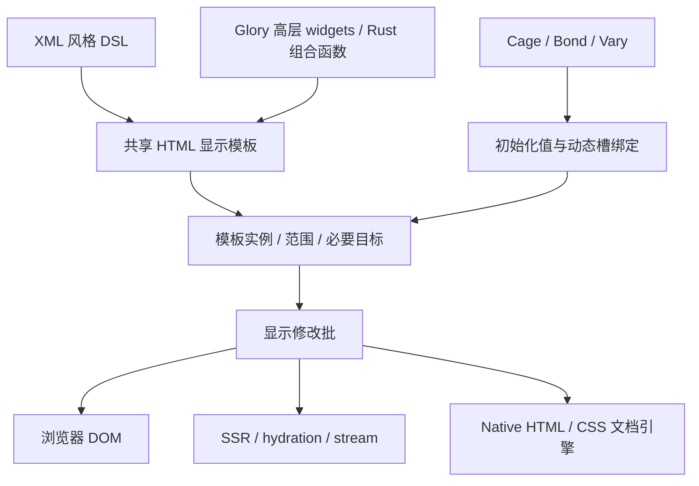

# v2：HTML 显示元素、模板实例与高层 Widgets

日期：2026-10-28。状态：v2 架构方向与迁移设计；后续已实现最小浏览器模板／稀疏实例原型，
见[实现和四轮实测](v2-html-template-prototype-results-2026-10-28.md)。后续已实现
[手写 API 与首版 XML 前端](v2-view-api-and-xml-dsl-2026-10-28.md)；复杂控件和跨平台迁移尚未完成。

## 决策

HTML／CSS 作为标准显示契约。Glory 的 button、view、输入与复合控件等高层 widgets
建立在显示元素之上。XML 风格 DSL 的普通 HTML 标签直接生成共享显示模板及动态槽，
不自动调用当前语义 widget builder，也不为每个静态标签建立完整 Glory 语义实例。
Cage/Bond/Vary 保留为响应式模型。

这更新了[此前调查](v2-dsl-and-host-batching-investigation-2026-10-28.md)中优先采用
“DSL 展开为现有 Plan，继续保留每个语义节点”的建议。现有实现和已测量结果继续作为迁移基线。
新的 HTML 显示层也不恢复已移除的旧 HTML API／协议或兼容别名。



静态节点仍会成为真实 DOM／布局节点，并在需要时出现在宿主无障碍树中。
被省掉的是逐元素 Glory 运行时包装、重复模型和不必要的身份登记，而不是必须显示的物理节点。

## 1 当前真正保留了什么

普通 builder 对象本来就不必长期存活。仅省去 builder 函数调用或改用 XML 外观，
不会消除当前实例成本：

- 每个语义节点的 NodeId、当前描述符、父子关系、generation／名字等索引。
- UI 中的 Memory，以及 Mapper 中的第二份 Memory。
- 浏览器每个语义节点的 Entry、部件和状态槽，以及身份属性写入。

当前 benchmark 的一行包含 8 个语义节点：行 View、4 个 Cell View、ID Text、2 个 Button。
因此每行有 8 个语义身份、两份各 8 个节点的 Memory，以及浏览器 8 个 Entry；
这还没有计入 Owner、响应图、监听器索引和真实 DOM。
创建万行时，以上三个逐节点记录集合分别包含约 8 万项。
这是从[行声明](../benchmarks/glory/src/main.rs)和
[Memory](../crates/render/src/memory.rs)、[Mapper](../crates/html/src/lib.rs)、
[Entry](../crates/web/src/browser/dom.rs)得到的结构计数，不是堆字节或性能收益测量。

现有 Plan 已能共享声明、克隆宿主原型。新的重点应当是：模板内部普通静态显示元素
不再进入这三份逐语义节点集合。是否构成与 Dioxus 性能差距的主要部分，需要独立原型验证。

上轮最终验收的万行现场也确认了这一点：原 v2 与提交优化后均为 **80010 个 UI 节点、
40003 个响应图节点、10013 个 Owner**。数据见
[既有最终验收证据](D:/BuildCache/glory-v2-host-cost-20261028/final/evidence.json)的 census.stats。
前一轮确实减少了提交准备成本，但没有改变这些常驻数量。

## 2 Dioxus 0.7.10 的具体做法

对照使用 benchmark 锁定的发布包源码；本地 sibling Dioxus 仓库是另一开发提交，
不将其中较新的 DynamicValues 等表示混入这里。
源码 SHA-256／包 VCS 记录见[源码审计](v2-html-template-dioxus-source-audit-2026-10-28.json)。

### 2.1 HTML 元素和组件是不同的编译分支

`dioxus-rsx/src/node.rs` 的 BodyNode 分别具有 Element 和 Component。
普通小写标识符走元素分支；组件路径、首字母大写或包含下划线的标识符等走组件分支，
另有自定义元素名规则。这是 RSX 的具体语法规则，Glory 无需复制其所有命名细节。

`element.rs` 把元素转换为 TemplateNode::Element 数据，包含 tag、namespace、属性和 children；
静态文字成为 TemplateNode::Text。表达式、控制流和组件作为动态节点边界。
`component.rs` 则构造 Props 并生成 VComponent。

所以 `button { ... }` 并不会构造一个 Dioxus Button 组件实例。
实际自定义 `Button { ... }` 才进入组件 Props／Scope 路径；
`core/src/diff/component.rs::create_component_node` 在需要时创建并执行组件 scope。
这正是 Glory 应明确的原生显示标签与高层组件分层。

### 2.2 宏输出静态声明与本次动态值

`template_body.rs` 的 release 展开生成静态 Template，以及本次调用的动态节点／属性数组，
再建立 VNode。Template 保存 roots、node_paths、attr_paths；
静态树是共享数据，路径定位运行时需要处理的位置。
[Dioxus Template 文档](https://docs.rs/dioxus-core/0.7.10/dioxus_core/struct.Template.html)。

这是“自动提取已写出的静态结构”。宏没有扫描任意 Rust 函数内部并推断完整 UI 生命周期；
Rust 表达式与组件 Props 继续由正常 Rust 名称解析和类型检查处理。
非订阅值也可能每个实例不同，不能因为它是普通 String 就把它放入全局共享模板。

### 2.3 实例记录集中在根与动态目标

`core/src/nodes.rs` 中，VNodeInner 保存模板引用、key、dynamic_nodes 和 dynamic_attrs；
VNodeMount 保存 parent、模板根 root_ids、动态属性目标 mounted_attributes，以及动态节点挂载信息。
它没有为所有静态模板后代建立同等的逐节点语义描述符实例。

`core/src/diff/node.rs` 中：

- create 的挂载数组长度来自模板根数及动态路径数。
- load_template_root 为根分配 ElementId。
- assign_static_node_as_dynamic 对需要运行时属性／事件的非根目标分配 ID；根复用自己的 ID。
- 同路径动态属性可以复用目标 ID。

所以“动态目标仍需要身份”和“每个静态 HTML 后代都要有完整框架身份”是不同的要求。
Dioxus 也有 VNode、scope、动态值、事件和实例记录，不能描述成所有 HTML 都零运行时成本。

### 2.4 Web 执行直接消费显示修改

`web/src/mutations.rs` 首次遇到模板时建立宿主原型并登记模板，之后发送 load_template。
`interpreter-js/src/unified_bindings.rs` 的 load_template 克隆原型根，保存根句柄；
assign_id 根据声明路径定位需要保留的目标。它不需要把每个静态后代的完整模型返回 Rust。
首次原型构造仍包含实际 DOM 创建；不能声称整个生命周期从来不逐节点工作。

修改接口包括 load_template、assign_node_id、set_attribute、set_node_text 和范围插入／删除，
Web 实现写入 interpreter，flush 时执行。它没有 Glory 当前那层
“每个语义 Props → Mapper → 普通 HTML 显示”的必经映射。
[WriteMutations 文档](https://docs.rs/dioxus-core/0.7.10/dioxus_core/trait.WriteMutations.html)。

### 2.5 表示方式可借鉴，更新算法可以保持 Glory 特性

Dioxus 在相关组件执行后获得本次动态值；相同模板的 diff 跳过静态结构，比较动态属性和节点。
Glory 可以共享这种模板与稀疏目标表示，继续让 Cage/Bond/Vary 直接驱动槽位。
不必为了采用模板身份模型而一并采用完整 VNode 重建／diff 路径。

还需单独对比响应式组织：仓库 Dioxus benchmark 的 for 循环直接生成行 div 模板，
未把每行写成 Row 组件，所以不因此为每行建立组件 Scope。
当前 Glory 每行有 label Cage、selected 派生 Bond、class 与 label 两个 Binding，以及行 Owner。
因此新实例表示与观察者粒度是两个可分开的变量：先保持相同业务 Cage／绑定隔离模板表示收益，
再比较一个 paint 区域与逐槽绑定。不能把所有差距都先归于静态节点，也不能忽略初始化观察者的成本。

## 3 建议的 Glory 实例模型

| 内容 | 共享声明 | 每次挂载／更新保留什么 |
|---|---|---|
| 固定标签、常量文本、固定属性和样式 | HTML／SVG 结构及静态内容 | 真实宿主节点；无逐静态元素 Glory 描述符／Owner |
| ID 文本等一次性业务值 | 初始化槽定义 | 挂载时写入；不自动建立持续订阅 |
| Cage／Bond／Vary 字段 | 有类型的槽定义和目标路径 | 绑定／当前值／必要目标，按实际依赖更新 |
| 事件与显式 ref | 事件／引用槽定义 | 处理器归属、目标及实例 generation；不是自动升级成 widget |
| 条件、列表、子组件 | 动态范围与子声明边界 | 当前范围、key、子实例和必要生命周期 |
| 状态组件、受控输入和资源行为 | 可共享的显示结构 | 真正需要的控制器、版本、组合态、选区、任务与资源状态 |

实例的基本形状是 TemplateId／InstanceId／根范围／动态目标／绑定与事件状态。
槽位可用 `(InstanceId, SlotIndex)` 寻址，不必给静态 div/span 分配独立 Glory NodeId。
静态声明仍保存完整结构，验证可以读取共享声明和实例范围关系；不先展开成两份逐元素 Memory。
旧每语义节点 API 的适用边界需要明确迁移，不能在访问静态目标时悄悄重新展开整棵语义树。

常驻框架记录的目标数量级是“模板实例＋动态槽＋事件／显式引用＋必要控制状态”，
实际 DOM／布局节点仍随总显示节点增长。大量动态交互控件本身的必要成本仍然存在。

### paint! 与 XML 前端

下面只是目标展开示意，尚非现有 API：

```text
paint!(cage1, cage2, vary1, |a, b, enabled| {
    html! {
        <div class="summary">
            <span>{a}</span>
            <button disabled={!enabled}>{b}</button>
            <Button ... />
        </div>
    }
})
```

这里 `<button>` 属于 HTML 显示模板；`<Button>` 是显式高层组件调用。
Glory 的 button/view 等现有高层名称如何迁移属于 API 工作，不能仅靠标签大小写偷偷改变旧调用含义。
无私有状态的普通 Rust 组合函数可以只返回模板与槽值；需要状态和生命周期的组件才拥有相应控制记录。
不要承诺宏能通过检查任意函数体自动判定其是否有状态。

paint 的静态结构应只注册／实例化一次。响应式变化只计算动态槽，提交真正变化的值；
更新时不重新安装绑定、监听器、Owner，也不反复创建模板。
第一版可以采用一个纯观察者计算一个区域的动态值，再逐槽比较；
随后与逐槽直接绑定做受控比较，不能先假定每个表达式都必须建立额外 Bond。

## 4 HTML／CSS 作为跨平台对齐目标

Dioxus 的 desktop 文档描述的是系统 WebView 路径；Dioxus Native／Blitz 则是 HTML／CSS 文档引擎路径。
二者不能混称为已经拥有相同浏览器能力。
[Desktop 0.7 指南](https://dioxuslabs.com/learn/0.7/guides/platforms/desktop/)、
[Blitz 官方架构与支持范围](https://github.com/DioxusLabs/blitz)。

Glory 的 native 已经使用 Blitz 的 HTML／CSS 文档引擎，这个方向可以复用现有引擎、宿主和平台工作。
要改变的是显示层上方的实例／修改协议，以及目前依赖语义节点的控制、查询和 AX 桥接。
新 native 入口应直接消费 HTML 模板／槽修改，让 HTML 布局、属性、事件及控件行为成为对齐基准。

输入法、焦点、选区和无障碍依然有活状态；这些状态由宿主原生元素和必要控制器维护，
不构成要求每个静态包装 div 都拥有完整 Glory widget／语义模型的理由。
浏览器自动获得的 HTML/ARIA 语义，在 native 需要由引擎 DOM 和实际状态导出，不能随着静态身份压缩丢掉。

HTML／CSS 对齐是目标，不是未经验收的完整 WebView 兼容承诺。Native 支持集合与差异必须明确，
现有编辑／IME／权限／资源／无障碍能力需要迁移验证；不能只接通绘制就宣布全部兼容。
属性与 property、输入版本、selection/composition、事件归属及有序失败确认均继续有明确契约。
具有加载副作用的属性要在正确提交阶段安装，普通动态字符串默认作为文本／属性值处理。

建议职责是：render 定义模板实例、槽、范围及显示提交契约；core 保留响应式与 Owner；
ui 提供高层组合／控件与结构协调；html 负责 HTML 数据、序列化和共同规范，
不再要求 raw-template 路径先转换成完整语义 Memory；web／ssr／blitz 实现显示提交。
这是职责目标，具体依赖调整须保持无循环、无浏览器类型进入 core。

## 5 下一步原型应验证的内容

先实现最小的直接 HTML 模板实例路径，再接 XML 宏；手工写这个原型的模板数据
是为了隔离实例表示收益，不是把现有 Plan 换一个入口名字。

1. 共享模板克隆，实例只登记根、动态字段、两个事件目标及明确引用。
2. 模板内部静态元素不分配 Glory 语义 NodeId，不进入 UI／Mapper 的逐元素 Memory，
   不创建对应高层 widget，也不为所有静态元素写框架身份属性。
3. 同一业务模型的旧 v2、手工新模板、DSL 生成同等新模板、Dioxus 0.7.10 分别构建。
   第一步只需旧 v2／手工新模板／Dioxus；宏加入后再验证生成物同等性。
4. 保持完整行、数据、顺序、布局、事件与真实 DOM/Text 身份。所有万行仍有真实布局盒；
   不改成虚拟列表或 Canvas，也不删功能来做速度对比。
5. 新增“增加静态后代、保持动态槽不变”的独立场景，验证常驻框架记录不随静态后代逐项增长。
   宿主节点数、框架记录数、观察者数、分配／退休工作分别记录，不能用 WASM memory.buffer 容量冒充活内存。
6. 分别测 Script、挂载／退休、wall／布局、初次模板建立与后续实例化、体积；保留不利数据。
   当前 CPU 差距有可能来自逐元素模型、身份属性和构造路径，也包含真实 DOM／布局等其他因素，
   本次源码分析不构成已证明这些因素各贡献多少的结论。
7. 创建／输入／事件／移动／退休／中途失败、引用 generation、SSR 接管及 native 对齐单独验收。
   Native 第一轮可先验证相同简单模板的真实文档布局；原有复杂控件迁移不能用编译通过替代。

原 `semantic-rows-v1` 的完整 Glory 语义身份是旧契约。新路径应明确版本化其 raw HTML／稀疏身份契约，
保留双方共同的真实 DOM 身份、业务数据、几何和画面检查，并公开说明能力边界。
不能删除旧断言后将新结果冒充“所有旧语义能力完全等同”的同口径重跑。

## 6 实施准则

接受此分层后，不应继续把“每个 HTML 元素必须拥有完整 Glory 语义实例”作为 raw-template 的前提。
已有 Plan 批量提交和连续日志优化保留为基线及可复用的提交经验；
新路径的立项标准是实例数量和修改单位确实改变，而不只是 XML 外观或进一步减少过桥调用。

本文件为设计和迁移基准。后续[首轮原型](v2-html-template-prototype-results-2026-10-28.md)
已验证手工模板、稀疏实例和绑定粒度；不要将其受限浏览器能力外推为完整设计已经交付。
